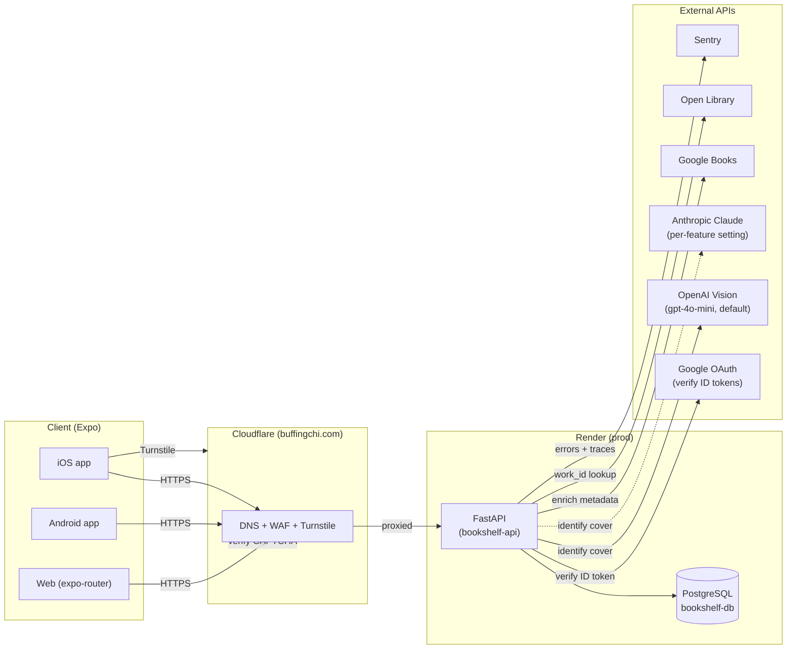

# Architecture

High-level system design, request lifecycle, middleware ordering, and the architectural decisions behind Bookshelf. For user-facing flows (scan, auth, reading states) see [`features.md`](features.md). For the REST endpoint reference see [`api.md`](api.md).

## System diagram

**Components:**
- **Frontend** (Expo SDK 55): one TypeScript codebase ships native iOS, native Android, and web. Runs on Hermes JS engine on native. Uses `expo-router` for file-based navigation.
- **Cloudflare**: DNS + WAF + Turnstile for `bookshelfapi.buffingchi.com`. Bot Fight Mode is on; health-check CI bypasses this entirely by hitting the Render origin directly (see [ADR: CI health checks bypass Cloudflare](#adr-ci-health-checks-bypass-cloudflare)).
- **Backend** (FastAPI on Render): Python 3.12, async end-to-end (SQLAlchemy async sessions, httpx for outbound). Auto-deploys from `dev` per `render.yaml`.
- **Database**: production runs on Supabase Postgres, reached through the Supabase session pooler via `DATABASE_URL`; the dev environment uses a Render Postgres instance. Nightly encrypted backups: see [backups](backups.md).
- **External APIs**: called server-side only from the FastAPI backend — the frontend never holds OpenAI, Anthropic or Google Books keys.

## Request lifecycle

A typical authenticated request (`POST /user-books/purchased`):

1. Client sends HTTPS with `Authorization: Bearer <access-token>`.
2. Cloudflare terminates TLS, runs WAF + Bot Fight Mode, forwards to Render.
3. Render's edge reaches the FastAPI app on the service port.
4. Middleware stack runs outermost → innermost (see next section).
5. Router matches the path → endpoint function runs. FastAPI dependencies inject the DB session + authenticated `current_user` (via `app/auth/dependencies.py`).
6. Endpoint mutates the DB via `SQLAlchemy` async session → commits.
7. Response flows back through the middleware stack (security headers added on the way out).
8. Client receives the JSON response with `X-Request-ID` and security headers set.

## Middleware stack

Middleware is configured in `backend/app/main.py`. FastAPI's `add_middleware` wraps in **reverse order** — the last call added is the outermost layer (first to see the request, last to touch the response).

| Order (outermost first) | Middleware | Role | Active in |
|---|---|---|---|
| 1 | `_HealthExemptTrustedHost` | Drops spoofed Host headers; exempts `/health` (not `/health/db`) so CI probes bypassing Cloudflare can still hit the origin | hardened only (staging + production) |
| 2 | `RequestSizeLimitMiddleware` | Rejects Content-Length > 10 MB with 413 before reading the body | all envs |
| 3 | `CORSMiddleware` | Allowlisted origins only (validator blocks `*`); credentials allowed; limited methods + headers | all envs |
| 4 | `RequestIdMiddleware` | Generates a request ID, stores it in a contextvar for log correlation, returns it as `X-Request-ID` | all envs |
| 5 | `SentryContextMiddleware` | Attaches request context to Sentry events | all envs |
| 6 | `SecurityHeadersMiddleware` | Sets `X-Frame-Options`, `X-Content-Type-Options`, `Referrer-Policy`, `CSP`, `Permissions-Policy`, and (hardened only) `HSTS` on every response | all envs |
| 7 | `OriginAuthMiddleware` | Origin lockdown: when `ORIGIN_AUTH_SECRET` is set, rejects requests without the matching origin header with 403 before routing; `/health` exempt | when `ORIGIN_AUTH_SECRET` is set |

"Hardened" means `settings.is_hardened` — any `ENVIRONMENT` other than `development`/`test` (see [deployment.md](deployment.md) for the full value list). A public `staging` deployment gets identical hardening to `production`.

**Why this ordering:**
- `_HealthExemptTrustedHost` is outermost so spoofed Host headers are rejected **before any middleware runs** — minimizes attack surface. Only `/health` is exempt, because that liveness probe (CI, Render's own, uptime monitors) hits the origin by its infrastructure hostname, not the public domain, and does nothing an attacker could abuse. `/health/db` is NOT exempt — it does a real DB probe, so it stays behind Host + rate-limit enforcement like everything else.
- `RequestSizeLimit` runs before CORS so oversized bodies are dropped without allocating request memory.
- `OriginAuthMiddleware` is innermost so its 403 still passes back through `SecurityHeaders` and `RequestId`, yet it rejects before routing: no handler, DB query or rate-limit counter runs for a rejected request.
- There is no client-IP middleware: the slowapi key function calls the resolver in `app/core/client_ip.py` directly (see Rate limiting below).
- `RequestId` runs before `SentryContext` so the request ID is available to attach to Sentry events.
- `SecurityHeaders` is innermost on the request (outermost on the response) because it only touches responses.

## Auth architecture

**Identity:** Google OAuth 2.0. The backend trusts any of three configured client IDs (`google_client_id` / `google_ios_client_id` / `google_android_client_id`) so the same API can serve web, iOS, and Android apps. `app/auth/google.py` verifies the Google ID token against Google's JWKS.

**Session tokens:** JWT RS256 (asymmetric).
- **Access token** (`type: access`, 24h default via `jwt_expiry_hours`): short-lived, sent as `Authorization: Bearer` on every authenticated request.
- **Refresh token** (`type: refresh`, 7d default via `refresh_token_expiry_days`): carries a `jti` claim. The `jti` is persisted in the `refresh_tokens` table at issuance time and checked on every `/auth/refresh` call.

**Why RS256 (not HS256):** the public key can be exposed freely (and is, if we ever need to verify tokens in a second service) while the signing key stays on the API. HS256 would require sharing the symmetric secret anywhere verification happens.

**Refresh rotation + revocation:**
- `/auth/refresh` validates the incoming refresh JWT, checks the `jti` exists and is not revoked in the DB, issues a new access + refresh pair, and **marks the old `jti` as revoked**.
- `/auth/logout` revokes the presented refresh `jti`.
- This means a stolen refresh token is one-use: the moment the legitimate client refreshes, the attacker's copy is revoked.

**Single-user lockdown:** `ALLOWED_EMAILS` (comma-separated env var) is the allowlist. Any authenticated email not in that list is rejected at the `/auth/google` exchange. Makes sense for a personal app; remove the check to open the API to arbitrary Google accounts.

## Rate limiting

Backed by `slowapi` + in-memory storage (single Render instance). Every endpoint carries a `@limiter.limit(settings.rate_limit_*)` decorator — this is rule #8 in `CLAUDE.md`. Defaults (per-client):

| Bucket | Default | Applied to |
|---|---|---|
| `rate_limit_auth` | 5/min | `/auth/*` endpoints |
| `rate_limit_scan` | 10/min | `POST /scan` |
| `rate_limit_books_search` | 30/min | `GET /books/search` |
| `rate_limit_writes` | 60/min | POST/PATCH/DELETE on `/user-books/*` |
| `rate_limit_reads` | 120/min | GET on `/user-books/*`, `/auth/me`, `/scan/usage` |
| `rate_limit_health` | 60/min | `/health`, `/health/db` |

**Keying:** `user:` when the request carries a verified **access** token (`type: access`); otherwise the client IP from `app/core/client_ip.py` (one bucket per IPv4 address, per IPv6 /64). Refresh tokens never select a per-user bucket. The resolver trusts `CF-Connecting-IP` only when `TRUSTED_PROXY_MODE=cloudflare` (the default in hardened environments, and set explicitly on Render); with `none` every client behind Cloudflare and Render would share the proxy's IP. See [security.md → Client IP and origin lockdown](security.md#client-ip-and-origin-lockdown).

A 429 response is logged at WARN level with the offending path, so repeated hits surface in Sentry.

## Book identification + dedup pipeline

Lives in `backend/app/services/` and is orchestrated from the `POST /scan` endpoint. The vision call itself goes through the AI gateway in `backend/app/ai/` (see step 2).

0. **Kill switches, then the existing guards.** The first step reads the `ai_settings` table through `app.ai.settings.get_ai_settings(db)` (cached per process for `AI_SETTINGS_CACHE_TTL_SECONDS`, default 30). If it cannot be read and nothing is cached, the scan fails closed with `503 ai_unavailable`; if a read fails after an earlier success, the last value read is used (see the Dials paragraph below). `scan.standard.enabled=false` returns `503 scan_disabled` for every scan and `scan.enhanced.enabled=false` returns `503 enhanced_scan_disabled` for enhanced scans only. All of this happens before the upload is read, Turnstile is called or any provider is contacted (the framework has already received the multipart body by then). Then Turnstile, file validation (extension/MIME, a chunked read that stops past 5 MB → `413`, magic bytes, optional ClamAV), image normalisation and the enhanced-credit check. Normalisation (`app/ai/images.py`, via `sanitize_image`) decodes the image in full with `pillow-heif` registered for HEIC (`415 image_undecodable` otherwise; no raw-bytes fallback), refuses a header pixel count above `scan.max_image_pixels` (from `ai_settings`) before decoding (`413 image_too_large_pixels`), applies EXIF orientation, drops all metadata, shrinks the long edge to the feature's `max_image_long_edge_px` (registry, 1568) and re-encodes as JPEG quality 85. It runs in a worker thread (`anyio.to_thread.run_sync`) so the event loop stays free, with at most `SCAN_NORMALISE_CONCURRENCY` (default 1) at once per process to bound memory. Only that JPEG reaches the provider. All of this runs before the reservation, so a bad image never uses a scan.

   Check order: switches → Turnstile → file and content checks → normalisation → entitlement → global count cap → daily cost ceiling → in-flight lease → daily reservation → monthly reservation → provider.
1. **Allowances and the in-flight lease** (`app/ai/quota.py`, tables `ai_quota` and `ai_inflight`, #528). `scan.py` calls `quota.reserve(...)`, which runs, in order:
   1. **Entitlement:** the tier from `entitlements.tier_for(db, user)` (server-side only) selects the allowance keys `quota.<tier>.daily` / `quota.<tier>.monthly` in `ai_settings` (launch values, OD-1: everyone is Free, 5 a day and 5 a month; Premium 30 and 300 once purchases exist). The enhanced-credit check (`402 no_enhanced_credits`) runs just before, in `scan.py`; #533 replaces it.
   2. **Global ceiling:** today's (UTC) day rows across all users and features are summed and compared with `scan.global_daily_limit` (`ai_settings`, seeded from `SCAN_GLOBAL_DAILY_LIMIT`, default 2000) → `503 scan_capacity`. It sits before the lease and the per-user reservations so nothing is taken for a user when the service-wide capacity is gone. It is a read, so concurrent requests can overshoot by at most the number in flight (now at most one per user); that is accepted. It stays as a second limit, independent of the cost ceiling below, and applies to every tier.
   3. **Daily cost ceiling** (`app/ai/breaker.py`, table `ai_spend_daily`, #531): the gateway feature's `est_cost_ceiling_micros` (registry: 10,000 micros for `scan.standard`, 30,000 for `scan.enhanced`) is added to today's (UTC) row with one conditional upsert, `INSERT INTO ai_spend_daily … ON CONFLICT (day) DO UPDATE SET reserved_micros = reserved_micros + est WHERE reserved_micros + settled_micros + est <= ceiling`. For Free it succeeds only while the day's reserved plus settled spend, across all tiers, stays within `breaker.free_daily_ceiling_micros` (`ai_settings`, seeded from `SCAN_FREE_DAILY_CEILING_MICROS`, default $10); otherwise `503 ai_budget_reached` and nothing per-user is taken. Postgres serialises upserts on the day, so concurrent Free reservations never pass the ceiling. Premium (decision #544) adds its estimate without the condition, so the totals and alerts show real spend, and continues to its own allowances and the count cap. Every later refusal or error (lease busy, daily or monthly refusal, lease lost, cancellation) gives the estimate back through the same shielded, bounded give-back as the lease.
   4. **In-flight lease:** one conditional upsert, `INSERT INTO ai_inflight … ON CONFLICT (user_id) DO UPDATE SET lease_id = …, lease_expires_at = … WHERE ai_inflight.lease_expires_at < clock_timestamp() RETURNING lease_id`. It succeeds only when the user has no row or the old lease expired, so at most one paid call per user is in flight → `429 scan_in_progress` with `Retry-After: 2`. The lease lasts the feature's `timeout_s` + 30 s (75 s with the default 45 s), so a crashed request frees it. Each acquisition has a random `lease_id`, and the release deletes the row only while it still holds that id: a slow request whose lease expired and was taken over cannot release the new holder's lease. `clock_timestamp()` (not `now()`) is used because the request's transaction may have started at authentication. After the daily and monthly reservations the lease is renewed (`UPDATE … WHERE lease_id = <ours>`), which restarts its clock so the full `timeout_s` + 30 s covers the provider call. If a stalled reservation let the lease expire and another request take it, the renewal finds nothing, and the request gives back both units and gets `429 scan_in_progress`, so two provider calls never overlap.
   5. **Daily, then monthly reservation:** the #509 conditional upsert, per user, quota key and window: `INSERT INTO ai_quota … ON CONFLICT (user_id, feature, window_kind, window_start) DO UPDATE SET units_used = units_used + 1 WHERE units_used < limit`. Exact under concurrency because Postgres serialises upserts on the key. A limit of 0 refuses without writing. Daily refused → `429 daily_scan_limit` with `Retry-After` until UTC midnight; monthly refused → `402 scan_limit_reached` with `{"limit", "used", "period_end"}` in the body. Windows are UTC days and UTC calendar months (OD-10); `period_end` is the 1st of the next month. Standard and enhanced scans share one allowance (OD-1): both reserve under the quota key `scan` (`quota.SCAN_QUOTA_FEATURE`), so for example 3 standard + 2 enhanced scans use a daily limit of 5. Refunds give back to the same key. Enhanced scans still also need an enhanced credit (checked separately, until #533). The `feature` column stays so later AI features can have their own allowance.

   A refusal gives back whatever was already taken before it propagates: a monthly refusal refunds the daily unit and releases the lease, a daily refusal releases the lease; any error (including cancellation) does the same. Every step commits straight away on the request's own session (the one `get_current_user` used): reservations are visible to concurrent requests, no second pool connection is needed, and no transaction or connection is held during the provider call. After the provider call the lease is always released in a `finally` (success, refund, any error, cancellation); the release is shielded from cancellation and bounded to 5 s. A failed release is logged and retried once after a rollback; a second failure is logged and swallowed, so the scan result is still returned. If the 5 s bound cuts the release query off mid-execute, the request session is rolled back (shielded, also bounded to 5 s) so the rest of the request (the dedup check, the enhanced-credit spend) can normally still use it; if that rollback also times out, the request fails with a 500. Either way the lease expiry is the backstop for a lease that was not released. A cost estimate whose give-back or settle failed has no such backstop: it stays in `reserved_micros` until the day ends (at most one estimate per failed release, and it can only make the breaker refuse sooner, never later). The legacy `scan_usage_daily` caps (`app/services/scan_quota.py`) are no longer called and are removed in #540.
2. **AI gateway → `OpenAIVisionProvider` or `AnthropicVisionProvider`** (`app/ai/gateway.py` → `app/ai/providers/openai_vision.py` / `anthropic_vision.py`; the feature's `provider` picks the adapter) — `scan.py` maps the client's `enhanced` flag to the feature `scan.standard` or `scan.enhanced` and calls `run_feature`; no client-supplied model, prompt or token value is read. The server-side registry (`app/ai/registry.py`, validated at import) supplies provider, model, `max_tokens`, timeout and the image long-edge cap for that feature. `run_feature` then builds a per-request spec with `dataclasses.replace(spec, provider=…, model=…, enabled=…)` from the validated `ai_settings` override (`scan.<feature>.provider` / `.model`) and kill switch; `replace` re-runs the registry's validation, so the registry stays the allow-list authority, and a disabled feature raises `FeatureDisabledError` before any provider is built. The provider base64-encodes the normalised JPEG and sends it to the feature's model (`gpt-4o-mini` for `scan.standard`, `gpt-4o` for `scan.enhanced`, from `SCAN_MODEL` / `SCAN_ENHANCED_MODEL`) with a structured-output prompt asking for `{title, author, confidence, isbn}` per book. 45-second timeout (`SCAN_TIMEOUT_SECONDS`), 2048 max tokens (`SCAN_MAX_TOKENS`). The timeout is enforced twice: the provider's HTTP client uses it per phase (connect, read, write), and `run_feature` wraps the whole provider call in an overall deadline of the same `timeout_s` (`anyio.move_on_after`), so a slow trickle of bytes cannot keep the call alive past it. Past the deadline the call is cancelled and raised as `ProviderTimeoutError`, a `ScanUnavailableError` (`503 scan_unavailable`, reservation refunded), and the in-flight lease (`timeout_s` + 30 s) always outlives the call. The deadline lives in the gateway, so every provider adapter gets it. Provider code may live only in `app/ai/providers/`; `tests/security/test_ai_choke_point.py` (`pytest -m security`) fails on any provider host, SDK or wrapper import (OpenAI, Anthropic, LiteLLM, LangChain, Google, Mistral, Cohere) or provider API-key read (`settings.*_api_key`, `os.getenv`/`os.environ`) elsewhere in `app/`, and on any import of `app.ai.providers` from anywhere but `app/ai/gateway.py` (so callers must go through `run_feature`). Returns up to 15 candidates (`SCAN_MAX_BOOKS`). Only `ScanUnavailableError` (timeout or provider HTTP error) or an `httpx.ConnectError` (connection never established) — both → `503 scan_unavailable` — refunds the daily and monthly reservation (never below zero). Any other error, or a cancelled request, keeps it counted, since the provider may already have been paid. An empty result still counts, including a response with no usable content (e.g. a refusal), which is treated as no books found.

   **Claude provider (#532).** When `scan.<feature>.provider` is `anthropic` in `ai_settings` (the registry default is still `openai`, until #536 and #538), `AnthropicVisionProvider` calls the Messages API through the official `anthropic` SDK (pinned in `requirements.txt`). The model per feature comes from `registry.PROVIDER_MODELS`: `claude-haiku-5-5` for `scan.standard` and `claude-sonnet-5-5` for `scan.enhanced` (#547). Anthropic publishes no dated snapshot for these models; the IDs are fixed IDs, not moving aliases, and are the only Anthropic IDs in the allow-list (#548). `max_tokens` and the timeout are the spec's, and `output_config.effort` is the spec's `effort`: `low` for standard scans (high-volume extraction) and `medium` for enhanced. The request never carries `temperature`/`top_p`/`top_k`, a `thinking` setting (the models' adaptive default applies) or an assistant prefill. The system prompt is the OpenAI adapter's `SYSTEM_PROMPT`, word for word, with a `cache_control` breakpoint (5-minute TTL); at about 300 tokens it is under the models' 512-token cache minimum, so the breakpoint is most likely a no-op until staging's ledger cache columns show otherwise. The reply is constrained by structured output (`output_config.format`, a JSON schema for `{books: [{title, author, confidence, isbn_13, isbn_10}]}`); the schema's `maxItems = SCAN_MAX_BOOKS` is not enforced by the API, so the SDK's `transform_schema` moves it into the description and the parser caps the list. The image is the normalised JPEG, base64. Every book is validated with pydantic (title and author non-empty and at most 500 characters, confidence clamped to 0–1); an ISBN with the wrong digit count or checksum is dropped and the book kept. `stop_reason: refusal` gives an empty `refused` result (reservation kept, as for any empty result); `max_tokens` gives `truncated` with every complete book that was parsed. Usage maps directly: Claude's `input_tokens` already excludes cached tokens; `cache_read_input_tokens` and `cache_creation_input_tokens` are the cache-read and cache-write counts, priced in `prices.py` (Claude bills cache writes at 1.25× input). Logs carry only lengths, a SHA-256 prefix, stop reasons, status codes and error types.

   Retries: the SDK's own retries are off (`max_retries=0`). The adapter retries 429, 500, 503 and 529 (overloaded) at most twice, with full-jitter exponential backoff (0.5 s, then 1 s ceilings) and never less than `retry-after`; it never sleeps when the sleep would end past `timeout_s` from the call's start, and the gateway's overall deadline still bounds the whole call. Error mapping: an SDK timeout (any phase, connect included) → `ProviderTimeoutError`, so the breaker (#531) settles the estimate for it; a connection never established → `ProviderConnectError` (a `ScanUnavailableError`, refunded like `httpx.ConnectError`); 429/500/503/529 after the retries, 502/504, and every other 4xx → `ScanUnavailableError` (refunded; a 4xx is also logged at error level as a bug signal); a connection dropped mid-request propagates (reservation kept, as an `httpx` transport error does for OpenAI). If `ANTHROPIC_API_KEY` is not set, a feature switched to `anthropic` fails closed before any call: an error log and `503 scan_unavailable`, refunded. The app still boots without the key, since no feature uses Claude by default. The SDK is imported, and the key read, only in `anthropic_vision.py` (`tests/security/test_claude_provider.py`). Production enablement waits on #549 (data handling) and #542.

   **Usage ledger (#530).** The provider returns its billed usage with the books (`ProviderResult`: input, output, cache-read and cache-write tokens, and an outcome `ok`, `refused` or `truncated`; for OpenAI the cached prompt tokens are split out of `prompt_tokens`, `finish_reason: length` is `truncated`, only a `refusal` field or a `content_filter` finish is `refused`, and a 200 with missing or unusable content is `ok` with no books; a missing usage block gives zeros, and counts are clamped to the INTEGER column range), and the gateway passes it on in `AIResult`. `scan.py` turns every outcome of the provider call into one `ai_usage` row (`app/ai/ledger.py`): the provider's outcome on success, `timeout` for `ProviderTimeoutError` (the provider's HTTP read/write timeout or the gateway deadline; a connect or pool timeout made no connection and is raised as `httpx.ConnectError`, so it is `refunded`), `refunded` for any other `ScanUnavailableError` or an `httpx.ConnectError`, and `error` for anything else, including a cancelled request, whose reservation is kept (tokens 0 on those paths). A `FeatureDisabledError` from the gateway (no provider reached) writes no row. The cost is priced from `app/ai/prices.py` at the current `price_version`. Each call gets a server-generated `call_id`, and the insert is `ON CONFLICT (call_id) DO NOTHING`. The row is committed with the lease release in one transaction, inside the same shielded give-back bounded to 5 s. If that attempt fails with an error (a rejected row), the row is dropped and the lease released on its own, in a second bounded give-back. If it times out, nothing more is tried: the database is slow, and the lease expiry is the backstop, so a slow database costs the request no more than before. A ledger failure is logged and never changes the scan's response. No Sentry event is sent per call (the breaker, #531, tags its own event).

   **Cost settle and spend alerts (#531).** The same settle transaction (ledger row, then lease delete) also settles the call's spend in `ai_spend_daily`: the estimate leaves `reserved_micros` (never below zero) and the call's cost is added to `settled_micros`. An answered call (`ok`/`refused`/`truncated`) settles its priced cost; a refunded call (`refunded`: provider unavailable or never reached, including a connect or pool timeout, which the provider adapter raises as `httpx.ConnectError`; or the gateway kill switch) settles nothing, so the estimate is simply given back; a `timeout` (a read/write timeout or the gateway deadline: units refunded, but the request reached the provider and is likely billed), an `error` or a cancelled call (reservation kept because the provider may have been paid) settles the estimate (the real cost is unknown and the ledger records 0, so the breaker errs on the safe side). If the ledger row is dropped, the lease-only fallback still settles the spend. The ledger insert is `ON CONFLICT (call_id) DO NOTHING RETURNING call_id`, and the spend is settled only when it returns a row: a settle retried after a commit whose acknowledgement was lost finds the row already there, which proves the spend and lease delete were committed with it, so the cost is not added twice. Give-backs with no ledger row (refusals inside `quota.reserve`, and the lease-only fallback) are made safe to retry by the lease instead: it is deleted in the same commit as the spend, so a retry deletes the lease first and settles or releases the estimate only if it was still there (if the lease was lost to another request for some other reason, the estimate stays reserved until the day ends). The cost release before any lease exists (a scan already in flight, or the lease insert failing) has nothing to show whether it committed, so it is attempted once and never retried: a repeat would give back another call's estimate and let Free scans pass the ceiling; a failure leaves the estimate reserved, which can only make the breaker refuse sooner. After the commit, each alert threshold (50, 75 and 90 % of the Free ceiling, fixed in code) that the settled total has reached and whose bit in `alerted_mask` is not yet set is claimed with `UPDATE … SET alerted_mask = alerted_mask | bit WHERE alerted_mask & bit = 0 RETURNING`; only one request can win each bit per day, and the winner sends one Sentry warning with fingerprint `["ai-breaker", "<day>", "<pct>"]`, tags `feature`, `model` and `status` of the crossing call, and the day's totals and the ceiling as extras. Never a user id or any content: the event is captured in a forked and emptied Sentry scope (`sentry_sdk.isolation_scope()`, both scopes cleared), so the user id that `get_current_user` puts on the request's scope and the request's tags are not attached, and the alert's tags do not stay on later events of the request. Clearing a scope keeps its event processors, and the Starlette/FastAPI integration's processor would still attach the HTTP request (url, headers including the client IP, user agent, body), so an event processor added to the forked scope, which runs after the integration's, strips the `request` block, `user`, breadcrumbs and any context other than `trace`/`runtime`/`os` from the alert. The event is sent only after the claim commits, so it is sent at most once. With a ceiling of 0 (Free paused on purpose) no alerts are sent. Rows are purged after 90 days by the daily cleanup task. Raw rows are rolled up into `ai_usage_daily` after 30 days by the daily cleanup task, and the rollup is kept 400 days ([data-model.md](data-model.md#ai_usage-backendappmodelsai_usagepy)).

   The gateway also resolves the user's tier with `app/ai/entitlements.tier_for(db, user)` and returns it on `AIResult.tier`. The tier is decided server-side from the ORM user only (no request field, header, query parameter or JWT claim is read) and is Free for everyone until subscriptions land (Phase 2.5).
3. **`EnrichmentService`** (`enrichment.py`) — for each candidate, tries Google Books first (title+author query), falls back to Open Library. Populates `open_library_work_id`, `google_books_id`, cover URL, description, ISBN.
4. **`DeduplicationService`** (`deduplication.py`) — checks the user's existing library. Keyed on `open_library_work_id` (primary) or `google_books_id` (fallback). Any candidate already in the user's library is flagged `already_in_library=True` but still returned — the frontend chooses to warn or skip.
5. Response is up to 15 `EnrichedBook` objects; the frontend's `BookCandidatePicker` shows them and the user confirms which to add.

**Client-side refusal handling.** The frontend maps `POST /scan` refusals (402 `scan_limit_reached`, 429 `daily_scan_limit` / `scan_in_progress`, the 503 codes) to UI states in one helper, `frontend/lib/scanErrors.ts`. `ScanJobContext` shows a notice on the scan screen and puts the refused job back in the `queued` state (it keeps its photo, counts in the pending-uploads badge and survives a restart). After the first refusal the queue drain sends no more photos (queued text searches, which use `GET /books/search`, still go through), so each drain costs at most one doomed request; the next drain (reconnect or launch) or the notice's "Try again" (`resumeQueue()`) continues from there.

**Dials in the database (`ai_settings`, no release or restart needed).** `app/ai/settings.py` defines the keys, types and bounds: `scan.standard.enabled` (bool; master switch for all scans), `scan.enhanced.enabled` (bool), `scan.standard.provider` / `scan.enhanced.provider` (a provider in `ALLOWED_MODELS`), `scan.standard.model` / `scan.enhanced.model` (a model in that provider's allow-list) `scan.max_image_pixels` (1,000,000–100,000,000), `scan.global_daily_limit` (1–1,000,000), `breaker.free_daily_ceiling_micros` (0–1,000,000,000 micro-dollars per UTC day; 0 pauses all Free scans) and the allowances `quota.free.daily` / `quota.premium.daily` (0–1000) and `quota.free.monthly` / `quota.premium.monthly` (0–100,000). Change them with `python -m app.ai.settings set <key> <value> [--by NAME]` (also `get <key>` and `list`), which validates, then writes `updated_at` and `updated_by`. A provider and its model are a pair, so a provider is changed with `python -m app.ai.settings switch <feature> <openai|anthropic> [--model M] [--by NAME]`, which writes both rows in one commit (the model defaults to the registry's model for that provider); `set` of a provider alone is refused while the stored model belongs to the other provider. A provider, model, pixel cap, global cap, allowance or cost ceiling that is invalid on read (a bad hand edit) is ignored with a log and Sentry warning, and the default is used. An invalid `*.enabled` value (not a JSON boolean) fails closed: it is treated as `false` (disabled), with the same warning. A missing `*.enabled` row still falls back to `SCAN_ENABLED`/`SCAN_ENHANCED_ENABLED`.

- **Seeding.** At startup (lifespan) every missing key is inserted from the env (`SCAN_ENABLED`, `SCAN_ENHANCED_ENABLED`, `SCAN_MAX_IMAGE_PIXELS`, `SCAN_GLOBAL_DAILY_LIMIT`, `SCAN_FREE_DAILY_LIMIT`, `SCAN_FREE_MONTHLY_LIMIT`, `SCAN_PREMIUM_DAILY_LIMIT`, `SCAN_PREMIUM_MONTHLY_LIMIT`, `SCAN_FREE_DAILY_CEILING_MICROS`) and the registry defaults (`SCAN_MODEL`, `SCAN_ENHANCED_MODEL`) with `INSERT … ON CONFLICT DO NOTHING`. Existing rows are never changed, so after the first boot the row is the source of truth and those env vars are initial defaults only. A key with no row falls back to the same env/registry default. Seeding is bounded to 5 s and never stops the app from starting; if the database is down, scans fail closed until it is back.
- **Cache and skew.** The cache is per process (per uvicorn worker): each caches the rows for `AI_SETTINGS_CACHE_TTL_SECONDS` (1–300, default 30). A change therefore reaches every process within the TTL, and during a deploy (two instances) or with several workers they can disagree for up to 30 s. `/scan` reads the settings once, at the top of the handler, and passes that snapshot to `run_feature(..., settings_snapshot=...)`, so one request uses one view; `run_feature` still reads them itself when no snapshot is given.
- **Read failures.** With nothing cached → `503 ai_unavailable` (fail closed). After at least one successful read → the last value read is used, with a warning, while it is at most `AI_SETTINGS_MAX_STALE_SECONDS` old (1–3600, default 300, never below the TTL); past that an error is logged and the request fails closed with `503 ai_unavailable`. Every request retries, so the first successful read refreshes it. A stale kill switch is better than both failing open (ignoring a switch that was just turned off) and refusing every scan during a short database blip. Inside the request's open transaction, or whenever the session already holds loaded objects, the read runs in a SAVEPOINT, so a failed read does not break that session or expire its objects; only on an empty session with no transaction open does it run in a short transaction of its own, so no connection is left idle in a transaction. (A session that holds objects but has no transaction open is left in its autobegun transaction until the caller commits or closes; `/scan` always has one open already.)

**Dials (env, restart needed):** `SCAN_NORMALISE_CONCURRENCY` (1–8, normalisations running at once per process; stays env because it sizes a process-wide `anyio.CapacityLimiter` created at import), `AI_SETTINGS_CACHE_TTL_SECONDS` (1–300), `AI_SETTINGS_MAX_STALE_SECONDS` (1–3600, ≥ the TTL). Out-of-range values fail validation at boot.

**Why work_id-based dedup instead of ISBN:**
- A single "work" (e.g. *Dune*) has dozens of editions — hardcovers, paperbacks, audiobooks, translations, anniversary reprints — all with different ISBNs. ISBN-based dedup would let the user wishlist 14 copies of *Dune*.
- Open Library's `work_id` identifies the conceptual book independent of edition, which matches how users actually think about their collection.
- When the work_id is unavailable, we fall back to Google Books volume ID (which is also work-level, not edition-level).

## Server-authoritative architecture

The server owns all library state. The client never holds a competing copy of it.

**The rule:** every change to the library — mark purchased, advance status, remove, add to the wishlist from scan results — is a request to the API that only takes effect once the server confirms it. There are no optimistic writes and no offline edits.

**How the client behaves:**
- **Reads:** the wishlist and My Books screens fetch from `GET /user-books` when focused, on pull-to-refresh, and when the filter tab changes. The result lives in component state only. Nothing authoritative is persisted between sessions (no persisted query cache, no library data in `AsyncStorage`).
- **Writes:** a handler sends the request, waits, and only then changes the list — for a status change it applies the row the server returned (`PATCH /user-books/{id}` responds with the full `UserBookRead`, including server-set timestamps); for a remove it drops the row after the `DELETE` succeeds. On failure the list is left untouched and an alert explains what went wrong.
- **In flight:** the row's buttons are locked (`mutatingIds`) so a double-tap can't send a second request. The UI shows the old state until the server answers.
- **Offline:** `useOnlineOnly()` (built on `useNetworkStatus`) reports connectivity. While offline, the mutation buttons are disabled and an `OfflineNotice` ("Go online to edit your library") is shown on both screens. If a press still gets through (for example the connection drops mid-tap), `requireOnline()` shows "This action requires an internet connection" and the request is never sent. Adding a scanned book to the wishlist (`ScanJobContext.handleSelectBook`) is guarded the same way.

**The one exception — scan capture.** Capturing a cover photo works offline because the photo can't be retaken later:
- The image is copied into `scan-queue/` under the document directory and a job is recorded (`scan_job_queue` in `AsyncStorage`, via `lib/scanJobStorage.ts`). Job metadata holds no library data.
- The queue is capped at 50 waiting scans (`MAX_QUEUE_SIZE`). At the cap the scan screen refuses new captures with a "Queue full" message *before* copying anything, and shows a "Pending uploads: N" count while scans wait.
- When connectivity returns, `ScanJobContext` drains the queue. Dismissing a job deletes its image; on launch, any file in `scan-queue/` that no job refers to (for example after a crash) is removed.
- Identifying the book is still a server call. Only *capturing* is offline; the result, and adding it to the wishlist, need a connection.

## Architectural decision records

### ADR: JWT RS256 over HS256
**Decision:** asymmetric signing for access + refresh tokens.
**Reasoning:** the public key can be distributed without risk, so any future verifier (a worker, a second service, a downstream proxy) doesn't need the signing secret. Zero cost today, big optionality later.

### ADR: Refresh token rotation with server-side JTI revocation
**Decision:** every `/auth/refresh` issues a new refresh token and revokes the old `jti` in the `refresh_tokens` table.
**Reasoning:** makes refresh tokens **effectively single-use**. A stolen refresh token is invalidated the moment the legitimate client refreshes. Trade-off: any refresh-token race on the client (two parallel tabs, interrupted network) can log the user out; acceptable for this app's usage pattern.

### ADR: Work-level book deduplication (Open Library `work_id`)
**Decision:** dedup by `open_library_work_id`, not ISBN.
**Reasoning:** users think in terms of the work (*Dune*), not the edition. ISBN-based dedup would break the mental model — 14 copies of *Dune* isn't a collection, it's noise.

### ADR: CI health checks bypass Cloudflare
**Decision:** backend-health CI job hits `bookshelf-api-rxp3.onrender.com` directly, not the public `bookshelfapi.buffingchi.com`. `/health` is exempt from `TrustedHostMiddleware` via `_HealthExemptTrustedHost`.
**Reasoning:** Cloudflare's Bot Fight Mode 403s GitHub Actions runner IPs (Azure cloud ranges) before WAF custom rules fire, and free-tier Bot Fight Mode is not skippable via custom rules. The direct-origin probe tests whether Render is up, which is the actual signal we care about. See `docs/claude/` and wcmchenry3-stack/.github#45 for the full diagnostic walkthrough.

### ADR: In-memory rate limiting (single instance)
**Decision:** `slowapi` with in-memory storage, no Redis.
**Reasoning:** Render runs a single instance (starter plan) so there's no distributed coordination problem. When we scale to multiple instances we'll need Redis-backed storage — but today it would be over-engineering. Documented here so the cost of scaling is known.

### ADR: Server-authoritative library, offline scan capture only
**Decision:** the server owns all library state; the only offline feature is capturing scan images into a bounded queue. No optimistic writes, no client-side source of truth, no persisted cache of library data.
**Reasoning:** a second, client-held copy of the library can disagree with the server (rejected update, edit from another device, expired session) and the app would have to reconcile it. Optimistic UI hid failures until the rollback flashed by. Since a scan photo is the one thing that can't be recreated later, that is the only thing worth queuing. Trade-off: library edits need a connection and feel slightly slower (the row waits for the server); the UI says so and locks the buttons instead of pretending.
