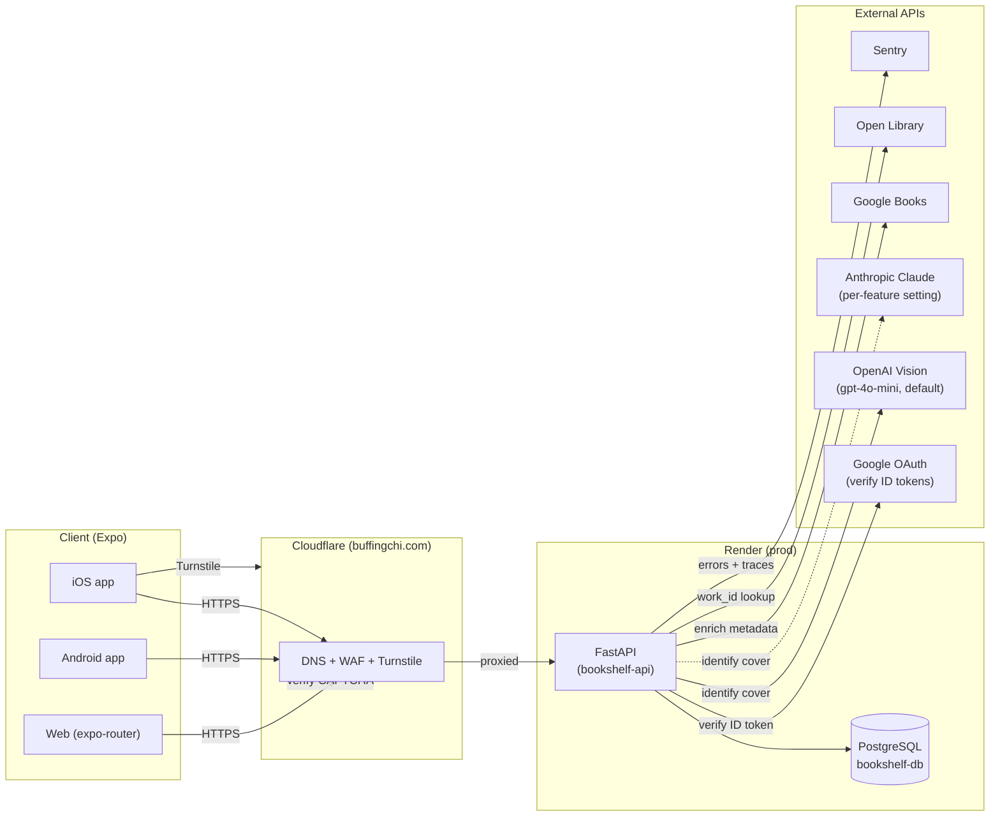

# Architecture

High-level system design, request lifecycle, middleware ordering, and the architectural decisions behind Bookshelf. For user-facing flows (scan, auth, reading states) see [`features.md`](features.md). For the REST endpoint reference see [`api.md`](api.md).

## System diagram

**Components:**
- **Frontend** (Expo SDK 55): one TypeScript codebase ships native iOS, native Android, and web. Runs on Hermes JS engine on native. Uses `expo-router` for file-based navigation.
- **Cloudflare**: DNS + WAF + Turnstile for `bookshelfapi.buffingchi.com`. Bot Fight Mode is on; health-check CI bypasses this entirely by hitting the Render origin directly (see [ADR: CI health checks bypass Cloudflare](#adr-ci-health-checks-bypass-cloudflare)).
- **Backend** (FastAPI on Render): Python 3.12, async end-to-end (SQLAlchemy async sessions, httpx for outbound). Auto-deploys from `dev` per `render.yaml`.
- **Database**: production runs on Supabase Postgres, reached through the Supabase session pooler via `DATABASE_URL`; the dev environment uses a Render Postgres instance. Nightly encrypted backups: see [backups](backups.md).
- **External APIs**: called server-side only from the FastAPI backend — the frontend never holds OpenAI, Anthropic or Google Books keys.

## Request lifecycle

A typical authenticated request (`POST /user-books/purchased`):

1. Client sends HTTPS with `Authorization: Bearer <access-token>`.
2. Cloudflare terminates TLS, runs WAF + Bot Fight Mode, forwards to Render.
3. Render's edge reaches the FastAPI app on the service port.
4. Middleware stack runs outermost → innermost (see next section).
5. Router matches the path → endpoint function runs. FastAPI dependencies inject the DB session + authenticated `current_user` (via `app/auth/dependencies.py`).
6. Endpoint mutates the DB via `SQLAlchemy` async session → commits.
7. Response flows back through the middleware stack (security headers added on the way out).
8. Client receives the JSON response with `X-Request-ID` and security headers set.

## Middleware stack

Middleware is configured in `backend/app/main.py`. FastAPI's `add_middleware` wraps in **reverse order** — the last call added is the outermost layer (first to see the request, last to touch the response).

| Order (outermost first) | Middleware | Role | Active in |
|---|---|---|---|
| 1 | `_HealthExemptTrustedHost` | Drops spoofed Host headers; exempts `/health` (not `/health/db`) so CI probes bypassing Cloudflare can still hit the origin | hardened only (staging + production) |
| 2 | `RequestSizeLimitMiddleware` | Rejects Content-Length > 10 MB with 413 before reading the body | all envs |
| 3 | `CORSMiddleware` | Allowlisted origins only (validator blocks `*`); credentials allowed; limited methods + headers; exposes only `Retry-After` (scan 429s) | all envs |
| 4 | `RequestIdMiddleware` | Generates a request ID, stores it in a contextvar for log correlation, returns it as `X-Request-ID` | all envs |
| 5 | `SentryContextMiddleware` | Attaches request context to Sentry events | all envs |
| 6 | `SecurityHeadersMiddleware` | Sets `X-Frame-Options`, `X-Content-Type-Options`, `Referrer-Policy`, `CSP`, `Permissions-Policy`, and (hardened only) `HSTS` on every response | all envs |
| 7 | `OriginAuthMiddleware` | Origin lockdown: when `ORIGIN_AUTH_SECRET` is set, rejects requests without the matching origin header with 403 before routing; `/health` exempt | when `ORIGIN_AUTH_SECRET` is set |

"Hardened" means `settings.is_hardened` — any `ENVIRONMENT` other than `development`/`test` (see [deployment.md](deployment.md) for the full value list). A public `staging` deployment gets identical hardening to `production`.

**Why this ordering:**
- `_HealthExemptTrustedHost` is outermost so spoofed Host headers are rejected **before any middleware runs** — minimizes attack surface. Only `/health` is exempt, because that liveness probe (CI, Render's own, uptime monitors) hits the origin by its infrastructure hostname, not the public domain, and does nothing an attacker could abuse. `/health/db` is NOT exempt — it does a real DB probe, so it stays behind Host + rate-limit enforcement like everything else.
- `RequestSizeLimit` runs before CORS so oversized bodies are dropped without allocating request memory.
- `OriginAuthMiddleware` is innermost so its 403 still passes back through `SecurityHeaders` and `RequestId`, yet it rejects before routing: no handler, DB query or rate-limit counter runs for a rejected request.
- There is no client-IP middleware: the slowapi key function calls the resolver in `app/core/client_ip.py` directly (see Rate limiting below).
- `RequestId` runs before `SentryContext` so the request ID is available to attach to Sentry events.
- `SecurityHeaders` is innermost on the request (outermost on the response) because it only touches responses.

## Auth architecture

**Identity:** Google OAuth 2.0. The backend trusts any of three configured client IDs (`google_client_id` / `google_ios_client_id` / `google_android_client_id`) so the same API can serve web, iOS, and Android apps. `app/auth/google.py` verifies the Google ID token against Google's JWKS.

**Session tokens:** JWT RS256 (asymmetric).
- **Access token** (`type: access`, 24h default via `jwt_expiry_hours`): short-lived, sent as `Authorization: Bearer` on every authenticated request.
- **Refresh token** (`type: refresh`, 7d default via `refresh_token_expiry_days`): carries a `jti` claim. The `jti` is persisted in the `refresh_tokens` table at issuance time and checked on every `/auth/refresh` call.

**Why RS256 (not HS256):** the public key can be exposed freely (and is, if we ever need to verify tokens in a second service) while the signing key stays on the API. HS256 would require sharing the symmetric secret anywhere verification happens.

**Refresh rotation + revocation:**
- `/auth/refresh` validates the incoming refresh JWT, checks the `jti` exists and is not revoked in the DB, issues a new access + refresh pair, and **marks the old `jti` as revoked**.
- `/auth/logout` revokes the presented refresh `jti`.
- This means a stolen refresh token is one-use: the moment the legitimate client refreshes, the attacker's copy is revoked.

**Single-user lockdown:** `ALLOWED_EMAILS` (comma-separated env var) is the allowlist. Any authenticated email not in that list is rejected at the `/auth/google` exchange. Makes sense for a personal app; remove the check to open the API to arbitrary Google accounts.

## Rate limiting

Backed by `slowapi` + in-memory storage (single Render instance). Every endpoint carries a `@limiter.limit(settings.rate_limit_*)` decorator — this is rule #8 in `CLAUDE.md`. Defaults (per-client):

| Bucket | Default | Applied to |
|---|---|---|
| `rate_limit_auth` | 5/min | `/auth/*` endpoints |
| `rate_limit_scan` | 10/min | `POST /scan` |
| `rate_limit_books_search` | 30/min | `GET /books/search` |
| `rate_limit_writes` | 60/min | POST/PATCH/DELETE on `/user-books/*` |
| `rate_limit_reads` | 120/min | GET on `/user-books/*`, `/auth/me`, `/scan/usage` |
| `rate_limit_health` | 60/min | `/health`, `/health/db` |

**Keying:** `user:` when the request carries a verified **access** token (`type: access`); otherwise the client IP from `app/core/client_ip.py` (one bucket per IPv4 address, per IPv6 /64). Refresh tokens never select a per-user bucket. The resolver trusts `CF-Connecting-IP` only when `TRUSTED_PROXY_MODE=cloudflare` (the default in hardened environments, and set explicitly on Render); with `none` every client behind Cloudflare and Render would share the proxy's IP. See [security.md → Client IP and origin lockdown](security.md#client-ip-and-origin-lockdown).

A 429 response is logged at WARN level with the offending path, so repeated hits surface in Sentry.

## Book identification + dedup pipeline

Lives in `backend/app/services/` and is orchestrated from the `POST /scan` endpoint. The vision call itself goes through the AI gateway in `backend/app/ai/` (see step 2).

0. **Kill switches, then the existing guards.** The first step reads the `ai_settings` table through `app.ai.settings.get_ai_settings(db)` (cached per process for `AI_SETTINGS_CACHE_TTL_SECONDS`, default 30). If it cannot be read and nothing is cached, the scan fails closed with `503 ai_unavailable`; if a read fails after an earlier success, the last value read is used (see the Dials paragraph below). `scan.standard.enabled=false` returns `503 scan_disabled` for every scan and `scan.enhanced.enabled=false` returns `503 enhanced_scan_disabled` for enhanced scans only. All of this happens before the upload is read, Turnstile is called or any provider is contacted (the framework has already received the multipart body by then). Then Turnstile, file validation (extension/MIME, a chunked read that stops past 5 MB → `413`, magic bytes, optional ClamAV), and image normalisation. Normalisation (`app/ai/images.py`, via `sanitize_image`) decodes the image in full with `pillow-heif` registered for HEIC (`415 image_undecodable` otherwise; no raw-bytes fallback), refuses a header pixel count above `scan.max_image_pixels` (from `ai_settings`) before decoding (`413 image_too_large_pixels`), applies EXIF orientation, drops all metadata, shrinks the long edge to the feature's `max_image_long_edge_px` (registry, 1568) and re-encodes as JPEG quality 85. It runs in a worker thread (`anyio.to_thread.run_sync`) so the event loop stays free, with at most `SCAN_NORMALISE_CONCURRENCY` (default 1) at once per process to bound memory. Only that JPEG reaches the provider. All of this runs before the reservation, so a bad image never uses a scan.

   Check order: switches → per-user daily request count (0b) → Turnstile → file and content checks → normalisation → scan-record lookup (a saved answer: entitlement, then the repeat; see 0a) → entitlement (incl. `403 enhanced_requires_premium`) → global count cap → daily cost ceiling → in-flight lease → zero-result throttle (enhanced, action `throttle`) → daily reservation → provider. There is no monthly reservation (#582).
0b. **Per-user daily `/scan` request limit** (#586, decision #573 point 3). Right after the kill switches, `scan.py` calls `quota.count_scan_request(db, user_id, ai)`: one more request for the user's UTC day under the `ai_quota` key `scan.requests` (`quota.SCAN_REQUESTS_QUOTA_FEATURE`), with the same exact conditional upsert as the daily reservation (`units_used + 1 WHERE units_used < scan.requests_per_user_daily`, committed at once), so parallel requests on any number of instances never pass the limit. At the limit nothing is written and the request gets `429 scan_requests_daily_limit` with `Retry-After` until UTC midnight. It counts every request past authentication and the switches (new photo or repeat, allowed or refused later) and gives nothing back: it counts requests, not scans. Repeats are free (#585), so this is the abuse control on them, on top of the 10/minute rate limit and Turnstile. **Why this order:** authentication first (the count is per user). The kill switches before the count: they cost nothing (no write, no work), a switched-off scan should say so, and the app's retries during an outage the operator caused must not use up a user's requests. Everything else after the count: Turnstile is an outbound call and a request that fails it is the kind of request the limit is for; the upload read, normalisation (CPU-heavy), the scan-record lookup, the allowance and the provider are the work it bounds. The key is not an AI call, so the global count cap (step 1.2, `quota.global_units_today`) leaves it out (`quota.NON_AI_QUOTA_FEATURES`). Setting: `scan.requests_per_user_daily` (`ai_settings`, default 100, 1..10,000; changeable with the CLI, applies within the settings cache TTL).
0a. **Scan records** (`app/ai/scan_records.py`, table `scan_records`, #585, decision #573). After normalisation and before any reservation, `scan.py` fingerprints the photo (SHA-256 of the normalised JPEG, so only the exact same file matches) and looks up the user's record for it: `user_id` from the session and the fingerprint from the bytes, nothing else. The key is deliberately not the prompt, model or request shape: an old answer stays valid when either changes (decision #573 point 5). A record holds the provider's validated candidate list, the enrichment result (Open Library / Google Books book data, without the per-user library flag; each saved book carries the format marker `record_v: 2`, and one saved without it, from before #602 made catalog fields provider-only, counts as a missing enrichment step, so a repeat redoes the lookups), the step flags `ai_done` / `enrich_done`, and the feature, tier and model that produced it. Only records younger than `scan_records.retention_days` are served. A standard scan is answered by any record of the photo; an enhanced scan only by one an enhanced scan produced (an enhanced re-scan is how a user gets a better answer), otherwise it takes the normal path and its answer replaces the saved one. **A repeat** checks the enhanced entitlement (`403 enhanced_requires_premium` for a non-Premium user, as for a new photo), writes one `ai_usage` row with status `cache_hit` (0 tokens, `cost_micros` 0, its own `call_id`, via `ledger.record`), then: with `enrich_done`, serves the saved books (no Open Library / Google Books call); without it, redoes the enrichment only and saves it if every lookup finished. The library check (`DeduplicationService`, edition-level since #587) always runs, and the response carries `repeat: true`. It makes no provider call and takes nothing: no daily unit, no lease, nothing counted by the global count cap, no cost estimate or settle in `ai_spend_daily`, no zero-result row, and there is no repeat cap (decision #573 point 2; the per-minute rate limit still applies). `enhanced_scans_remaining` is the user's current value (unchanged), and `GET /scan/usage` is unchanged. **A new photo** runs the normal path below; after the settle (outside the lease) the record is saved step by step: the AI step first (an upsert on `(user_id, fingerprint)` that also clears any enrichment and never replaces a still-valid enhanced record with a standard one (an expired one, past `scan_records.retention_days` but not yet purged, is replaced, so the next repeat is free), then the user's oldest rows beyond `scan_records.max_per_user` are evicted, at most 1,000 per save, one commit), then enrichment runs and, if every Open Library / Google Books lookup finished (`EnrichmentService.last_complete`), the enrichment step is saved (an update matched on the AI step's `created_at`, so it never lands on a newer answer). Only provider outcome `ok` is saved, with books or without: since #572 a missing, malformed or unparseable reply is its own outcome (`malformed`, a 503), so an empty `ok` list is a genuine `{"books": []}`, saved as a finished record (empty candidates and enrichment), and its re-upload is a free repeat (owner decision on #573). Refusals, truncated or malformed replies, errors, timeouts and unavailability are never saved. Only validated data is stored (candidates: title, author, confidence, ISBNs; books: the `EnrichedBook` fields; at most `SCAN_MAX_BOOKS` each, checked on write and read), never the raw model output or the image. Both saves are idempotent by `(user_id, fingerprint)`. Any scan-record failure (fingerprint, lookup, either save or the repeat's ledger row) is logged without content and the scan carries on (a failed lookup rolls the session back, reloads the user and takes the normal path). Observability: one log line per scan that touched a record, `scan_record event=<saved|repeat|repeat_enriched|not_saved|save_failed|lookup_failed> ai_done=… enrich_done=… books=N in_library=M reason=… attempt=N` (counts only; no user id, no content; `attempt` is the request's validated `attempt` form field, 1–6, #603), so records left with an incomplete step, repeats whose books are not in the library, and repeats served to the app's retries can be counted. Dials: `scan_records.enabled` (kill switch; off, every scan takes the normal path), `scan_records.retention_days` (1–30, default 30), `scan_records.max_per_user` (1–10,000, default 500). Old records are purged by the daily cleanup task in bounded batches.
1. **Allowances and the in-flight lease** (`app/ai/quota.py`, tables `ai_quota` and `ai_inflight`, #528). `scan.py` calls `quota.reserve(...)`, which runs, in order:
   1. **Entitlement:** the tier from `entitlements.tier_for(db, user)` (server-side only) selects the allowance keys `quota.<tier>.found_daily` and `quota.<tier>.no_match_daily` in `ai_settings` (#577; launch values: everyone is Free, 5 found and 5 no-match a day; Premium 5 and 5 once purchases exist, decision #583). There is no monthly allowance (#582, see "No monthly limit" below). Enhanced scans are Premium-only (#533): an enhanced request from any other tier is refused here, `403 enhanced_requires_premium`, before anything (cost estimate, lease, unit) is taken or any provider is called. This replaces the lifetime `users.enhanced_scan_credits` balance, which was charged after the provider call and could race; the column is no longer read or written and is dropped in #540.
   2. **Global ceiling:** today's (UTC) day rows across all users and AI-call keys (found and no-match; not the `scan.requests` request counter, #586) are summed and compared with `scan.global_daily_limit` (`ai_settings`, seeded from `SCAN_GLOBAL_DAILY_LIMIT`, default 2000) → `503 scan_capacity`. It sits before the lease and the per-user reservations so nothing is taken for a user when the service-wide capacity is gone. It is a read, so concurrent requests can overshoot by at most the number in flight (now at most one per user); that is accepted. It stays as a second limit, independent of the cost ceiling below, and applies to every tier.
   3. **Daily cost ceiling** (`app/ai/breaker.py`, table `ai_spend_daily`, #531): the gateway feature's `est_cost_ceiling_micros` (registry: 10,000 micros for `scan.standard`, 30,000 for `scan.enhanced`) is added to today's (UTC) row with one conditional upsert, `INSERT INTO ai_spend_daily … ON CONFLICT (day) DO UPDATE SET reserved_micros = reserved_micros + est WHERE reserved_micros + settled_micros + est <= ceiling`. For Free it succeeds only while the day's reserved plus settled spend, across all tiers, stays within `breaker.free_daily_ceiling_micros` (`ai_settings`, seeded from `SCAN_FREE_DAILY_CEILING_MICROS`, default $10); otherwise `503 ai_budget_reached` and nothing per-user is taken. Postgres serialises upserts on the day, so concurrent Free reservations never pass the ceiling. Premium (decision #544) adds its estimate without the condition, so the totals and alerts show real spend, and continues to its own daily allowance and the count cap. Every later refusal or error (lease busy, daily refusal, lease lost, cancellation) gives the estimate back through the same shielded, bounded give-back as the lease.
   4. **In-flight lease:** one conditional upsert, `INSERT INTO ai_inflight … ON CONFLICT (user_id) DO UPDATE SET lease_id = …, lease_expires_at = … WHERE ai_inflight.lease_expires_at < clock_timestamp() RETURNING lease_id`. It succeeds only when the user has no row or the old lease expired, so at most one paid call per user is in flight → `429 scan_in_progress` with `Retry-After: 2`. The lease lasts the feature's `timeout_s` + 30 s (75 s with the default 45 s), so a crashed request frees it. Each acquisition has a random `lease_id`, and the release deletes the row only while it still holds that id: a slow request whose lease expired and was taken over cannot release the new holder's lease. `clock_timestamp()` (not `now()`) is used because the request's transaction may have started at authentication. After the daily reservation the lease is renewed (`UPDATE … WHERE lease_id = <ours>`), which restarts its clock so the full `timeout_s` + 30 s covers the provider call. If a stalled reservation let the lease expire and another request take it, the renewal finds nothing, and the request gives back its unit and gets `429 scan_in_progress`, so two provider calls never overlap.
   5. **Daily reservation:** the #509 conditional upsert, per user, quota key and window: `INSERT INTO ai_quota … ON CONFLICT (user_id, feature, window_kind, window_start) DO UPDATE SET units_used = units_used + 1 WHERE units_used < limit`. Exact under concurrency because Postgres serialises upserts on the key. A limit of 0 refuses without writing. Daily refused → `429 daily_scan_limit` with `Retry-After` until UTC midnight. Windows are UTC days. Standard and enhanced scans share one allowance (OD-1): both reserve under the quota key `scan` (`quota.SCAN_QUOTA_FEATURE`), so for example 3 standard + 2 enhanced scans use a daily limit of 5. Refunds give back to the same key. The `feature` column lets later AI features have their own allowance.

   **No monthly limit (#582, owner decision 2026-10-22).** There is no monthly allowance for any tier, and no Premium enhanced monthly allowance: `quota.reserve` takes, checks and gives back no month-window unit, and no scan is refused for a monthly reason (no `402`). Daily limits are enough to bound cost: one account is bounded by its daily limit (at most 31 × it a month), many accounts by the service-wide `scan.global_daily_limit` and the daily spend ceiling (`breaker.free_daily_ceiling_micros`, so a worst-case month for Free is about 31 × the ceiling; set it with that in mind), and a bug in our own limits by the monthly spend limit in the provider console (#542), the one monthly limit kept, outside the code. Monthly spend and call counts stay visible in the usage ledger (`ai_usage`, rolled up into `ai_usage_daily` and kept 400 days): tracking, not a limit. The retired keys `quota.free.monthly`, `quota.premium.monthly` and `quota.premium.enhanced_monthly` are unknown to the CLI and the seed, and a row left by the previous release is ignored on read (expand step; a later contract migration deletes the rows). Month rows (`window_kind = 'month'`) are no longer read or written and age out through the existing 13-month retention, which keeps a rollback safe.
   6. **Enhanced scans only (#533).** After the lease, with `scan.enhanced.zero_result_action = throttle`, the user's rows in `ai_enhanced_zero_results` inside the sliding window (`scan.enhanced.zero_result_window_hours`, measured on the database clock) are counted; at or above `scan.enhanced.zero_result_threshold` the scan is refused, `429 enhanced_throttled`, with `Retry-After` the seconds until enough rows leave the window. Counting under the lease serialises it with the user's own settle. An enhanced scan then takes the shared daily unit and nothing else: since #582 there is no Premium enhanced monthly allowance, so the daily allowance is what limits enhanced scans until #583 adds a per-model daily Sonnet counter. Every refusal gives back the unit, the lease and the cost estimate like the others.

   **Unit flags and the gated give-back (#590).** The daily unit (since #582 the only one) is taken by `quota.take_unit`, which writes the `ai_quota` increment and a flag on the request's own lease row (`ai_inflight.daily_taken`, matched on `user_id` and `lease_id`) in one commit. The `monthly_taken` and `enhanced_taken` columns are no longer set (a takeover still clears them) and are dropped by a later contract migration. If the lease row is no longer ours (another request took the expired lease over), nothing is taken and the scan is refused with `scan_in_progress` (fails closed); a refused take clears its flag again in the same transaction. So when a take's commit lands but its acknowledgement is lost (the call raises), the flag shows afterwards that the unit landed. Every give-back of a unit outside the settle (a refund after the provider was unavailable, and a refusal or error inside `quota.reserve`, which includes a lost acknowledgement on a take) goes through `quota.give_back_unit`: in one commit it clears the flag (`UPDATE ai_inflight SET <flag> = false WHERE user_id = ? AND lease_id = ? AND <flag> RETURNING`) and takes the unit off only if a row came back, never below zero. On an error in `quota.reserve`, every unit whose take was attempted is given back this way, so a unit whose acknowledgement was lost comes back and one that never landed does not: the user's counters end where they started. A retry after a give-back whose own acknowledgement was lost finds the flag clear and gives nothing back, so a unit is never given back twice; the give-backs are therefore retried like the other give-backs (#567 had made them one-shot while nothing gated them). The settle in `quota.release` needs no flag: it deletes the lease row, flags and all, in the same commit as its own give-back (the zero-result decision below). A takeover of an expired lease resets the flags, since they belong to the new lease, so the old request's gated give-back finds nothing (`lease_lost`). A unit the old request knows it took (its take was acknowledged) is then given back once without the gate (`refund_unit`), on the first attempt only (a later attempt may follow one that committed); a unit whose take was never acknowledged stays charged (fails toward charging). That is the one accepted exception to "counters end where they started", and it is tracked: whenever a unit the request attempted to take is left charged (`lease_lost_unacknowledged`: the gate shows `lease_lost` and the take was not acknowledged; `fallback_failed`: the ungated fallback failed or was skipped; `give_back_failed`: every give-back attempt raised or timed out), `quota._return_unit` sends one Sentry warning per unit per request (`app.ai.alerts.capture_service_warning`, fingerprint `["ai-quota-unit-kept", reason]`, tags `unit` = daily (monthly|enhanced before #582) and `reason`, no user id, email, lease id or content) and a structured log line with the same fields. The warning never raises and never changes the give-back's outcome. The fallback is at most once by the first-attempt rule, so a lost acknowledgement on the fallback leaves the unit charged (`fallback_failed`) rather than risk giving it back twice. Deploy window: Render runs `alembic upgrade head` as the `preDeployCommand` (`render.yaml`) before the new code takes traffic, so new code always has the flag columns. A reservation in flight during the deploy belongs to an old-code process, which gives its units back with the old ungated `refund_unit`, so nothing is lost. A downgrade of 0012 must only follow a code rollback, because the new code fails without the columns. During the #582 deploy, old and new instances overlap: old instances still take and give back monthly (and enhanced) units through their own gated give-back, new instances take only the daily unit, and a takeover by either resets all three flags, so neither gives back the other's units. A refusal gives back whatever was already taken before it propagates: a daily refusal releases the lease (and the cost estimate); any error (including cancellation) gives back the daily unit too. Every step commits straight away on the request's own session (the one `get_current_user` used): reservations are visible to concurrent requests, no second pool connection is needed, and no transaction or connection is held during the provider call. After the provider call the lease is always released in a `finally` (success, refund, any error, cancellation); the release is shielded from cancellation and bounded to 5 s. A failed release is logged and retried once after a rollback; a second failure is logged and swallowed, so the scan result is still returned. If the 5 s bound cuts the release query off mid-execute, the request session is rolled back (shielded, also bounded to 5 s) so the rest of the request (the dedup check, the remaining-allowance read) can normally still use it; if that rollback also times out, the request fails with a 500. Either way the lease expiry is the backstop for a lease that was not released. A cost estimate whose give-back or settle failed has no such backstop: it stays in `reserved_micros` until the day ends (at most one estimate per failed release, and it can only make the breaker refuse sooner, never later). The legacy `scan_usage_daily` caps (`app/services/scan_quota.py`) are no longer called and are removed in #540.

   **Found and no-match counters (#577, owner decision 2026-10-22).** Each user has two daily counters in `ai_quota`: **found** (quota key `scan`, the daily unit above) and **no-match** (quota key `scan.no_match`), with ceilings `quota.<tier>.found_daily` and `quota.<tier>.no_match_daily` (default 5 and 5 for both tiers, 0–1000). The mechanics:
   - **Before the call** every scan takes a found unit, exactly as above (with its #590 flag). Found full → `429 daily_scan_limit`, even when no-match has room: the next photo might find books.
   - **After a genuine no-match** (outcome `ok`, no candidates, **standard** scans only), `scan.py` passes a `quota.NoMatch` to `quota.release`, and `quota.move_to_no_match` runs inside the settle transaction, under the same gate as the cost settle and the #566 zero-result decision: only the attempt whose ledger insert returns a row (or, without a ledger row, the attempt that deletes the lease) decides, so a retry after a lost commit acknowledgement never moves twice. In a SAVEPOINT it locks the request's own lease row (`FOR UPDATE`, matched on `lease_id`, and only while `daily_taken` is set), takes one no-match unit with the same exact conditional upsert (`units_used + 1 WHERE units_used < ceiling`, so concurrent moves never pass the ceiling), gives the found unit back (never below zero) and clears `daily_taken`, all in the commit that deletes the lease. If no-match is full (or its ceiling is 0) the found unit stays charged. A failure in the move rolls back only the SAVEPOINT: the scan stays charged and the usage row, spend and lease delete still commit. The lease-only fallback paths delete the lease first, so they never move (fails toward charging).
   - **Never move:** enhanced scans (the #533 zero-result rule stays for them), malformed replies (already refunded, #572), refusals by the model and truncated replies (they stay charged as found). Repeats from a scan record (#585), provider failures and malformed replies touch neither counter.
   - **Global cap:** `scan.global_daily_limit` sums every day row, so it counts both counters: every provider call, found or no-match. A user's provider calls per day never exceed found + no-match.
   - **Response:** `ScanResponse.no_match` is `"free"` (moved) or `"counted"` (no-match full); `null` when nothing was decided or confirmed. `GET /scan/usage` reports `found_*` and `no_match_*`, with `used_today` / `daily_limit` kept as the found counter for one release.
   - **Tracking:** per-user daily counts are the `ai_quota` rows (`scan` and `scan.no_match`). The move that brings no-match to its ceiling logs a warning line (tier and ceiling, no user id) and, after the commit, sends one Sentry warning via `app.ai.alerts.capture_service_warning` (fingerprint `["ai-no-match-ceiling"]`, tag `tier`, extra `ceiling`; no user id or content). Counts only rise within a day, so only one move per user per day can reach the ceiling: at most one warning per user per day (raising the ceiling mid-day lets the new one be reached once more). After a lost acknowledgement the retry does not move and sends nothing (fewer alerts, never more). A no-match counted because the ceiling is full logs an info line.
   - **Settings migration:** `quota.<tier>.daily` became `quota.<tier>.found_daily` and is retired (`RETIRED_KEYS`: the CLI rejects it, it is not seeded, a row is ignored on read). An operator-customised old value (a valid `quota.<tier>.daily` row whose `updated_by` is not `seed`) is carried over while no `found_daily` row exists: the seed inserts `found_daily` with it, and a read uses it if the seed has not run. A seeded old row (the env default; Premium's was 30) is not carried, so the new default (5) applies. `SCAN_<TIER>_DAILY_LIMIT` now seeds `found_daily` (Premium's default changed from 30 to 5); `SCAN_<TIER>_NO_MATCH_DAILY_LIMIT` seeds `no_match_daily`.
2. **AI gateway → `OpenAIVisionProvider` or `AnthropicVisionProvider`** (`app/ai/gateway.py` → `app/ai/providers/openai_vision.py` / `anthropic_vision.py`; the feature's `provider` picks the adapter) — `scan.py` maps the client's `enhanced` flag to the feature `scan.standard` or `scan.enhanced` and calls `run_feature`; no client-supplied model, prompt or token value is read. The server-side registry (`app/ai/registry.py`, validated at import) supplies provider, model, `max_tokens`, timeout and the image long-edge cap for that feature. `run_feature` then builds a per-request spec with `dataclasses.replace(spec, provider=…, model=…, enabled=…)` from the validated `ai_settings` override (`scan.<feature>.provider` / `.model`) and kill switch; `replace` re-runs the registry's validation, so the registry stays the allow-list authority, and a disabled feature raises `FeatureDisabledError` before any provider is built. The provider base64-encodes the normalised JPEG and sends it to the feature's model (`gpt-4o-mini` for `scan.standard`, `gpt-4o` for `scan.enhanced`, from `SCAN_MODEL` / `SCAN_ENHANCED_MODEL`) with a structured-output prompt asking for `{title, author, confidence, isbn}` per book. 45-second timeout (`SCAN_TIMEOUT_SECONDS`), 2048 max tokens (`SCAN_MAX_TOKENS`). The timeout is enforced twice: the provider's HTTP client uses it per phase (connect, read, write), and `run_feature` wraps the whole provider call in an overall deadline of the same `timeout_s` (`anyio.move_on_after`), so a slow trickle of bytes cannot keep the call alive past it. Past the deadline the call is cancelled and raised as `ProviderTimeoutError`, a `ScanUnavailableError` (`503 scan_unavailable`, reservation refunded), and the in-flight lease (`timeout_s` + 30 s) always outlives the call. The deadline lives in the gateway, so every provider adapter gets it. Provider code may live only in `app/ai/providers/`; `tests/security/test_ai_choke_point.py` (`pytest -m security`) fails on any provider host, SDK or wrapper import (OpenAI, Anthropic, LiteLLM, LangChain, Google, Mistral, Cohere) or provider API-key read (`settings.*_api_key`, `os.getenv`/`os.environ`) elsewhere in `app/`, and on any import of `app.ai.providers` from anywhere but `app/ai/gateway.py` (so callers must go through `run_feature`). Returns up to 15 candidates (`SCAN_MAX_BOOKS`). Only `ScanUnavailableError` (timeout or provider HTTP error) or an `httpx.ConnectError` (connection never established) — both → `503 scan_unavailable` — refunds the daily reservation (never below zero). A malformed reply (#572, below) is refunded the same way. Any other error, or a cancelled request, keeps it counted, since the provider may already have been paid. An empty result still counts (a genuine `{"books": []}`, or a refusal, which is treated as no books found; refusals are out of scope for #572).

   **Malformed replies (#572).** Both adapters return the outcome `malformed` for a 200 that is not a usable answer: no content, content that is not JSON, JSON that is not a `{"books": [...]}` object (OpenAI still accepts a bare list, as before), a non-empty list in which every item is structurally broken (not an object, a title or author missing or not a string; for Claude also one over 500 characters; for OpenAI also a confidence that is not a number), or an unexpected stop reason (Claude: anything but `end_turn`, `refusal` or `max_tokens`, including a missing one; OpenAI: anything but `stop`, `length` or `content_filter`; a missing OpenAI `finish_reason` is judged on the content). Otherwise the reply is `ok`, and schema-valid items keep each adapter's handling from before #572: Claude drops a book with an empty or blank title or author (so the list may end up empty, a genuine no-match), OpenAI keeps it as a candidate (a title-only lookup). Refusals keep their outcome. A truncated reply (Claude `max_tokens`, OpenAI `length`) keeps `truncated` when it holds at least one complete book (answered and charged); with none, the gateway (`run_feature`, `reported_outcome`) reports it as `malformed` for every caller (owner decision on #572: a cut-off reply never counts against the user). `scan.py` treats `malformed` like the provider being unavailable for the user: `503 scan_unavailable` (retryable; the app shows "try again", never "no books found") and the daily unit refunded through `quota.refund`; it is never a zero-result (#533) and never saved as a scan record. Because the provider billed the call, the ledger row (status `malformed`) carries the real tokens and priced cost, and the breaker settles that cost. Retries are #574. Logs carry only lengths, a SHA-256 prefix and the stop reason, never the content.

   **Claude provider (#532).** When `scan.<feature>.provider` is `anthropic` in `ai_settings` (the registry default is still `openai`, until #536 and #538), `AnthropicVisionProvider` calls the Messages API through the official `anthropic` SDK (pinned in `requirements.txt`). The model per feature comes from `registry.PROVIDER_MODELS`: `claude-haiku-5-5` for `scan.standard` and `claude-sonnet-5-5` for `scan.enhanced` (#547). Anthropic publishes no dated snapshot for these models; the IDs are fixed IDs, not moving aliases, and are the only Anthropic IDs in the allow-list (#548). `max_tokens` and the timeout are the spec's, and `output_config.effort` is the spec's `effort`: `low` for standard scans (high-volume extraction) and `medium` for enhanced. The request never carries `temperature`/`top_p`/`top_k`, a `thinking` setting (the models' adaptive default applies) or an assistant prefill. The system prompt is the OpenAI adapter's `SYSTEM_PROMPT`, word for word, with a `cache_control` breakpoint (5-minute TTL); at about 300 tokens it is under the models' 512-token cache minimum, so the breakpoint is most likely a no-op until staging's ledger cache columns show otherwise. The reply is constrained by structured output (`output_config.format`, a JSON schema for `{books: [{title, author, confidence, isbn_13, isbn_10}]}`); the schema's `maxItems = SCAN_MAX_BOOKS` is not enforced by the API, so the SDK's `transform_schema` moves it into the description and the parser caps the list. The image is the normalised JPEG, base64. Every book is validated with pydantic (title and author non-empty and at most 500 characters, confidence clamped to 0–1; an empty one drops the book, a longer one makes it structurally broken, #572); an ISBN with the wrong digit count or checksum is dropped and the book kept. `stop_reason: refusal` gives an empty `refused` result (reservation kept, as for any empty result); `max_tokens` gives `truncated` with every complete book that was parsed (with none, the gateway reports `malformed`, #572); `end_turn` with a usable reply is `ok`, and any other stop reason, or an unusable reply, is `malformed` (#572, below). Usage maps directly: Claude's `input_tokens` already excludes cached tokens; `cache_read_input_tokens` and `cache_creation_input_tokens` are the cache-read and cache-write counts, priced in `prices.py` (Claude bills cache writes at 1.25× input). Logs carry only lengths, a SHA-256 prefix, stop reasons, status codes and error types.

   Retries: the SDK's own retries are off (`max_retries=0`). The adapter retries 429, 500, 503 and 529 (overloaded) at most twice, with full-jitter exponential backoff (0.5 s, then 1 s ceilings) and never less than `retry-after`; it never sleeps when the sleep would end past `timeout_s` from the call's start, and the gateway's overall deadline still bounds the whole call. Error mapping: an SDK timeout (any phase, connect included) → `ProviderTimeoutError`, so the breaker (#531) settles the estimate for it; a connection never established → `ProviderConnectError` (a `ScanUnavailableError`, refunded like `httpx.ConnectError`); 429/500/503/529 after the retries, 502/504, and every other 4xx → `ScanUnavailableError` (refunded; a 4xx is also logged at error level as a bug signal); a connection dropped mid-request propagates (reservation kept, as an `httpx` transport error does for OpenAI). If `ANTHROPIC_API_KEY` is not set, a feature switched to `anthropic` fails closed before any call: an error log and `503 scan_unavailable`, refunded. The app still boots without the key, since no feature uses Claude by default. The SDK is imported, and the key read, only in `anthropic_vision.py` (`tests/security/test_claude_provider.py`). Production enablement waits on #549 (data handling) and #542.

   **Usage ledger (#530).** The provider returns its billed usage with the books (`ProviderResult`: input, output, cache-read and cache-write tokens, and an outcome `ok`, `refused`, `truncated` or `malformed`; for OpenAI the cached prompt tokens are split out of `prompt_tokens`, `finish_reason: length` is `truncated` (with no book, the gateway reports `malformed`, #572), only a `refusal` field or a `content_filter` finish is `refused`, and a 200 with missing or unusable content is `malformed` (#572); a missing usage block gives zeros, and counts are clamped to the INTEGER column range), and the gateway passes it on in `AIResult`. `scan.py` turns every outcome of the provider call into one `ai_usage` row (`app/ai/ledger.py`): the provider's outcome on success, `timeout` for `ProviderTimeoutError` (the provider's HTTP read/write timeout or the gateway deadline; a connect or pool timeout made no connection and is raised as `httpx.ConnectError`, so it is `refunded`), `refunded` for any other `ScanUnavailableError` or an `httpx.ConnectError`, and `error` for anything else, including a cancelled request, whose reservation is kept (tokens 0 on those paths). A `FeatureDisabledError` from the gateway (no provider reached) writes no row. The cost is priced from `app/ai/prices.py` at the current `price_version`. Each call gets a server-generated `call_id`, and the insert is `ON CONFLICT (call_id) DO NOTHING`. The row is committed with the lease release in one transaction, inside the same shielded give-back bounded to 5 s. If that attempt fails with an error (a rejected row), the row is dropped and the lease released on its own, in a second bounded give-back. If it times out, nothing more is tried: the database is slow, and the lease expiry is the backstop, so a slow database costs the request no more than before. A ledger failure is logged and never changes the scan's response. No Sentry event is sent per call (the breaker, #531, tags its own event). **Attempt (#603).** Every row a `/scan` request writes (each status above, and a repeat's `cache_hit`) also carries `attempt`: which try of the request it was, from the optional `attempt` form field (1 the first try, 2–6 the app's scheduled retries, #574; missing means 1). FastAPI validates it as a form field (`Form(ge=1, le=6)`) before the handler runs, so a bad value is a `422` with nothing counted, reserved or written, exactly like a bad `enhanced`; the #586 request count is not taken for it. It is purely informational: `quota`, the breaker and the order of the checks never read it, and the daily rollup does not carry it (`ai_usage_daily` keeps its (day, feature, model, status) key; the 30 days of raw rows are enough to count the retry rate and how far down the schedule scans get, including retries that succeed). Rows from before migration 0014 have `attempt` NULL (unknown).

   **Cost settle and spend alerts (#531).** The same settle transaction (ledger row, then lease delete) also settles the call's spend in `ai_spend_daily`: the estimate leaves `reserved_micros` (never below zero) and the call's cost is added to `settled_micros`. An answered call (`ok`/`refused`/`truncated`, and `malformed`, #572, whose units are refunded) settles its priced cost; a refunded call (`refunded`: provider unavailable or never reached, including a connect or pool timeout, which the provider adapter raises as `httpx.ConnectError`; or the gateway kill switch) settles nothing, so the estimate is simply given back; a `timeout` (a read/write timeout or the gateway deadline: units refunded, but the request reached the provider and is likely billed), an `error` or a cancelled call (reservation kept because the provider may have been paid) settles the estimate (the real cost is unknown and the ledger records 0, so the breaker errs on the safe side). If the ledger row is dropped, the lease-only fallback still settles the spend. The ledger insert is `ON CONFLICT (call_id) DO NOTHING RETURNING call_id`, and the spend is settled only when it returns a row: a settle retried after a commit whose acknowledgement was lost finds the row already there, which proves the spend and lease delete were committed with it, so the cost is not added twice. Give-backs with no ledger row (refusals inside `quota.reserve`, and the lease-only fallback) are made safe to retry by the lease instead: it is deleted in the same commit as the spend, so a retry deletes the lease first and settles or releases the estimate only if it was still there (if the lease was lost to another request for some other reason, the estimate stays reserved until the day ends). The cost release before any lease exists (a scan already in flight, or the lease insert failing) has nothing to show whether it committed, so it is attempted once and never retried: a repeat would give back another call's estimate and let Free scans pass the ceiling; a failure leaves the estimate reserved, which can only make the breaker refuse sooner. After the commit, each alert threshold (50, 75 and 90 % of the Free ceiling, fixed in code) that the settled total has reached and whose bit in `alerted_mask` is not yet set is claimed with `UPDATE … SET alerted_mask = alerted_mask | bit WHERE alerted_mask & bit = 0 RETURNING`; only one request can win each bit per day, and the winner sends one Sentry warning with fingerprint `["ai-breaker", "<day>", "<pct>"]`, tags `feature`, `model` and `status` of the crossing call, and the day's totals and the ceiling as extras. Never a user id or any content: the event is captured in a forked and emptied Sentry scope (`sentry_sdk.isolation_scope()`, both scopes cleared), so the user id that `get_current_user` puts on the request's scope and the request's tags are not attached, and the alert's tags do not stay on later events of the request. Clearing a scope keeps its event processors, and the Starlette/FastAPI integration's processor would still attach the HTTP request (url, headers including the client IP, user agent, body), so an event processor added to the forked scope, which runs after the integration's, strips the `request` block, `user`, breadcrumbs and any context other than `trace`/`runtime`/`os` from the alert. The event is sent only after the claim commits, so it is sent at most once. With a ceiling of 0 (Free paused on purpose) no alerts are sent. Rows are purged after 90 days by the daily cleanup task. Raw rows are rolled up into `ai_usage_daily` after 30 days by the daily cleanup task, and the rollup is kept 400 days ([data-model.md](data-model.md#ai_usage-backendappmodelsai_usagepy)).

   **Zero-result tracking for enhanced scans (#533).** An enhanced scan takes only the shared daily unit (#582): it is refunded on `503 scan_unavailable` (including a timeout) and kept on any other error or cancellation, and nothing is recorded on those paths. Before #582 an empty enhanced scan below the threshold also gave back an enhanced monthly unit; with that unit gone the rule stays as the abuse signal (rows, the warning and the throttle) until #583 decides its replacement. The decision is on what the provider returned: when it answered with no books (no candidates), `scan.py` passes a `ZeroResult` (with the ledger `call_id`) to `quota.release`, and the settle transaction decides, in a SAVEPOINT. It runs only when the settle applies the cost settle too (the ledger insert returned a row; without a ledger row, on the first attempt only, since a retry goes through the lease-only path), and only while the request still holds its own lease: it first locks its `ai_inflight` row with `SELECT … WHERE user_id = ? AND lease_id = ? FOR UPDATE`. That row is deleted later in the same transaction, so the lock lasts until the commit, and a second settle of the same user (a request whose lease expired and was taken over), finds no row of its own and records no row and no warning. Without its lease a settle never records; that includes the lease-only paths (a retry without a ledger row, and the fallback after a rejected ledger row), which delete the lease before the decision, so they record nothing. Then it counts the user's rows in the window; below the threshold it inserts one `ai_enhanced_zero_results` row (`ledger_id` = the call's `call_id`), committed together with the usage row, the cost settle and the lease delete; at or above the threshold it changes nothing (`charge`; with `throttle` the request would normally have been refused already). The daily unit stays charged either way. A failed decision rolls back only the SAVEPOINT (no row) and never drops the usage row or changes the response. Threshold 0: `charge` records nothing, `throttle` refuses every enhanced scan. Enrichment and dedup run after the settle for every scan, as before, so the lease covers only the provider call. When the inserted row brings the user's count to the threshold and no row of that user with `warned = true` is inside the window, the row is inserted with `warned = true` (the claim commits atomically with the row) and one Sentry warning is sent after the commit, so at most one per user per window: level `warning`, fingerprint `["ai-enhanced-zero-results", "<action>"]`, tags `feature=scan.enhanced` and `action`, extras `count`, `threshold`, `window_hours`; never a user id, email, image hash or content. It is captured like the spend alerts below, through the shared helper `app/ai/alerts.py` (forked, emptied scopes and the request-stripping event processor). The window slides: rows ageing out one by one can bring the count back to the threshold, but no new warning is sent until the `warned` row itself has left the window. Two cases send no warning in a window: lowering the threshold below a user's current in-window count (no new row reaches it exactly; the user is still throttled with `throttle`), and a settle that committed `warned = true` but lost its acknowledgement (the retry records nothing, so that window's warning is lost: fewer alerts, never more than one). A repeat served from a scan record (#585) makes no provider call and passes no `ZeroResult`. The response's `enhanced_scans_remaining` is the Premium daily allowance left after the scan (`null` for other tiers). Rows are purged after 30 days by the daily cleanup task ([data-model.md](data-model.md#ai_enhanced_zero_results-backendappmodelsai_enhanced_zero_resultpy)).

   The gateway also resolves the user's tier with `app/ai/entitlements.tier_for(db, user)` and returns it on `AIResult.tier`. The tier is decided server-side from the ORM user only (no request field, header, query parameter or JWT claim is read) and is Free for everyone until subscriptions land (Phase 2.5).
3. **`EnrichmentService`** (`enrichment.py`) — for each candidate, looks it up in Open Library and Google Books concurrently (by ISBN-13 when the candidate has one, else title + author). The candidate is only a search key (#602): when a provider matched, the book's title and author are the provider's (Open Library `title` / `author_name[0]`, else Google Books `volumeInfo.title` / `authors[0]`), and an edition ISBN is kept only when a record used lists it (an ISBN-10 beside a confirmed ISBN-13 only when it is that ISBN-13's ISBN-10 form). When both providers matched, the Google Books volume is used only if it agrees with the Open Library doc (a shared ISBN, or the same title and first-author surname, where a differing subtitle may only be an edition note such as "Deluxe Edition"); otherwise nothing from it is used. Populates `open_library_work_id`, `google_books_id`, cover URL, description, subjects, publisher / year / page count. Only when nothing matched does the result keep the model's title and author; it then has no provider ID, is not signed and cannot be added to the shared catalog (the user can add it as their own unverified entry instead, #616).
4. **`DeduplicationService`** (`deduplication.py`) — checks the user's existing library (#587). Each candidate gets `ownership`:
   - `owned_same_edition`: its ISBN-13 (from `editions[0]`, the edition the app would add; ISBN-10 normalised to 13) matches an edition the user has, under any book row;
   - `owned_other_edition`: the work matches (`open_library_work_id` or `google_books_id`) and no entry of it holds this ISBN, but one holds an edition with another ISBN;
   - `owned_edition_unknown`: the work matches but there is no ISBN to compare (none on the result, or none on any matching entry);
   - `not_owned`.

   One query per response, whatever the number of results: the user's entries (driven by `user_books.user_id`) of any of the results' work IDs, Google Books IDs or ISBNs, with each entry's edition ISBNs outer-joined in. Every matching entry is looked at (entries with an edition first). `already_in_library` / `in_library` are true for any `owned_*` value. Owned candidates are still returned; the app shows the matching message and won't let them be selected, and `POST /wishlist` refuses them with 409 and the same code. `GET /books/search` runs the same check; if the check fails, the search answers with every result `not_owned`.
5. Response is up to 15 `EnrichedBook` objects; the frontend's `BookCandidatePicker` shows them and the user confirms which to add.

**Client-side refusal handling.** The frontend maps `POST /scan` refusals (429 `daily_scan_limit` / `scan_requests_daily_limit` (#586, its own notice that names the local reset time) / `scan_in_progress`, the 503 codes (all `paused` except the retryable `scan_unavailable`, below), and the enhanced-only 403 `enhanced_requires_premium` / 429 `enhanced_throttled`, which stop only enhanced photos and fall back to the standard results; a 402 from an older server is shown as a generic failure, #582) to UI states in one helper, `frontend/lib/scanErrors.ts`. `ScanJobContext` shows a notice on the scan screen and puts the refused job back in the `queued` state (it keeps its photo, counts in the pending-uploads badge and survives a restart). After the first refusal the queue drain sends no more photos (queued text searches, which use `GET /books/search`, still go through), so each drain costs at most one doomed request; the next drain (reconnect or launch) or the notice's "Try again" (`resumeQueue()`) continues from there. **Retry schedule (#604):** 503 `scan_unavailable` (the provider was out, timed out or overloaded after the server's own retry, or sent a malformed reply, #572; refunded) is the one retryable outcome: `classifyScanError` maps it to `unavailable`, not `paused`. `ScanJobContext` keeps the photo `queued` with `error: 'unavailable'`, `attempts` (used so far) and `nextAttemptAt` on the job (persisted by `saveJobs`, so a restart keeps them), on the fixed schedule `SCAN_RETRY_DELAYS_MS` (30 s, 10 min, 1 h, 4 h); each `POST /scan` sends the form field `attempt` (1–5; the server accepts 1–6, #603). The drain sends due photos first and no other photo while one is waiting (one at a time); a timer keyed on the earliest `nextAttemptAt` drains when it is due while the app is open (cleared on unmount; `inFlightRef` stops a double send), and the launch or reconnect drain sends anything already due. Offline (only `isConnected === false`; `null` counts as online) nothing is sent and no attempt is used, and the timer checks again every 60 s; a request with no response leaves the attempt count unchanged but sets `nextAttemptAt` 30 s ahead, so it can't loop. The timer never waits more than 4 h, and `nextAttemptAt` values further ahead are clamped on load. Any successful `POST /scan` (a new capture, which is always sent at once, or a drained photo) makes every waiting photo due now, keeping `attempts`. After attempt 5 the job is `failed`, with one banner ("Retry" restarts at attempt 1; "View queue" opens the scan queue screen, #605) and one Sentry message (fingerprint `scan-final-failure`, tags `attempts` and `last_error`), and it no longer holds the queue: the rest is sent. Enhanced re-scans are never put on the schedule (they take the paused path). A refusal or any other failure ends the schedule. All job writes go through `setJobsAndRef`, which updates `jobsRef` synchronously, so a drain never reads a stale list. The first failure shows the paused notice; later ones show nothing. **Repeats (#588):** a `200` with `repeat: true` was answered from the user's scan record and took nothing, so the app does not refetch `GET /scan/usage`; `repeatOutcome()` in `frontend/lib/scanJob.ts` picks the message from `books` and each book's `in_library`: all in the library discards the job and its photo, some missing offers "Re-add" (the review sheet on the saved books, then `POST /wishlist` only), none found suggests a clearer photo.

**Dials in the database (`ai_settings`, no release or restart needed).** `app/ai/settings.py` defines the keys, types and bounds: `scan.standard.enabled` (bool; master switch for all scans), `scan.enhanced.enabled` (bool), `scan.standard.provider` / `scan.enhanced.provider` (a provider in `ALLOWED_MODELS`), `scan.standard.model` / `scan.enhanced.model` (a model in that provider's allow-list) `scan.max_image_pixels` (1,000,000–100,000,000), `scan.global_daily_limit` (1–1,000,000), `breaker.free_daily_ceiling_micros` (0–1,000,000,000 micro-dollars per UTC day; 0 pauses all Free scans) and the allowances `quota.free.found_daily` / `quota.premium.found_daily` and `quota.free.no_match_daily` / `quota.premium.no_match_daily` (0–1000, #577; the old `quota.<tier>.daily` keys are retired, and there are no monthly keys since #582), plus for enhanced scans (#533) `scan.enhanced.zero_result_threshold` (0–20), `scan.enhanced.zero_result_window_hours` (1–720) and `scan.enhanced.zero_result_action` (`charge` or `throttle`), plus for scan records (#585) `scan_records.enabled` (bool), `scan_records.retention_days` (1–30) and `scan_records.max_per_user` (1–10,000), `scan.requests_per_user_daily` (1–10,000, default 100: `/scan` requests per user per UTC day, #586). Change them with `python -m app.ai.settings set <key> <value> [--by NAME]` (also `get <key>` and `list`), which validates, then writes `updated_at` and `updated_by`. A provider and its model are a pair, so a provider is changed with `python -m app.ai.settings switch <feature> <openai|anthropic> [--model M] [--by NAME]`, which writes both rows in one commit (the model defaults to the registry's model for that provider); `set` of a provider alone is refused while the stored model belongs to the other provider. A provider, model, pixel cap, global cap, allowance, cost ceiling, zero-result, scan-record or request-limit setting that is invalid on read (a bad hand edit) is ignored with a log and Sentry warning, and the default is used. An invalid `*.enabled` value (not a JSON boolean) fails closed: it is treated as `false` (disabled), with the same warning. A missing `*.enabled` row still falls back to `SCAN_ENABLED`/`SCAN_ENHANCED_ENABLED` (`scan_records.enabled` to its code default, `true`).

- **Seeding.** At startup (lifespan) every missing key is inserted from the env (`SCAN_ENABLED`, `SCAN_ENHANCED_ENABLED`, `SCAN_MAX_IMAGE_PIXELS`, `SCAN_GLOBAL_DAILY_LIMIT`, `SCAN_FREE_DAILY_LIMIT`, `SCAN_PREMIUM_DAILY_LIMIT` (they seed the `found_daily` keys since #577), `SCAN_FREE_NO_MATCH_DAILY_LIMIT`, `SCAN_PREMIUM_NO_MATCH_DAILY_LIMIT`, `SCAN_FREE_DAILY_CEILING_MICROS`; the retired `SCAN_*_MONTHLY_LIMIT` vars seed nothing since #582), code defaults for the three `scan.enhanced.zero_result_*` keys (3, 24, `charge`) and the registry defaults (`SCAN_MODEL`, `SCAN_ENHANCED_MODEL`) with `INSERT … ON CONFLICT DO NOTHING`. Existing rows are never changed, so after the first boot the row is the source of truth and those env vars are initial defaults only. A key with no row falls back to the same env/registry default. Seeding is bounded to 5 s and never stops the app from starting; if the database is down, scans fail closed until it is back.
- **Cache and skew.** The cache is per process (per uvicorn worker): each caches the rows for `AI_SETTINGS_CACHE_TTL_SECONDS` (1–300, default 30). A change therefore reaches every process within the TTL, and during a deploy (two instances) or with several workers they can disagree for up to 30 s. `/scan` reads the settings once, at the top of the handler, and passes that snapshot to `run_feature(..., settings_snapshot=...)`, so one request uses one view; `run_feature` still reads them itself when no snapshot is given.
- **Read failures.** With nothing cached → `503 ai_unavailable` (fail closed). After at least one successful read → the last value read is used, with a warning, while it is at most `AI_SETTINGS_MAX_STALE_SECONDS` old (1–3600, default 300, never below the TTL); past that an error is logged and the request fails closed with `503 ai_unavailable`. Every request retries, so the first successful read refreshes it. A stale kill switch is better than both failing open (ignoring a switch that was just turned off) and refusing every scan during a short database blip. Inside the request's open transaction, or whenever the session already holds loaded objects, the read runs in a SAVEPOINT, so a failed read does not break that session or expire its objects; only on an empty session with no transaction open does it run in a short transaction of its own, so no connection is left idle in a transaction. (A session that holds objects but has no transaction open is left in its autobegun transaction until the caller commits or closes; `/scan` always has one open already.)

**Dials (env, restart needed):** `SCAN_NORMALISE_CONCURRENCY` (1–8, normalisations running at once per process; stays env because it sizes a process-wide `anyio.CapacityLimiter` created at import), `AI_SETTINGS_CACHE_TTL_SECONDS` (1–300), `AI_SETTINGS_MAX_STALE_SECONDS` (1–3600, ≥ the TTL). Out-of-range values fail validation at boot.

**Why work_id-based dedup instead of ISBN:**
- A single "work" (e.g. *Dune*) has dozens of editions — hardcovers, paperbacks, audiobooks, translations, anniversary reprints — all with different ISBNs. ISBN-based dedup would let the user wishlist 14 copies of *Dune*.
- Since #587 the ISBN only refines the answer within that identity: it tells "this exact edition" (`owned_same_edition`) from "another edition of a work you have" (`owned_other_edition`). The work stays the unit of a library entry (`uq_user_books_user_book`); adding another edition is #610.
- Open Library's `work_id` identifies the conceptual book independent of edition, which matches how users actually think about their collection.
- When the work_id is unavailable, we fall back to Google Books volume ID (which is also work-level, not edition-level).

## Server-authoritative architecture

The server owns all library state. The client never holds a competing copy of it.

**The rule:** every change to the library — mark purchased, advance status, remove, add to the wishlist from scan results — is a request to the API that only takes effect once the server confirms it. There are no optimistic writes and no offline edits.

**How the client behaves:**
- **Reads:** the wishlist and My Books screens fetch from `GET /user-books` when focused, on pull-to-refresh, and when the filter tab changes. The result lives in component state only. Nothing authoritative is persisted between sessions (no persisted query cache, no library data in `AsyncStorage`).
- **Writes:** a handler sends the request, waits, and only then changes the list — for a status change it applies the row the server returned (`PATCH /user-books/{id}` responds with the full `UserBookRead`, including server-set timestamps); for a remove it drops the row after the `DELETE` succeeds. On failure the list is left untouched and an alert explains what went wrong.
- **In flight:** the row's buttons are locked (`mutatingIds`) so a double-tap can't send a second request. The UI shows the old state until the server answers.
- **Offline:** `useOnlineOnly()` (built on `useNetworkStatus`) reports connectivity. While offline, the mutation buttons are disabled and an `OfflineNotice` ("Go online to edit your library") is shown on both screens. If a press still gets through (for example the connection drops mid-tap), `requireOnline()` shows "This action requires an internet connection" and the request is never sent. Adding a scanned book to the wishlist (`ScanJobContext.handleSelectBook`) is guarded the same way.

**The one exception — scan capture.** Capturing a cover photo works offline because the photo can't be retaken later:
- The image is copied into `scan-queue/` under the document directory and a job is recorded (`scan_job_queue` in `AsyncStorage`, via `lib/scanJobStorage.ts`). Job metadata holds no library data.
- The queue is capped at 50 waiting scans (`MAX_QUEUE_SIZE`). At the cap the scan screen refuses new captures with a "Queue full" message *before* copying anything, and shows a "Pending uploads: N" count while scans wait.
- When connectivity returns, `ScanJobContext` drains the queue. Dismissing a job deletes its image; on launch, any file in `scan-queue/` that no job refers to (for example after a crash) is removed.
- Failed jobs are persisted like waiting ones (everything except completed jobs), each with a `failedAt` timestamp, and keep their image. The scan queue screen (`app/scan-queue.tsx`, #605) lists waiting and failed jobs; Retry calls `restartScanSchedule` (which sends at once only when no other photo is being sent, no drain is running and no photo waits on its schedule; otherwise it resets the job to `queued` with a clean schedule and lets the drain send it in turn, #604), Delete asks for confirmation (`Alert.alert`) and then calls `dismissJob`. A failed job older than `FAILED_SCAN_RETENTION_MS` (7 days; counted from `failedAt`, or `createdAt` when absent) is dropped on launch (its image is then removed by the orphan sweep, so the job is never saved with its image already gone) and when the screen opens (`purgeExpiredFailedJobs` saves the pruned list first, then deletes the images). `failedAt` is stamped only when a job changes to failed.
- Identifying the book is still a server call. Only *capturing* is offline; the result, and adding it to the wishlist, need a connection.

**Adding a result to the wishlist — the shared catalog (#602).** `books` and `editions` are shared by all users and written only from server-produced data. `POST /scan` and `GET /books/search` sign every `EnrichedBook` they return for the requesting user (`catalog_token`, `app/core/catalog_token.py`; HMAC-SHA256 keyed from `JWT_PRIVATE_KEY`, 30-day expiry). The app keeps the book object unchanged in the job's `results` (in memory; `saveJobs` strips results) and the review sheet, and `ScanJobContext.handleAddBooks` posts each chosen book as received to `POST /wishlist`. `WishlistService` verifies the token against the received fields and the authenticated user: valid, it may create a missing `Book` / `Edition`; otherwise it only links an existing `Book` (and an existing `Edition` of it), or refuses with `422 catalog_token_invalid`. A book with no provider ID is never signed and is refused with `422 book_not_in_catalog`; the app says why for each ("not in our catalog: try searching by title" / "out of date: scan or search again", #612), doesn't retry them or report them to Sentry, and closes the review when nothing is left to retry. For a book the catalog can't find, the banner (and the review sheet, on a result with no match) offers **Add it yourself** (#616): a form pre-filled from the scan posts `POST /wishlist/unverified`, which stores a private, unverified entry in the per-user `user_custom_books` table, outside `books` / `editions`, so no catalog lookup or library check can ever see it. Signed fields are provider data only (see step 3 above), and a user book never links an edition of another book. Existing catalog rows are never modified from a request. See [security.md](security.md#shared-catalog-trust-model).

## Architectural decision records

### ADR: JWT RS256 over HS256
**Decision:** asymmetric signing for access + refresh tokens.
**Reasoning:** the public key can be distributed without risk, so any future verifier (a worker, a second service, a downstream proxy) doesn't need the signing secret. Zero cost today, big optionality later.

### ADR: Refresh token rotation with server-side JTI revocation
**Decision:** every `/auth/refresh` issues a new refresh token and revokes the old `jti` in the `refresh_tokens` table.
**Reasoning:** makes refresh tokens **effectively single-use**. A stolen refresh token is invalidated the moment the legitimate client refreshes. Trade-off: any refresh-token race on the client (two parallel tabs, interrupted network) can log the user out; acceptable for this app's usage pattern.

### ADR: Work-level book deduplication (Open Library `work_id`)
**Decision:** dedup by `open_library_work_id`, not ISBN.
**Reasoning:** users think in terms of the work (*Dune*), not the edition. ISBN-based dedup would break the mental model — 14 copies of *Dune* isn't a collection, it's noise.

### ADR: CI health checks bypass Cloudflare
**Decision:** backend-health CI job hits `bookshelf-api-rxp3.onrender.com` directly, not the public `bookshelfapi.buffingchi.com`. `/health` is exempt from `TrustedHostMiddleware` via `_HealthExemptTrustedHost`.
**Reasoning:** Cloudflare's Bot Fight Mode 403s GitHub Actions runner IPs (Azure cloud ranges) before WAF custom rules fire, and free-tier Bot Fight Mode is not skippable via custom rules. The direct-origin probe tests whether Render is up, which is the actual signal we care about. See `docs/claude/` and wcmchenry3-stack/.github#45 for the full diagnostic walkthrough.

### ADR: In-memory rate limiting (single instance)
**Decision:** `slowapi` with in-memory storage, no Redis.
**Reasoning:** Render runs a single instance (starter plan) so there's no distributed coordination problem. When we scale to multiple instances we'll need Redis-backed storage — but today it would be over-engineering. Documented here so the cost of scaling is known.

### ADR: Server-authoritative library, offline scan capture only
**Decision:** the server owns all library state; the only offline feature is capturing scan images into a bounded queue. No optimistic writes, no client-side source of truth, no persisted cache of library data.
**Reasoning:** a second, client-held copy of the library can disagree with the server (rejected update, edit from another device, expired session) and the app would have to reconcile it. Optimistic UI hid failures until the rollback flashed by. Since a scan photo is the one thing that can't be recreated later, that is the only thing worth queuing. Trade-off: library edits need a connection and feel slightly slower (the row waits for the server); the UI says so and locks the buttons instead of pretending.
