# Data model

PostgreSQL schema, entity reference, and the dedup strategy that makes the collection work at the work-level instead of per-edition. For the architectural rationale behind dedup see [`architecture.md`](architecture.md#adr-work-level-book-deduplication-open-library-work_id); for migration mechanics see the [Migration workflow](#migration-workflow) section below.

> How long every table is kept, what grows and the expected size at 100, 1,000 and 10,000 users: [`storage-and-retention.md`](storage-and-retention.md).

## ER diagram

```mermaid
erDiagram
  USERS ||--o{ USER_BOOKS : owns
  USERS |o--o{ LIBRARY_EVENTS : "library audit log (set null on delete, #684)"
  USERS ||--o{ IDEMPOTENCY_KEYS : "stored write responses, 24 h (#685)"
  USERS ||--o{ ACCOUNT_EXPORTS : "data export requests, 7 days (#694)"
  USERS ||--o{ REFRESH_TOKENS : issued
  USERS ||--o{ AI_QUOTA : "AI calls per window"
  USERS ||--o| AI_INFLIGHT : "call in flight"
  USERS |o--o{ AI_USAGE : "provider calls (set null on delete)"
  USERS ||--o{ AI_ENHANCED_ZERO_RESULTS : "recorded empty enhanced scans"
  USERS ||--o{ SCAN_RECORDS : "scan records"
  SCAN_RECORDS ||--o{ SCAN_CORRECTIONS : "correction flags (#631, cascade)"
  USERS ||--o{ USER_CUSTOM_BOOKS : "own unverified entries (#616)"
  USER_CUSTOM_BOOKS ||--o| USER_BOOKS : "held by (cascade)"
  BOOKS ||--o{ EDITIONS : "has editions"
  BOOKS ||--o{ USER_BOOKS : "tracked by"
  BOOKS |o--o{ BOOKS : "merged into (#682)"
  EDITIONS ||--o{ USER_BOOKS : "optional edition"

  USERS {
    uuid id PK
    string email UK
    string google_id UK
    string display_name
    string avatar_url
    string default_tab "scan, wishlist, my-books or null (#913)"
    timestamptz created_at
    timestamptz updated_at
  }
  BOOKS {
    uuid id PK
    string open_library_work_id UK "indexed"
    string google_books_id
    string title
    string author
    string description
    string cover_url
    string_array subjects
    string language "default 'en'"
    string source "provenance, check constraint (#682)"
    timestamptz fetched_at "provenance (#682)"
    uuid merged_into_id FK "self, restrict delete, indexed (#682)"
    timestamptz created_at
    timestamptz updated_at
  }
  EDITIONS {
    uuid id PK
    uuid book_id FK "indexed, restrict delete"
    string isbn_13 UK
    string isbn_10
    string publisher
    int publish_year
    string format "check constraint"
    int page_count
    string open_library_edition_id
    timestamptz created_at
  }
  USER_BOOKS {
    uuid id PK
    uuid user_id FK "indexed, cascade delete"
    uuid book_id FK "restrict delete; null for an unverified entry"
    uuid custom_book_id FK,UK "nullable, cascade delete (#616)"
    uuid edition_id FK "optional"
    string status "indexed, check constraint"
    timestamptz wishlisted_at
    timestamptz purchased_at
    timestamptz started_at
    timestamptz finished_at
    string notes
    int rating "1..5"
    string title_override "user's own, nullable (#682)"
    string author_override "user's own, nullable (#682)"
    string cover_url_override "user's own, nullable (#682)"
    timestamptz created_at
    timestamptz updated_at
    int version "optimistic concurrency, default 1 (#685)"
  }
  REFRESH_TOKENS {
    uuid id PK
    string jti UK "indexed"
    uuid user_id FK "indexed, cascade delete"
    timestamptz issued_at
    timestamptz expires_at
    timestamptz revoked_at
  }
  AI_QUOTA {
    uuid user_id PK,FK "cascade delete"
    varchar feature PK "quota key: scan"
    varchar window_kind PK "day (month: legacy, #582)"
    date window_start PK "UTC day"
    int units_used ">= 0"
  }
  AI_INFLIGHT {
    uuid user_id PK,FK "cascade delete"
    uuid lease_id
    timestamptz lease_expires_at
  }
  AI_USAGE {
    bigint id PK
    uuid call_id UK "server-generated per call"
    uuid user_id FK "nullable, set null on delete"
    varchar feature
    varchar model
    varchar price_version
    int input_tokens ">= 0"
    int output_tokens ">= 0"
    int cache_read_tokens ">= 0"
    int cache_write_tokens ">= 0"
    bigint cost_micros ">= 0"
    varchar status "check constraint"
    varchar request_id "nullable"
    smallint attempt "nullable, 1..6, #603"
    timestamptz created_at "indexed"
  }
  AI_USAGE_DAILY {
    date day PK "UTC"
    varchar feature PK
    varchar model PK
    varchar status PK
    bigint calls
    bigint input_tokens
    bigint output_tokens
    bigint cost_micros
  }
  AI_ENHANCED_ZERO_RESULTS {
    uuid id PK
    uuid user_id FK "cascade delete"
    timestamptz created_at "indexed with user_id"
    uuid ledger_id "nullable, ai_usage.call_id (no FK)"
    boolean warned "row that sent the threshold warning"
  }
  SCAN_RECORDS {
    uuid id PK
    uuid user_id FK "cascade delete, unique with fingerprint"
    varchar fingerprint "sha256 hex of the normalised JPEG"
    varchar feature
    varchar tier
    varchar model
    jsonb candidates "validated candidates only"
    jsonb enrichment "nullable, enriched books"
    boolean ai_done
    boolean enrich_done
    timestamptz created_at "indexed"
    timestamptz updated_at
  }
  SCAN_CORRECTIONS {
    bigint id PK
    uuid scan_record_id FK "cascade delete, unique with candidate_index"
    smallint candidate_index "check >= 0"
    varchar feature
    varchar tier
    varchar model
    boolean title_edited
    boolean author_edited
    boolean isbn_edited
    timestamptz created_at "indexed"
  }
  SCAN_CORRECTIONS_DAILY {
    date day PK "UTC"
    varchar feature PK
    varchar model PK
    bigint prefilled_saves
    bigint title_edited
    bigint author_edited
    bigint isbn_edited
    bigint any_edited
  }
  AI_SPEND_DAILY {
    date day PK "UTC"
    bigint reserved_micros "check >= 0"
    bigint settled_micros "check >= 0"
    smallint alerted_mask "bit per alert threshold"
  }
  LIBRARY_EVENTS {
    bigint id PK
    uuid user_id FK "nullable, set null on delete"
    uuid user_book_id "no FK: outlives the row"
    varchar event_type "check constraint"
    jsonb changed_fields "field: old/new; free text as changed"
    varchar request_id "nullable"
    timestamptz created_at "indexed"
  }
  IDEMPOTENCY_KEYS {
    bigint id PK
    uuid user_id FK "cascade on delete"
    varchar key "unique with user_id"
    varchar request_hash "SHA-256 hex"
    varchar state "pending, committed or complete"
    smallint response_status "nullable"
    text response_body "nullable, at most 64 KB"
    jsonb response_headers "ETag, Location"
    timestamptz created_at "indexed"
  }
  ACCOUNT_EXPORTS {
    uuid id PK
    uuid user_id FK "cascade on delete"
    varchar status "pending, running, ready or failed"
    varchar locale "the email's language"
    smallint attempts
    timestamptz claimed_at "nullable, the lease"
    timestamptz completed_at "nullable"
    varchar object_path "nullable, in the private bucket"
    bigint size_bytes "nullable"
    timestamptz expires_at "nullable, indexed"
    varchar error_code "nullable"
    timestamptz created_at
  }
  AI_SETTINGS {
    text key PK
    jsonb value
    timestamptz updated_at
    text updated_by "nullable"
  }
```



All primary keys are `UUID` (Postgres native `uuid` type, generated server-side via `uuid.uuid4`), except `ai_usage.id`, `scan_corrections.id`, `library_events.id` and `idempotency_keys.id` (`BIGSERIAL`) and the composite keys of the counter tables. All timestamps are `TIMESTAMPTZ` (UTC).

**Deletion semantics.** Shared catalog rows (`books`, `editions`) must never take user data with them:

| FK | `ON DELETE` | Effect |
|---|---|---|
| `user_books.user_id` → `users.id` | `CASCADE` | Deleting an account removes that user's library (intentional). |
| `refresh_tokens.user_id` → `users.id` | `CASCADE` | Deleting an account removes its refresh tokens. |
| `refresh_tokens.replaced_by_id` → `refresh_tokens.id` | `SET NULL` | The cleanup can delete a successor before the row rotated into it; the pointer becomes NULL (#690). |
| `ai_quota.user_id`, `ai_inflight.user_id`, `ai_enhanced_zero_results.user_id` → `users.id` | `CASCADE` | Deleting an account removes its usage counters, any lease and its zero-result enhanced-scan rows. |
| `scan_records.user_id` → `users.id` | `CASCADE` | Deleting an account removes its scan records. |
| `scan_corrections.scan_record_id` → `scan_records.id` | `CASCADE` | A scan record's correction flags go with it (retention purge, per-user cap, account deletion); the daily totals in `scan_corrections_daily` (no user) stay. |
| `ai_usage.user_id` → `users.id` | `SET NULL` | Deleting an account keeps the cost history but removes the personal link (`user_id` becomes NULL). |
| `library_events.user_id` → `users.id` | `SET NULL` | Deleting an account anonymises its library audit events (`user_id` becomes NULL) instead of failing or deleting them; they still leave after 180 days (#684). `library_events.user_book_id` has no FK, so purging a library row never touches its events. |
| `idempotency_keys.user_id` → `users.id` | `CASCADE` | Deleting an account removes its stored `Idempotency-Key` responses, which hold its data (#685). |
| `account_exports.user_id` → `users.id` | `CASCADE` | Deleting an account removes its export rows (#694). The export files in Supabase Storage are not rows: account deletion (#291) must delete them first; the daily sweep removes any left after 8 days. |
| `user_books.book_id` → `books.id` | `RESTRICT` | A book referenced by any user's library cannot be deleted (`IntegrityError`). |
| `editions.book_id` → `books.id` | `RESTRICT` | A book that still has editions cannot be deleted. |
| `books.merged_into_id` → `books.id` | `RESTRICT` | A book that other rows were merged into cannot be deleted (#682). |
| `user_books.edition_id` → `editions.id` | none (`NO ACTION`) | An edition referenced by a `UserBook` cannot be deleted. |

An unreferenced book can be deleted. The ORM relationships `Book.editions` and `Book.user_books` have no delete cascade and use `passive_deletes="all"`, so the ORM never deletes or nulls out children (even when they are loaded in the session) and the `ON DELETE RESTRICT` FKs reject the delete (migration `0004`).

## Entity reference

**Shared columns (#814).** Columns that several tables declare the same way come from the mixins in `backend/app/models/_mixins.py`: `IdMixin` (`id`, UUID primary key, `uuid4`), `UserOwnedMixin` (`user_id` → `users.id` `ON DELETE CASCADE`, NOT NULL; `user_id_indexed = True` adds `ix_<table>_user_id`), `CreatedAtMixin` (`created_at`, `server_default now()`), `TimestampMixin` (`created_at` plus `updated_at` with `onupdate`) and `DailyFeatureModelKeyMixin` (the `day`, `feature`, `model` primary key of the daily totals tables). The tables below still list every column. A mixin's columns keep the place the table declared them in through `sort_order` (SQLAlchemy would otherwise put them after the class's own columns). `tests/unit/test_model_schema_snapshot.py` pins every table's columns, indexes and constraints against `backend/tests/fixtures/model_schema_snapshot.json`; a migration that changes the schema regenerates it in the same PR (see *Writing a new migration*).

### `users` (`backend/app/models/user.py`)

| Column | Type | Notes |
|---|---|---|
| `id` | UUID PK | generated |
| `email` | string, **unique**, not null | authenticated email, stored as Google reports it. Also **unique ignoring case**: index `uq_users_email_lower` on `lower(email)` (#705, migration 0022); the case-sensitive constraint `uq_users_email` is kept, as the index implies it |
| `google_id` | string, **unique**, not null | Google OAuth `sub` claim |
| `display_name` | string, nullable | from Google profile |
| `avatar_url` | string, nullable | from Google profile |
| `token_version` | integer, not null, server default `0` | carried in every token as `tv`; bumping it revokes all the user's sessions (`app/auth/sessions.py`, #689, migration 0021) |
| `default_tab` | string, nullable | the "Open on" screen the app opens on after sign-in and on launch (#913, migration 0029): `scan`, `wishlist` or `my-books`; NULL means Scan. Check constraint `ck_users_default_tab` (NULL or one of the three; `DEFAULT_TABS` in the model). Returned by `GET /auth/me`, set only by `PATCH /users/me/preferences` (the caller's own row). Goes with the account row; included in the account export (#694) |
| `ai_consent_at` | timestamptz, nullable | when the user last agreed that scan photos may go to the AI provider (#1023, Apple 5.1.2(i), migration 0031). Server time, set only by `POST /users/me/ai-consent` (the caller's own row; idempotent, so a consent that stands keeps its first time). NULL: never given (every user before 0031) |
| `ai_consent_withdrawn_at` | timestamptz, nullable | when the user last withdrew it (#1023, migration 0031), server time, set only by `DELETE /users/me/ai-consent`. Consent **stands** when `ai_consent_at` is set and `ai_consent_withdrawn_at` is NULL or earlier (`User.ai_consent`); both times are kept, so the row says when it was last given and last withdrawn. Returned by `GET /auth/me` (`ai_consent`, `ai_consent_at`, `ai_consent_withdrawn_at`). `POST /scan` refuses without it only while `AI_CONSENT_REQUIRED` is on. Goes with the account row on deletion (#291); both columns are in the account export (#694) |
| `created_at` / `updated_at` | timestamptz, server defaults | `updated_at` auto-bumps on row change |

**Lockdown:** the backend enforces `ALLOWED_EMAILS` at the `/auth/google` endpoint — any Google account whose email isn't in that comma-separated env var is rejected *before* a User row is created. See [`architecture.md`](architecture.md#auth-architecture).

### `books` (`backend/app/models/book.py`)

Represents the **conceptual work** — the thing a user would say "I own Dune" about. Editions are separate.

**Who writes `books` and `editions` (#602).** Only `WishlistService` (`POST /wishlist`) creates them, and only from a book whose server-signed `catalog_token` verifies (data the server produced from Open Library / Google Books for that user). Without one it may only reference existing rows; a book with no provider ID (no `open_library_work_id`, no `google_books_id`) is never signed or created. Signed fields are provider data only (title and author from the Open Library / Google Books record, ISBNs only when a provider record used lists them; a Google Books volume that disagrees with the Open Library doc is not used). `books.open_library_work_id`, `books.google_books_id` (when set, #613) and `editions.isbn_13` are unique, and a racing duplicate insert links the existing row (the loser of the race re-reads by the work ID, then the volume ID). Lookups by `google_books_id` still take the oldest row (`created_at`, `id`) and the library check only tests existence, a harmless guard from before the index (#611). No request ever updates an existing `books` or `editions` row. See [security.md](security.md#shared-catalog-trust-model).

| Column | Type | Notes |
|---|---|---|
| `id` | UUID PK | generated |
| `open_library_work_id` | string, **unique**, indexed, nullable | primary dedup key ([ADR](architecture.md#adr-work-level-book-deduplication-open-library-work_id)) |
| `google_books_id` | string, nullable, **unique when not null** (partial index `uq_books_google_books_id`, #613) | fallback dedup key when Open Library has no work_id. Migration 0015 merged the duplicates that existed before the index |
| `title` | string, not null | |
| `author` | string, not null | first author; additional authors rolled into the string |
| `description` | string, nullable | from Open Library or Google Books |
| `cover_url` | string, nullable | Google Books cover URL (typically) |
| `subjects` | text[], nullable | Open Library subject tags |
| `language` | string, default `'en'`, not null | ISO 639-1 code |
| `source` | string, nullable, check `ck_books_source`: `google_books`, `open_library`, `scan` | provenance (#682, migration 0025): `google_books` when a Google Books volume matched (it supplies the description, cover and edition details), else `open_library`, else `scan` (no provider matched; only rows from before #602). Set on every new row (`app/services/catalog.py:source_of`); 0025 backfilled existing rows with the same rule. Nullable only so the previous release can insert during a deploy; a later contract migration backfills those and sets NOT NULL |
| `fetched_at` | timestamptz, nullable | when the server fetched the row's provider data (#682); `created_at` for rows backfilled by 0025 |
| `merged_into_id` | UUID FK → `books.id`, `ON DELETE RESTRICT`, nullable, indexed (`ix_books_merged_into_id`) | set when this row was merged into another (#682); check `ck_books_merged_into_other` (never itself). Always points at a row that is not merged. See [the catalog/user boundary](#the-cataloguser-boundary-682) |
| `created_at` / `updated_at` | timestamptz, server defaults | |

**Relationships:**
- `editions` → `Edition[]` (no cascade — a Book with Editions cannot be deleted)
- `user_books` → `UserBook[]` (no cascade — a Book in any user's library cannot be deleted)
- `merged_into` → `Book` (the survivor; `lazy="raise"`, loaded explicitly)

#### The catalog/user boundary (#682)

`books` / `editions` hold what the providers say about a work and are shared by every user; nothing a client sends is written to them (#602, #611). What a user says about *their* copy lives on their `user_books` row: status, dates, notes, rating and the overrides `title_override`, `author_override`, `cover_url_override`. Library reads show an override in place of the catalog value and list the user's values under `overrides`; another user's read of the same book is unaffected.

Merges: a duplicate catalog row is kept with `merged_into_id` set rather than deleted. A merged row and its survivor are one work. Library entries on a merged row can exist (a merge moves them, but nothing relies on it) and count as entries of the survivor everywhere: library reads follow `merged_into_id` to the survivor; the library check (`held_entries`, used by scan, search and `POST /wishlist` alike) matches an entry when the candidate carries any ID of the work (the survivor's or any merged row's `id`, Open Library work ID or Google Books ID), whichever row the entry is on, so scan says owned exactly when `POST /wishlist` answers 409; `POST /purchased` with either row's `book_id` promotes the user's existing entry of the work (the survivor's own entry first, else the oldest) instead of adding a second one. `POST /wishlist` / `POST /purchased` redirect a merged row to the survivor, so no new library entry ever targets a merged row (redirect rather than reject: a client holding a stale `book_id` still adds the work it meant, and only once). The edition check (#686) runs against the survivor: since a merge moves editions to the survivor, an `edition_id` still on the merged row is refused (`422 edition_book_mismatch`). There is no runtime merge code: the only merge so far is migration 0015 (#613), which deleted its duplicates before this column existed. A future merge must set `merged_into_id` (re-pointing rows already merged into the duplicate, so one hop always reaches the survivor) and move the duplicate's `user_books` and `editions` to the survivor as 0015 did.

### `editions` (`backend/app/models/edition.py`)

Specific publication of a Book. Captures ISBN, publisher, year, format.

| Column | Type | Notes |
|---|---|---|
| `id` | UUID PK | generated |
| `book_id` | UUID FK → `books.id`, indexed, restrict delete, not null | |
| `isbn_13` | string, **unique**, nullable | canonical identifier |
| `isbn_10` | string, nullable | legacy form |
| `publisher` | string, nullable | |
| `publish_year` | int, nullable | |
| `format` | string, nullable | check constraint: `hardcover`, `paperback`, `ebook`, `audiobook`, `unknown` |
| `page_count` | int, nullable | |
| `open_library_edition_id` | string, nullable | Open Library's per-edition ID |
| `created_at` | timestamptz, server default | no `updated_at` — editions are immutable once captured |

### `user_books` (`backend/app/models/user_book.py`)

The user's relationship to a Book — this is the "bookshelf" row.

| Column | Type | Notes |
|---|---|---|
| `id` | UUID PK | generated |
| `user_id` | UUID FK → `users.id`, indexed, cascade delete, not null | |
| `book_id` | UUID FK → `books.id`, restrict delete, nullable | the catalog book; `NULL` only for an unverified entry (#616) |
| `custom_book_id` | UUID FK → `user_custom_books.id`, cascade delete, nullable, unique (`uq_user_books_custom_book`) | the user's own unverified entry (#616); `ck_user_books_one_book` requires exactly one of `book_id` / `custom_book_id` |
| `edition_id` | UUID FK → `editions.id`, nullable (no cascade) | nullable because wishlisted items often don't have an edition picked yet. **Must be an edition of `book_id`** (#686): enforced in the API (`app/services/edition_check.py`, `422 edition_book_mismatch`), not by a composite FK (see below) |
| `status` | string, indexed, not null | check constraint: `wishlisted`, `purchased`, `reading`, `read` |
| `wishlisted_at` | timestamptz, nullable | set when status first enters `wishlisted` |
| `purchased_at` | timestamptz, nullable | set on wishlisted→purchased transition |
| `started_at` | timestamptz, nullable | set on purchased→reading transition (or on re-read) |
| `finished_at` | timestamptz, nullable | set on reading→read transition |
| `notes` | string, nullable | user notes |
| `rating` | int, nullable | check constraint: 1..5 |
| `title_override` | string, nullable | the user's own title for this copy (#682, migration 0025); check: 1–500 characters. Never written to `books` |
| `author_override` | string, nullable | the user's own author (#682); check: 1–500 characters |
| `cover_url_override` | string, nullable | the user's own cover URL (#682), validated like every user-supplied URL (https, public IP); check: 1–2048 characters |
| `deleted_at` | timestamptz, nullable | set when the entry is moved to the trash (`DELETE /user-books/{id}`, #683, migration 0026); NULL for a live entry. Partial index `ix_user_books_deleted_at` on `(deleted_at) WHERE deleted_at IS NOT NULL` (trashed rows only) serves the trash list and the purge |
| `created_at` / `updated_at` | timestamptz, server defaults | |
| `version` | int, not null, server default 1 | optimistic concurrency (#685, migration 0032): 1 for a new row, bumped by the ORM on every UPDATE (`VersionedMixin`, `version_id_col`), which writes `UPDATE ... WHERE id = ? AND version = ?`. Returned as `version` and as the single-entry `ETag`; `PATCH` / `DELETE /user-books/{id}` compare `If-Match` with it under the row lock (`412 version_mismatch`, `app/api/_concurrency.py`). A bulk `update(UserBook)` does not bump it: change entries through the ORM. Not user data (`has_no_user_data()`) and not tracked by `library_events`. 4 bytes per row |

Overrides are NULL for an unverified entry (`ck_user_books_overrides_catalog_only`): that entry is already the user's own data and never carries a cover (#616). Storage: at most ~3 KB more per row, typically none.

**Uniqueness:** `(user_id, book_id)` is unique among live rows: the partial unique index `uq_user_books_user_book_live` `WHERE deleted_at IS NULL` (#683, migration 0026; before it the full constraint `uq_user_books_user_book`). A user can have at most one live tracking row per work — this is what dedup is enforcing. Entries in the trash do not count, so a deleted book can be added again; restoring the trashed entry is then refused (`409 restore_conflict`). Different editions of the same work still share one `UserBook`; changing edition updates `edition_id` in place. (Unverified rows have `book_id` NULL, which the constraint does not compare; their duplicates are refused by `UnverifiedBookService`.)

**Soft delete and trash (#683).** `DELETE /user-books/{id}` sets `deleted_at` (on the row and, for an unverified entry, its `user_custom_books` row) and deletes nothing. Lifecycle:

1. **Live** (`deleted_at` NULL): the only state any library read or check sees. Every query on `user_books` / `user_custom_books` filters on `UserBook.live()` / `UserCustomBook.live()` (`deleted_at IS NULL`) except the trash list, restore and the purge: `GET /user-books`, `PATCH`, `DELETE`, `POST /purchased`'s existing-entry lookup (a trashed entry is never promoted), `held_entries` (scan, search and `POST /wishlist`'s 409), and the unverified cap and duplicate check.
2. **Trashed** (`deleted_at` set): listed by `GET /user-books/trash` with `purge_after = deleted_at + TRASH_RETENTION_DAYS` (default 30); `POST /user-books/{id}/restore` clears `deleted_at` on both rows and the entry is exactly as it was (status, dates, notes, rating, edition, overrides). Restore is refused with `409` when the user has a live entry of the same work (merged rows count, #682) or, for an unverified entry, a live duplicate or a full cap. One trashed copy per book, unless a copy holds the user's data: a `DELETE` hard-deletes, in the same transaction, the user's other, older trashed rows of the same book that hold no user data (`trash.evict_same_book`; a catalog entry matches any row of the same work, merged rows included (`catalog.of_work`, #682), an unverified entry the same normalised title and author or ISBN (`unverified_books.same_book`)), so an add / delete loop never grows the trash. "No user data" is `UserBook.has_no_user_data()`: `status = 'wishlisted'`, `purchased_at`, `started_at` and `finished_at` NULL, `notes` NULL or whitespace only, and `rating`, `edition_id`, `title_override`, `author_override` and `cover_url_override` NULL (`wishlisted_at` is set by the server on every add, and an unverified entry's title, author and ISBN are the book itself, so neither counts). A copy with any of these set is never same-book evicted: it stays until the purge or the backstop cap (owner decision, 2026-10-28). The entry being deleted is never evicted, whatever it holds. Backstop: at most `TRASH_MAX_ENTRIES_PER_USER` (default 1,000, range 100–5,000) per user; a `DELETE` beyond it hard-deletes the user's oldest trashed rows (`trash.evict_over_cap`, newest `deleted_at` kept, ties by `id`, highest kept, the trash list's order), in the same transaction. The cap eviction and the catalog same-book eviction lock `FOR UPDATE SKIP LOCKED` (a row the purge holds is being deleted anyway); the unverified same-book eviction reads its candidates without row locks (it matches the book in Python over every trashed unverified entry of the user, so locking would lock them all) and relies on the user lock, which serialises it with restore. Every eviction re-checks the row in the `DELETE` (still trashed, still the user's, and for same-book eviction still empty).
3. **Purged**: the daily cleanup (`app/services/trash.py:purge_trash`) hard-deletes rows trashed before `now - TRASH_RETENTION_DAYS`, with the `user_custom_books` rows of exactly the rows it deleted, in batches of 500 (one commit each, at most 20 per run), `FOR UPDATE SKIP LOCKED` with a `DELETE` that re-checks the row is still trashed and past the cutoff (so a concurrent restore always wins), under the transaction-level advisory lock `pg_try_advisory_xact_lock(PURGE_LOCK_KEY)` so two instances never purge at once (the second skips). A trashed entry stays restorable until it is purged, so up to a day past `purge_after`.

So the trash keeps 30 days, one trashed copy per book (copies with your data are kept), and the newest 1,000 entries per user. Storage: a trashed `user_books` row is at most ~13 KB (10,000 characters of notes plus overrides of 500 / 500 / 2,048, measured with `pg_column_size`), up to ~25 KB with multibyte notes, so ~13–25 MB per user worst case at the default cap and ~65–125 MB at the maximum of 5,000, typically far less.

**Locking.** `DELETE`, restore, `POST /purchased` and `POST /wishlist` take the user's row lock first (`unverified_books.lock_user`, `FOR NO KEY UPDATE`), then the `user_books` row (`FOR UPDATE`, live filter kept), then `user_custom_books`: one order everywhere, so one user's library writes are serialised and a write never lands on a row trashed meanwhile. `PATCH` locks the row it updates.

Account deletion (#291, not built yet) must remove trashed rows at once, not leave them to the purge; the `users` cascade does.

**Edition belongs to book (#686).** A composite FK `(book_id, edition_id)` → `editions(book_id, id)` was considered and not added: it needs a unique key on `editions(book_id, id)` and would fail on any existing mismatched row, so it waits for the existing-data check to come back clean. Until then the API enforces the rule on every write that takes an `edition_id`.

### `user_custom_books` (`backend/app/models/user_custom_book.py`)

Unverified entries (#616, migration 0016): books the user added themselves because neither Open Library nor Google Books found them. **Private to the creator and outside the shared catalog**: nothing that reads `books` / `editions` (catalog lookups, the library check, `WishlistService`) can see them, and only the creator's own `user_books` row references one.

| Column | Type | Notes |
|---|---|---|
| `id` | UUID PK | generated; shown as `book.id` in `UserBookRead` |
| `user_id` | UUID FK → `users.id`, indexed, cascade delete, not null | the creator |
| `title` | string, not null | check: 1–500 characters |
| `author` | string, not null | check: 1–500 characters |
| `isbn_13` | string, nullable | the ISBN the user typed, normalised to ISBN-13 (check: 13 characters). **Not unique and never matched against anyone else's data**: it never claims `editions.isbn_13` |
| `deleted_at` | timestamptz, nullable | set and cleared together with its library row's `deleted_at` (#683, migration 0026). No index: the table is only read by `user_id` and is purged with its library row |
| `created_at` / `updated_at` | timestamptz, server defaults | |
| `version` | int, not null, server default 1 | optimistic concurrency (#685, migration 0032), as on `user_books.version`: bumped by the ORM on every UPDATE of the row (trash and restore). The API's `ETag` / `If-Match` use the library row's version, not this one |

No provider IDs, cover, description or edition. At most `UNVERIFIED_BOOKS_PER_USER_MAX` (default 200) live rows per user (trashed rows do not count, #683, which changes #625's decision that deleting an unverified entry is permanent); plus at most `TRASH_MAX_ENTRIES_PER_USER` (default 1,000) trashed rows; each row is at most ~1.1 KB (typically ~150 B), so ~1.3 MB per user worst case (200 live + 1,000 trashed), and writes are rate limited (`rate_limit_writes`). Rows go with the account (cascade) and with their library row: `DELETE /user-books/{id}` moves both to the trash, restore brings both back, and both are deleted 30 days after deletion, when the same book is deleted again (an older trashed copy whose library row holds no user data is replaced), or when the user's trash passes the cap, whichever comes first (#683). Account deletion and data export (not built yet) must include this table. Downgrading 0016 deletes every unverified entry.

### `library_events` (`backend/app/models/library_event.py`)

The library audit log (#684, migration 0030): one row per change to a library entry, so support can answer "where did my book go?". **Append-only**: the app inserts (`app/services/library_events.py`) and only the retention job deletes (`app/services/library_events_retention.py`); nothing updates a row. `tests/security/test_library_events_append_only.py` fails on any `update(...)` / `delete(...)` / raw `UPDATE` or `DELETE` of the table elsewhere in `app/`, and migration 0030 revokes `UPDATE` from `bookshelf_app` (`DELETE` stays for the retention job; `scripts/db/app_role_grants.sql` does the same after a restore).

| Column | Type | Notes |
|---|---|---|
| `id` | BIGSERIAL PK | |
| `user_id` | UUID FK → `users.id`, nullable, `ON DELETE SET NULL` | NULL once the account is deleted (anonymised) |
| `user_book_id` | UUID, nullable, **no FK** | the `user_books.id` the event is about; the event outlives the row (trash purge, eviction) |
| `event_type` | varchar(32), not null, check `ck_library_events_event_type` | `created`, `updated`, `status_changed`, `deleted`, `restored`, `purged`, `format_added`, `format_removed`. The last two are reserved for book formats (#501) and not written yet |
| `changed_fields` | JSONB, not null, default `{}` | `{field: {"old": ..., "new": ...}}` for the tracked `user_books` columns (`library_events.TRACKED_FIELDS`: `book_id`, `custom_book_id`, `edition_id`, `status`, the four status dates, `rating`, `deleted_at`, and the free-text ones). **Free text is never copied**: `notes`, `title_override`, `author_override` and `cover_url_override` are recorded as `"changed"` only (`FREE_TEXT_FIELDS`), and an unverified entry's title and author (in `user_custom_books`) are not tracked. UUIDs as strings, timestamps ISO 8601. `{}` for `purged` |
| `request_id` | varchar(64), nullable | the server-generated `X-Request-ID` (`ledger.current_request_id`); NULL from the daily purge |
| `created_at` | timestamptz, not null, server default `now()` | the transaction's start time |

Indexes: `ix_library_events_user_created (user_id, created_at)` for a user's history (support, export #694) and the `SET NULL` on account deletion; `ix_library_events_created_at (created_at)` for retention. RLS on, no policies (#677).

**Writes.** Every library mutation writes **exactly one event per entry it changes**, in its own transaction, before its commit, so a refused or failed request writes none (`tests/integration/test_library_events_db.py`):

| Path | Event |
|---|---|
| `POST /wishlist`, `POST /wishlist/unverified`, `POST /purchased` (no live entry) | `created`, with the new entry's tracked fields as `old: null` |
| `POST /purchased` promoting a live entry | `status_changed` (or `updated` if it was already purchased) |
| `PATCH /user-books/{id}` | `status_changed` when the status changed, else `updated`; **none when nothing changed** |
| `DELETE /user-books/{id}` | `deleted` for the entry, plus `purged` for each older trashed copy it evicts (`trash.evict_same_book`, `evict_over_cap`) |
| `POST /user-books/{id}/restore` | `restored` |
| the daily trash purge (`trash.purge_trash`) | `purged` per row, in one `INSERT` per batch |

All hard deletes of `user_books` go through `trash._delete_entries`, which writes the `purged` events. A new library mutation calls `library_events.record_created` / `record_change` / `record_purged` before its commit.

**Retention.** Kept `LIBRARY_EVENTS_RETENTION_DAYS` (default 180, 1–730) days: the daily cleanup (`token_cleanup.py:_purge_library_events`) deletes older rows in batches of 5,000 (one commit each, at most 20 per run) under the advisory lock `pg_try_advisory_xact_lock(library_events_retention.PURGE_LOCK_KEY)`, so two instances never run it at once (the second skips).

**Volume.** About 400 B per event with its indexes (`pg_column_size`: about 70 B for `purged`, 180–260 B for a typical change, 400 B for `created`, 650 B for a change of every tracked field; plus three index entries). Expected about 2 events per active user per day, so about 144 KB per active user at steady state (see `storage-and-retention.md`). No per-user cap: the write rate limit (`rate_limit_writes`) bounds it.

**Export and account deletion.** The account export (#694) includes the user's events (read through `library_events.history`; `request_id` left out). Account deletion (#291) needs nothing more for this table: the `SET NULL` anonymises them.

### `idempotency_keys` (`backend/app/models/idempotency_key.py`)

The `Idempotency-Key` store (#685, migration 0033): one row per key a user sent on a library or account write, with the response to replay when the same request comes again (see [api.md](api.md#idempotency-key-retries-without-double-writes-685)). Only `app/services/idempotency.py` writes it, driven by `app/api/_idempotency.py`.

| Column | Type | Notes |
|---|---|---|
| `id` | BIGSERIAL PK | |
| `user_id` | UUID FK → `users.id`, not null, `ON DELETE CASCADE` | keys are per user; the stored body is the user's data and goes with the account |
| `key` | varchar(255), not null | the client's key, 1 to 255 visible ASCII characters (validated before any write) |
| `request_hash` | varchar(64), not null | SHA-256 hex of the method, the path, the query, `If-Match` and the canonical JSON body; another request with the key is `422 idempotency_key_reused` |
| `state` | varchar(16), not null, check `ck_idempotency_keys_state` | `pending` while the first request runs (a duplicate gets `409 idempotency_in_progress`); `committed` from the commit of its write, set in that same transaction, with no response stored yet (a duplicate gets `409 idempotency_outcome_unknown`); `complete` once its response is stored |
| `response_status` | smallint, nullable | NULL while pending |
| `response_body` | text, nullable, check `ck_idempotency_keys_body_size` (at most 65,536 bytes) | the JSON body as sent; NULL while pending and for a `204`. A larger response is not stored (`MAX_RESPONSE_BODY_BYTES`) |
| `response_headers` | JSONB, nullable | `etag`, `location` and `retry-after` only (`REPLAYED_HEADERS`; `retry-after` since #694, for the replayed `409 export_limit`) |
| `created_at` | timestamptz, not null, server default `now()` | set from the app's clock at the claim; the 24 h window and the 2-minute pending lease count from it |

Constraint `uq_idempotency_keys_user_key (user_id, key)`: the claim's `ON CONFLICT DO NOTHING` target, the lookup and the scan for the cascade. Index `ix_idempotency_keys_created_at (created_at)` for the purge. RLS on, no policies (#677). `bookshelf_app` has `SELECT`, `INSERT`, `UPDATE` (pending to complete) and `DELETE` (release and purge), granted explicitly by the migration too.

**Lifecycle.** The claim inserts a `pending` row and commits before the endpoint runs. A `before_commit` listener on the request's session (`idempotency.arm_commit_marker`) turns it `committed` inside the endpoint's own transaction, so the mark and the write are durable together; a successful response or a `4xx` refusal is then stored on it (`complete`). A `5xx`, a `429` or an exception deletes the row only while it is `pending` (nothing was written), so a retry runs again; a `committed` row is never deleted early, so the write never runs twice. A row older than 24 h (`KEY_TTL`), or a `pending` one older than 2 minutes (`PENDING_LEASE`), counts as absent: the next claim deletes it (the `DELETE` re-checks both conditions, so a row committed meanwhile survives) and inserts afresh. If the old request was in fact still running, its commit then fails (`KeyLostError`), so its write is not applied.

**Retention.** Never replayed after 24 h; the daily cleanup (`token_cleanup.py:_purge_idempotency_keys`, `idempotency.purge_expired`) deletes rows older than that in batches of 1,000 (one commit each, at most 200 per run), so a row lasts at most about 48 h.

**Volume.** About 1 KB per row with its indexes (`pg_column_size`: about 940 B for an add, 720 B for a `PATCH` with 2,000 characters of notes, 190 B for a `204`; plus about 100 B of index entries). At most two days of keyed writes per user, bounded by `rate_limit_writes`; see `storage-and-retention.md`.

**Export and account deletion.** The account export (#694) leaves it out (`EXCLUDED_TABLES`: a short-lived cache of responses the user already received, with request hashes). Account deletion (#291) needs nothing more: the cascade removes the rows.

### `account_exports` (`backend/app/models/account_export.py`)

One row per request for a copy of the user's data (#694, migration 0034): the export worker's queue and the record of where the file is and when its link expires. `POST /account/export` inserts it; `app/services/account_export_jobs.py` moves it through its states and purges it. The file is a JSON document in the private Supabase Storage bucket `account-exports`, never in Postgres; what the document holds is in `app/services/account_export.py` (`SECTIONS`, `EXCLUDED_TABLES`).

| Column | Type | Notes |
|---|---|---|
| `id` | UUID PK | generated; also the file name, `exports/<id>.json` (no user id in the path) |
| `user_id` | UUID FK → `users.id`, not null, `ON DELETE CASCADE` | the requester |
| `status` | varchar(16), not null, server default `pending`, check `ck_account_exports_status` | `pending` (queued, or waiting to retry before its link was recorded), `running` (claimed), `emailing` (the file is stored and its link recorded; the email may have gone out, so a retry re-sends the identical email and the file is kept until `expires_at`), `ready` (emailed), `failed` (gave up after 3 attempts) |
| `locale` | varchar(16), not null | the email's language: one of the app's 13 locales, from the request body (default `en`) |
| `attempts` | smallint, not null, default 0, check `ck_account_exports_attempts` (>= 0) | tries so far; at most 3 (`MAX_ATTEMPTS`) |
| `claimed_at` | timestamptz, nullable | when the current or last try claimed the row: a 10-minute lease (`LEASE`); a dead run's row is taken over, and a failed try waits it out before the next |
| `completed_at` | timestamptz, nullable | when it was emailed |
| `object_path` | varchar(255), nullable | the file inside the bucket, set right after the upload |
| `size_bytes` | bigint, nullable | the document's size |
| `delivery_url` | text, nullable | the signed link, recorded with `expires_at` in the commit that makes the row `emailing`, before any email, so a retry sends a byte-identical email (Resend then dedupes it by its idempotency key). A bearer credential for the file until `expires_at`: it grants nothing a database reader does not already have (the file is a copy of rows in this database), stops working after 7 days, and is never logged or exported |
| `expires_at` | timestamptz, nullable | when the signed link stops working: signing time + 7 days (604,800 s) |
| `error_code` | varchar(64), nullable | why the last try failed: `storage_<operation>_<status>`, `email_<status>`, `unexpected_error`, `attempts_exhausted`; never a message |
| `created_at` | timestamptz, not null, server default `now()` | set from the app's clock; the 24-hour cap counts from it |

Indexes: `ix_account_exports_user_created (user_id, created_at)` for the one-a-day cap and the cascade; `ix_account_exports_open (created_at) WHERE status IN ('pending', 'running', 'emailing')` for the worker's queue; `ix_account_exports_expires_at (expires_at)` for the purge. RLS on, no policies (#677). `bookshelf_app` has `SELECT`, `INSERT`, `UPDATE`, `DELETE`, granted explicitly by the migration too.

**Retention.** The daily cleanup deletes the file, then the row, once `expires_at` has passed; `failed` and never-finished rows 7 days after `created_at`, and never before their `expires_at` (a `failed` row that reached `emailing` may have delivered its link); then it deletes any file in `exports/` older than 8 days (`storage-and-retention.md`).

**Volume.** About 150 bytes per row; at most one row per user per day, each kept 7 days. The files are about 1.4 MB per 1,000 books (`storage-and-retention.md`).

**Export and account deletion.** The export includes this table (`id`, `status`, `created_at`, `completed_at`, `expires_at`). Account deletion (#291): the cascade removes the rows, but the files must be deleted from storage first (`object_storage.ObjectStorage.delete`).

### `refresh_tokens` (`backend/app/models/refresh_token.py`)

Backs the refresh-rotation + revocation mechanism ([architecture.md](architecture.md#auth-architecture)).

| Column | Type | Notes |
|---|---|---|
| `id` | UUID PK | generated |
| `jti` | string, **unique**, indexed, not null | the `jti` claim inside the refresh JWT |
| `user_id` | UUID FK → `users.id`, indexed, cascade delete, not null | |
| `issued_at` | timestamptz, server default | |
| `expires_at` | timestamptz, not null | issued + `REFRESH_TOKEN_EXPIRY_DAYS` (default 7) |
| `revoked_at` | timestamptz, nullable | set on `/auth/refresh` (old jti), `/auth/logout`, or `revoke_all_sessions` (logout-all, reuse detection) |
| `family_id` | UUID, nullable | the rotation chain (#690, migration 0024): a sign-in's first row uses its own `id`, each successor inherits it. Backfilled to `id` for rows from before 0024; NULL only for a row written during the deploy by older code, read as its own `id` |
| `used_at` | timestamptz, nullable | set when `/auth/refresh` rotated this row (with `revoked_at`); starts the reuse grace window. Rows revoked any other way have none |
| `replaced_by_id` | UUID FK → `refresh_tokens.id`, nullable, indexed, `ON DELETE SET NULL` | the successor this row was rotated into (for a displaced row, the row that replaced it; a retried row keeps pointing at the displaced one) |
| `displaced_at` | timestamptz, nullable | set when a grace-window retry or a concurrent refresh replaced this row before it was used (with `revoked_at`, `used_at` and `replaced_by_id`); presenting it is reuse, and a row whose successor is displaced has had its one retry (#690) |

**Lifecycle:** `/auth/refresh` validates the presented refresh JWT and looks up its `jti`. An unknown `jti`, or a row revoked without being rotated (logout, logout-all, a stale `tv`; `revoked_at` set, `used_at` NULL), gets a plain `401`. A live row is rotated: a new access+refresh pair, a new row in the same family, and `revoked_at = used_at = now()` and `replaced_by_id` on the old row, so **refresh tokens are single-use**. A rotated row presented again is classified (`classify_replay`): **race** (a concurrent request with the same token rotated it first) and **retry** (within `REFRESH_REUSE_GRACE_SECONDS`, 30 s, with an unused successor) get a fresh pair and *displace* the successor (`displaced_at`); **ended** (the successor was logged out or deleted) gets a plain `401`; **reuse** (outside the window, the successor already rotated or displaced, or the token itself displaced) revokes every row of the user and bumps `users.token_version` (`401 refresh_reused`, #690; see [architecture.md](architecture.md#auth-architecture)). A legacy refresh token without `tv` (#725) is rotated without `used_at`, so it counts as plainly revoked afterwards.

**Volume and retention:** about 150 bytes per row, one row per refresh. Since #689 the access token lives 15 minutes, so a user refreshes about once per 15 minutes of use (a refresh happens only on a request after expiry): an hour of use a day is about 4 rows a day, about 30 live rows per user (about 5 KB); a heavy user (8 hours a day) about 220 rows (about 35 KB). The daily cleanup task (`app/services/token_cleanup.py` → `app/auth/refresh_family.py:purge_refresh_tokens`) deletes a row once `expires_at` has passed, or once it is revoked without having been rotated (logout, logout-all: nothing reads it again). Rotated rows stay until they expire (at most 7 days), because reuse detection needs them. Since #690 the purge runs in batches of 5,000 rows, at most 20 batches per run, with a commit per batch, and never waits for a row lock (`FOR UPDATE SKIP LOCKED` on the batch and on the rows pointing at it; a skipped row goes in a later run). Migration 0024 adds about 50 bytes per row (two UUIDs and two timestamps) plus the `replaced_by_id` index, so about 190 bytes per row. Rows go with the user (cascade). **Phase 2 account deletion and data export must include this table.**

### `device_keys` (`backend/app/models/device_key.py`)

Stores registered iOS App Attest public keys for `/scan` bot protection (#753).

| Column | Type | Notes |
|--------|------|-------|
| id | UUID PK | `IdMixin` |
| user_id | UUID FK | CASCADE delete on `users.id`, indexed (`UserOwnedMixin`) |
| platform | ENUM `device_key_platform` | `ios` or `android` (android rows unused — Play Integrity is stateless) |
| key_id | VARCHAR(256) | Hex key id from `DCAppAttestService.generateKey()` |
| public_key_cbor | BYTEA | COSE-encoded public key from the Apple attestation object |
| counter | BIGINT | Strictly-monotonic assertion counter; reset on re-registration |
| last_used_at | TIMESTAMPTZ | Set on each successful `/scan` assertion |
| created_at | TIMESTAMPTZ | Server default (`CreatedAtMixin`) |

Unique constraint: `(user_id, key_id)` — one row per device per user; re-registering replaces the key.

### `ai_quota` (`backend/app/models/ai_quota.py`)

Per-user count of AI calls reserved, per quota key and window (#528). Backs the daily found and no-match scan allowances (#577), the global daily ceiling and, under its own key, the per-user daily `/scan` request limit (#586). There is no monthly allowance since #582: month rows are legacy, no longer read or written ([architecture.md](architecture.md#book-identification--dedup-pipeline)).

| Column | Type | Notes |
|---|---|---|
| `user_id` | UUID FK → `users.id`, cascade delete, PK part | |
| `feature` | varchar(64), PK part | the quota key: `scan` is the **found** counter, the unit every scan, standard or enhanced, reserves before the provider (one shared allowance, OD-1; `quota.SCAN_QUOTA_FEATURE`); `scan.no_match` is the **no-match** counter (#577; `quota.SCAN_NO_MATCH_QUOTA_FEATURE`): standard scans whose provider answered but found no book, moved off `scan` in the settle while under `quota.<tier>.no_match_daily`. Both are day rows; the global daily sum counts both. `scan.requests` is the **/scan request** counter (#586; `quota.SCAN_REQUESTS_QUOTA_FEATURE`): every `/scan` request past authentication and the kill switches, new photo or repeat, allowed or refused later, taken with the same conditional upsert while under `scan.requests_per_user_daily` and never given back. It counts requests, not AI calls, so the global daily sum leaves it out (`quota.NON_AI_QUOTA_FEATURES`). Legacy: `scan.enhanced` month rows, from the Premium enhanced monthly allowance #582 removed |
| `window_kind` | varchar(8), PK part, CHECK `IN ('day', 'month')` | `day`; `month` rows are legacy (written before #582, never since) |
| `window_start` | date, PK part | the UTC day (legacy month rows: the 1st of the UTC calendar month) |
| `units_used` | int, not null, server default 0, CHECK `>= 0` | incremented by the reservation upsert, decremented (never below 0) on a refund or (found, #577) when a no-match moves to `scan.no_match`; `scan.requests` rows are only ever incremented (#586) |

**Keys and indexes:** the composite primary key `(user_id, feature, window_kind, window_start)` is the unique key the reservation upsert targets (`INSERT … ON CONFLICT … DO UPDATE SET units_used = units_used + 1 WHERE units_used < limit`). `ix_ai_quota_window (window_kind, window_start)` serves the global daily sum (which filters out `scan.requests`) and the retention purge.

**Writes:** only `app/ai/quota/` (reserve, refund, the no-match move, the request count, purge), from the request's server-side user and the server's quota key. No client-supplied value is stored.

**Volume and retention:** about 70 bytes per row. Per active user, up to three day rows for each day they scan (`scan`, `scan.no_match` on a day with a no-match, #577, and `scan.requests` on any day they call `/scan`, #586): at most about 210 bytes per active user per day. `scan.requests` rows are purged with the other day rows. No month rows are written since #582. The daily cleanup task (`app/services/token_cleanup.py`, calling `quota.purge_old_quota`) deletes day rows older than 90 days and month rows whose month began more than 13 months before the current month (so the legacy month rows are gone 13 months after the last one was written; until then they are kept so a rollback to the previous release finds its counters), in batches of 5,000 and at most 20 batches per window kind per run. This table is not used for reporting: monthly spend and call counts come from `ai_usage` / `ai_usage_daily`.

### `ai_inflight` (`backend/app/models/ai_quota.py`)

The per-user lease that allows one paid AI call in flight at a time (#528).

| Column | Type | Notes |
|---|---|---|
| `user_id` | UUID FK → `users.id`, cascade delete, PK | at most one row per user |
| `lease_id` | UUID, not null | random per acquisition; the release deletes the row only while it still holds this id, so a slow request whose lease expired and was taken over cannot release the new holder's lease |
| `lease_expires_at` | timestamptz, not null | `clock_timestamp()` + the feature's `timeout_s` + 30 s; an expired lease can be taken over |
| `daily_taken` | boolean, not null, server default false | the holder took its daily `ai_quota` unit (#590, migration 0012); set in the same commit as the increment, cleared in the same commit as the give-back |

**Writes:** acquired with `INSERT … ON CONFLICT (user_id) DO UPDATE … WHERE ai_inflight.lease_expires_at < clock_timestamp()` (a takeover also resets the flag), deleted when the call settles or is refunded (always, in a `finally`). Each unit flag is set with `UPDATE … WHERE user_id = ? AND lease_id = ?` in the transaction that takes the unit, and cleared with `UPDATE … WHERE user_id = ? AND lease_id = ? AND <flag> RETURNING` in the transaction that gives it back, which decrements only when a row came back, so a retried give-back never gives a unit back twice ([architecture.md](architecture.md)).

**Volume and retention:** at most one row per user with a call in flight (~65 bytes; the flags add 3 bytes and no rows). Rows are deleted on release; a row left by a crashed request stays until that user's next scan takes it over (it is harmless once expired), or the user is deleted.

### `ai_usage` (`backend/app/models/ai_usage.py`)

The AI usage ledger: one row per paid provider call (#530). Counts and cost only; it never stores the prompt, the image or the model's output (`tests/security/test_ai_usage_ledger_content.py` asserts the exact column set).

| Column | Type | Notes |
|---|---|---|
| `id` | BIGSERIAL, PK | |
| `call_id` | UUID, not null, unique (`uq_ai_usage_call_id`) | generated by the server (`uuid4`) once per provider call; the insert is `ON CONFLICT (call_id) DO NOTHING`, so a settle retried after a commit whose acknowledgement was lost adds no second row |
| `user_id` | UUID FK → `users.id`, nullable, `ON DELETE SET NULL` | NULL after the account is deleted |
| `feature` | varchar(64), not null | gateway feature, e.g. `scan.standard`, `scan.enhanced` |
| `model` | varchar(64), not null | the model the call used (registry default or `ai_settings` override) |
| `price_version` | varchar(16), not null | the price-table version the cost was computed at (`app/ai/prices.py`) |
| `input_tokens` | int, not null, ≥ 0 | prompt tokens billed at the full input price (excludes cached tokens) |
| `output_tokens` | int, not null, ≥ 0 | completion tokens |
| `cache_read_tokens` | int, not null, ≥ 0 | prompt tokens served from the provider's cache |
| `cache_write_tokens` | int, not null, ≥ 0 | prompt tokens written to the provider's cache (the 5-minute TTL cache writes, billed at 1.25x input) |
| `cost_micros` | bigint, not null, ≥ 0 | cost in micro-dollars (1,000,000 = $1), each count × its list price, rounded up |
| `status` | varchar(16), not null, check | `ok`, `refused` (a `refusal` or content filter), `truncated` (the provider answered), `malformed` (#572: the provider answered HTTP 200 and billed the call, but the reply was missing, not JSON, the wrong shape, a non-empty list in which every item was structurally broken, ended on an unexpected stop reason, or was cut off by the token limit before a single complete book; the real tokens and cost are recorded and settled, the user's units are refunded and the client gets `503 scan_unavailable`; added to the CHECK by migration 0013), `timeout`, `refunded` (unavailable or never reached; the quota was refunded), `error` (anything else, including a cancelled request; the quota was kept), `cache_hit` (a repeat served from a scan record, #585: no provider call, 0 tokens, cost always 0) |
| `request_id` | varchar(64), nullable | the server-generated `X-Request-ID`; never client-supplied |
| `attempt` | smallint, nullable | which try of the `/scan` request wrote the row (#603, migration 0014): the request's `attempt` form field, 1 the first try, 2–6 the app's scheduled retries (#574); a missing field is stored as 1. The only client-supplied value in the table: FastAPI validates it to 1–6 before the handler runs (anything else is a `422` with nothing written). Set on every row a `/scan` request writes (`ok`, `refused`, `truncated`, `malformed`, `refunded`, `timeout`, `error` and a repeat's `cache_hit`). NULL on rows written before 0014 (unknown). Purely informational: never read for charging, limits or ordering, and not carried into `ai_usage_daily` (the 30 days of raw rows are enough to count retries) |
| `created_at` | timestamptz, not null, server default `now()` | indexed (`ix_ai_usage_created_at`) |

**Writes:** `/scan` builds the row (`app/ai/ledger.py`, `usage_insert`) and hands it to `quota.release`, which executes it just before the lease delete, so the row and the settle commit in one transaction. A cancelled request still writes an `error` row (0 tokens) through the shielded settle, since its reservation is kept. A kill switch hit inside the gateway (`FeatureDisabledError`, no provider reached) writes none. If the row is rejected (CHECK or FK), it is dropped (logged, no content) and the lease is released on its own; if the settle times out, nothing more is tried and the lease expiry is the backstop. A ledger failure never fails the scan. `ledger.record` commits on its own and is only for paths with no settle: a repeat served from a scan record (#585) writes its `cache_hit` row this way, with its own `call_id`. Costs come from the list-price table in `app/ai/prices.py`, keyed by `(model, price_version)`; an unknown pair raises instead of pricing at zero, and every allow-listed model must have a price at the current version (checked at import and in CI).

**Keys and indexes:** `ix_ai_usage_created_at (created_at)` for the rollup; `ix_ai_usage_user_created (user_id, created_at)` for per-user lookups and the `SET NULL` on account deletion.

**Volume and retention:** about 80 bytes per row (`attempt` adds 2), one row per provider call. Raw rows are kept 30 days: the daily cleanup task (`app/services/token_cleanup.py`, calling `ledger.rollup_and_purge`) moves older rows into `ai_usage_daily` and deletes them, in batches of 5,000 and at most 20 batches per run. Each batch deletes its rows (`DELETE … RETURNING`) and adds their totals to the daily rows in one transaction, so a row is never counted twice or lost, and a second run changes nothing.

### `ai_usage_daily` (`backend/app/models/ai_usage.py`)

Daily totals of `ai_usage` per UTC day, feature, model and status (#530). No user column.

| Column | Type | Notes |
|---|---|---|
| `day` | date, PK | UTC day of `ai_usage.created_at` |
| `feature` | varchar(64), PK | |
| `model` | varchar(64), PK | |
| `status` | varchar(16), PK, check | same values as `ai_usage.status` |
| `calls` | bigint, not null, ≥ 0 | number of raw rows |
| `input_tokens` | bigint, not null, ≥ 0 | sum of `ai_usage.input_tokens` (cache tokens are not carried over) |
| `output_tokens` | bigint, not null, ≥ 0 | sum of `ai_usage.output_tokens` |
| `cost_micros` | bigint, not null, ≥ 0 | sum of `ai_usage.cost_micros` (includes cache costs) |

**Writes:** only the rollup, as an upsert that adds to an existing row (`INSERT … ON CONFLICT (day, feature, model, status) DO UPDATE SET calls = calls + excluded.calls, …`).

**Volume and retention:** tens of rows per day (features × models × statuses), each under 100 bytes. Rows are kept 400 days; the same cleanup run deletes older ones in bounded batches.

**Cost per scan and correction rate (#631).** Cost per scan comes from `ai_usage` (the last 30 days) and `ai_usage_daily` (older days), per day, feature and model. Next to it, `scan_corrections_daily` (below) gives how often users corrected the AI's reading when they saved an "Add it yourself" entry pre-filled from a scan, on the same key, for every day including today (it is counted when the save happens, not after 30 days). For example, per model over the last 30 days:

```sql
SELECT feature, model,
       SUM(any_edited)::float    / NULLIF(SUM(prefilled_saves), 0) AS correction_rate,
       SUM(title_edited)::float  / NULLIF(SUM(prefilled_saves), 0) AS title_rate,
       SUM(author_edited)::float / NULLIF(SUM(prefilled_saves), 0) AS author_rate,
       SUM(isbn_edited)::float   / NULLIF(SUM(prefilled_saves), 0) AS isbn_rate
FROM scan_corrections_daily
WHERE day >= CURRENT_DATE - 30
GROUP BY feature, model;
```

Join it with the cost per scan on `(day, feature, model)` (sum `cost_micros` and `calls` over the statuses of `ai_usage_daily`, plus the raw `ai_usage` rows of the last 30 days) to compare models on both. The rate only covers results no catalog matched (the only ones "Add it yourself" is offered for), so it is a signal of reading quality on hard spines, not of every scan.

### `ai_enhanced_zero_results` (`backend/app/models/ai_enhanced_zero_result.py`)

One row per recorded enhanced scan that returned no books (#533). Before #582 such a scan was not charged an enhanced monthly unit and the rows stopped that from being farmed; with no enhanced monthly unit any more (the daily unit is always charged) they remain the abuse signal behind the warning and the throttle: the per-user count inside `scan.enhanced.zero_result_window_hours` is compared with `scan.enhanced.zero_result_threshold` (see [architecture.md](architecture.md#book-identification--dedup-pipeline)).

| Column | Type | Notes |
|---|---|---|
| `id` | UUID, PK | generated (`uuid4`) |
| `user_id` | UUID FK → `users.id`, not null, `ON DELETE CASCADE` | |
| `created_at` | timestamptz, not null, server default `now()` | set to `clock_timestamp()` by the insert; the window is measured on the same database clock |
| `ledger_id` | UUID, nullable, no FK | the scan's `ai_usage.call_id`; NULL when the settle had no ledger row. No FK because `ai_usage` rows are rolled up and deleted after 30 days |
| `warned` | boolean, not null, server default `false` | `true` on the row whose insert sent the threshold warning. A new warning is sent only while no `warned` row of the user is inside the window: at most one warning per user per window |

**Index:** `ix_ai_enhanced_zero_results_user_created (user_id, created_at)` serves the window count (`WHERE user_id = ? AND created_at > clock_timestamp() - window`) and the throttle's Retry-After lookup.

**Writes:** only `app/ai/quota/zero_result.py` (`record_zero_result`), inside the scan's settle transaction (`quota.release`): the `ai_usage` insert, the cost settle, this row and the lease delete commit together (before #582 also the refund of the `scan.enhanced` month unit; there is no such unit any more). It is applied only when that ledger insert returned a row (without a ledger row, only on the first attempt), so a settle retried after a lost commit acknowledgement writes no second row, and only while the request still holds its lease (its `ai_inflight` row is locked `FOR UPDATE` until the commit), so a request whose lease was taken over writes nothing. The insert also sets `warned` when it claims the threshold warning, so the claim commits with the row. The row is written only when the user was below the threshold; an empty scan at or above it, a scan with books and any provider error, timeout or malformed reply write nothing. The scan's daily unit stays charged either way (#582). A repeat served from a scan record (#585) makes no provider call and writes none. No client-supplied value is stored: no image, hash or content.

**Volume and retention:** about 40 bytes per row (more with the index), bounded by the threshold per user per window (at most 20 per window at the maximum setting). Rows older than 30 days are deleted by the daily cleanup task (`app/services/token_cleanup.py`, calling `quota.purge_old_zero_results`) in batches of 5,000 and at most 20 batches per run. Deleting a user removes their rows by cascade. **Phase 2 account deletion and data export must include this table.**

### `scan_records` (`backend/app/models/scan_record.py`)

Per-user scan records by photo fingerprint (#585, decision #573): a user who uploads the exact same photo again gets the saved result, with no provider call, no enrichment call and no allowance used; if only the enrichment step is missing, only that step is redone (see [architecture.md](architecture.md#book-identification--dedup-pipeline)). Only `app/ai/scan_records.py` reads and writes it. Keyed on the user and the fingerprint only, not the prompt or model, so an old answer stays valid when either changes.

| Column | Type | Notes |
|---|---|---|
| `id` | UUID PK | |
| `user_id` | UUID FK → `users.id`, not null, `ON DELETE CASCADE` | from the session, never the request |
| `fingerprint` | varchar(64), not null | SHA-256 hex of the normalised JPEG bytes (`app/ai/images.py`), the bytes the provider would get. Never the image itself |
| `feature` | varchar(64), not null | the gateway feature that produced `candidates` (`scan.standard`, `scan.enhanced`); an enhanced scan is only answered by an enhanced record |
| `tier` | varchar(16), not null | the user's tier at the time (`free`, `premium`) |
| `model` | varchar(64), not null | the model that produced `candidates` |
| `candidates` | JSONB, not null | the AI step: the validated candidate list (`title`, `author`, `confidence`, `isbn_13`, `isbn_10` per book). Never the model's raw output. Validated again on read; a row that does not validate is treated as no record |
| `enrichment` | JSONB, nullable | the enrichment step: the enriched books (the `EnrichedBook` fields from Open Library / Google Books, without `book_id`, `catalog_token` and the per-user library flag, which is checked on every scan; each book also holds `record_v: 2`, #602). NULL until the step finished; validated on read, and treated as missing if it does not validate or a book lacks the current `record_v` (saved before catalog fields were provider-only), so a repeat redoes the lookups |
| `ai_done` | boolean, not null, default false | true once the AI step is saved (rows are only written with it true) |
| `enrich_done` | boolean, not null, default false | true once every Open Library / Google Books lookup for the answer finished |
| `created_at` | timestamptz, not null | when the AI step was saved; retention runs from it |
| `updated_at` | timestamptz, not null | the last step saved |

Constraints: `uq_scan_records_user_fingerprint (user_id, fingerprint)`; `ck_scan_records_fingerprint` (64 characters); `ck_scan_records_steps` (`enrich_done` needs `ai_done` and a non-null `enrichment`).

**Indexes:** the unique `(user_id, fingerprint)` for the lookup; `ix_scan_records_user_created (user_id, created_at)` for the per-user eviction and the cascade; `ix_scan_records_created_at (created_at)` for the purge.

**Writes:** after a successful provider call (outcome `ok`, with books or a genuine no-match, #572), `/scan` saves the record step by step after the settle, outside the lease. The AI step is an upsert on `(user_id, fingerprint)` that sets the candidates, feature, tier and model, clears the enrichment (stored as SQL NULL, not JSON `null`) and resets `created_at`, then deletes the user's rows beyond `scan_records.max_per_user` (default 500) oldest first (at most 1,000 per save), in one transaction. An existing `scan.enhanced` record that is still within `scan_records.retention_days` is never replaced by a `scan.standard` one (a standard and an enhanced scan of the same new photo running at once); an expired one is replaced, since lookups no longer serve it; the skipped save leaves the row's `created_at` unchanged, so that standard scan's enrichment step matches nothing. The enrichment step is an update matched on the AI step's `created_at` (so it never lands on a newer answer), saved only when every lookup finished; a repeat whose enrichment step is missing saves it the same way. Both are idempotent: re-running one (a commit whose acknowledgement was lost, then a retry) leaves the same single row. A genuine no-match (an empty `ok` list) is saved as a finished record with empty `candidates` and `enrichment`, so its re-upload is a free repeat (#572, owner decision on #573). Refusals, truncated or malformed replies, errors, timeouts and unavailability are never saved. Reads serve only rows of the requesting user with `ai_done` and `created_at` within `scan_records.retention_days`, and at most `SCAN_MAX_BOOKS` candidates or books (checked on write and read). A read or write failure is logged without content and never fails the scan. No client-supplied value is stored. The record's `id` is returned as `scan_record_id` on `/scan` (#631) so an "Add it yourself" save can name the candidate it came from; it is only ever looked up together with the session's user.

**Volume and retention:** usually 1–10 KB per row (the enrichment carries book descriptions of up to 5,000 characters; a full shelf of 15 books can approach 80 KB). Bounded per user by `scan_records.max_per_user` and by the retention: rows older than `scan_records.retention_days` (default 30, at most 30) are deleted by the daily cleanup task (`app/services/token_cleanup.py`, calling `scan_records.purge_old_scan_records`; if the settings cannot be read it uses 30) in batches of 5,000 and at most 20 batches per run. Deleting a user removes their rows by cascade. **Phase 2 account deletion and data export must include this table.**

### `scan_corrections` (`backend/app/models/scan_correction.py`)

Whether the user changed the scan's reading when they saved an "Add it yourself" entry (`POST /wishlist/unverified`) pre-filled from it (#631). Written only by `app/ai/scan_corrections.py`. **No text column:** neither what the scan read nor what the user typed is stored, only three server-derived booleans.

| Column | Type | Notes |
|---|---|---|
| `id` | bigserial PK | |
| `scan_record_id` | UUID FK → `scan_records.id`, not null, `ON DELETE CASCADE` | the record the app named (`scan_reference.scan_record_id`), looked up for the session's user only; the user is reachable through it (no `user_id` column) |
| `candidate_index` | smallint, not null, ≥ 0 | which of the record's `candidates` the form was pre-filled from |
| `feature` | varchar(64), not null | copied from the record |
| `tier` | varchar(16), not null | copied from the record |
| `model` | varchar(64), not null | copied from the record |
| `title_edited` | boolean, not null | saved title differs from the pre-filled one after `normalise_title` (case, punctuation, spacing and a leading article are not edits) |
| `author_edited` | boolean, not null | saved author differs after `normalise_text` (the author string as read, however many authors it names) |
| `isbn_edited` | boolean, not null | saved ISBN differs as an ISBN-13 (hyphens, spaces, the ISBN-10 form are not edits); added, removed or changed is an edit. The form's ISBN starts empty for every result "Add it yourself" is offered for (enrichment keeps only provider-confirmed ISBNs, and no provider matched), so today this means the user typed one |
| `created_at` | timestamptz, not null, default `now()` | |

Constraints: `uq_scan_corrections_record_candidate (scan_record_id, candidate_index)` (a second save of the same candidate inserts nothing, `ON CONFLICT DO NOTHING`, and is not counted again); `ck_scan_corrections_index`. **Indexes:** the unique one (also serves the cascade); `ix_scan_corrections_created_at` for the purge.

**Writes:** after the entry is saved and its response built, in its own transaction: the insert and, when it inserted a row, the add to `scan_corrections_daily`, committed together. A reference to a record that does not exist, expired (`scan_records.retention_days`), belongs to another user or does not validate, and an index out of range, are ignored (nothing written, same response). Any failure is logged (error type only) and rolled back; the save never fails because of it.

**Volume and retention:** about 60 bytes per pre-filled save, at most one per (record, candidate). Rows go with their scan record (cascade) and are deleted 30 days after `created_at` by the ledger's daily run (`ledger.rollup_and_purge`, in batches of 5,000, at most 20 per run). **Phase 2 account deletion and data export must include this table.**

### `scan_corrections_daily` (`backend/app/models/scan_correction.py`)

Daily totals of `scan_corrections` per UTC day, feature and model (#631). No user column.

| Column | Type | Notes |
|---|---|---|
| `day` | date, PK | UTC day of the save |
| `feature` | varchar(64), PK | |
| `model` | varchar(64), PK | |
| `prefilled_saves` | bigint, not null, ≥ 0 | correction rows counted |
| `title_edited`, `author_edited`, `isbn_edited` | bigint, not null, ≥ 0 | rows with that flag set |
| `any_edited` | bigint, not null, ≥ 0 | rows with at least one flag set |

**Writes:** an upsert that adds 1 / 0 to each count (`INSERT … ON CONFLICT (day, feature, model) DO UPDATE SET prefilled_saves = prefilled_saves + excluded.prefilled_saves, …`) in the same transaction as the `scan_corrections` insert. **Why at write time, not after 30 days like `ai_usage`:** a correction row cascades with its scan record, which can be deleted well before 30 days (`scan_records.retention_days` can be as low as 1, the per-user cap evicts the oldest records, account deletion), so a 30-day rollup could lose rows; counting in the insert's transaction cannot lose or double-count one, and the daily run only deletes.

**Volume and retention:** tens of rows per day, under 100 bytes each. Kept 400 days; `ledger.rollup_and_purge` deletes older rows.

### `ai_spend_daily` (`backend/app/models/ai_spend.py`)

The service-wide daily AI cost circuit breaker (#531, `app/ai/breaker.py`). One row per UTC day, all tiers and features together. Standalone: no foreign keys, no user column, no content.

| Column | Type | Notes |
|---|---|---|
| `day` | date, PK | UTC day the calls were reserved on |
| `reserved_micros` | bigint, not null, default 0, ≥ 0 | sum of the cost estimates (`FeatureSpec.est_cost_ceiling_micros`) of calls reserved but not yet settled |
| `settled_micros` | bigint, not null, default 0, ≥ 0 | cost of finished calls: the priced cost of an answered call, the estimate of a `timeout`/`error`/cancelled call, nothing for a refunded call (provider unavailable or never reached) |
| `alerted_mask` | smallint, not null, default 0, ≥ 0 | bit 0/1/2 set once the 50/75/90 % spend alert was sent for the day |

The non-negative rule is one CHECK, `ck_ai_spend_daily_non_negative`.

**Writes:** only `app/ai/breaker.py`, on the request's session: the reservation upsert in `quota.reserve` (`INSERT … ON CONFLICT (day) DO UPDATE SET reserved_micros = reserved_micros + est`, with `WHERE reserved_micros + settled_micros + est <= ceiling` for Free; Premium has no condition); the give-back (`reserved_micros = greatest(reserved_micros - est, 0)`); the settle, executed with the `ai_usage` row (only when that insert returned a row, so a retried settle is not counted twice) and committed with the lease delete; and the alert claim (`UPDATE … SET alerted_mask = alerted_mask | bit WHERE alerted_mask & bit = 0`). The ceiling is the `ai_settings` key `breaker.free_daily_ceiling_micros`. No endpoint reads or writes the table directly.

**Volume and retention:** one row per day, under 60 bytes. Rows older than 90 days are deleted by the daily cleanup task (`app/services/token_cleanup.py`, calling `breaker.purge_old_spend`) in bounded batches.

### `ai_settings` (`backend/app/models/ai_settings.py`)

Server-side AI dials and kill switches ([architecture.md](architecture.md#book-identification--dedup-pipeline)). Standalone: no foreign keys, no user data.

| Column | Type | Notes |
|---|---|---|
| `key` | text, PK | one of the keys defined in `app/ai/settings/definitions.py`; other keys are ignored |
| `value` | JSONB, not null | bool, string or int depending on the key; validated on write and again on read |
| `updated_at` | timestamptz, not null, server default `now()` | set on every write |
| `updated_by` | text, nullable | `seed` for startup seeding, else the CLI's `--by` / `$USER` / `cli` |

**Writes:** only the startup seed (insert-if-missing) and the CLI `python -m app.ai.settings set`. No endpoint reads or writes it from a request.

**Volume and retention:** 20 known keys today (7 from #526, plus `scan.global_daily_limit` and the found and no-match allowances per tier from #528 and #577, plus `breaker.free_daily_ceiling_micros` from #531, plus the three `scan.enhanced.zero_result_*` keys from #533, plus `scan_records.enabled`, `scan_records.retention_days` and `scan_records.max_per_user` from #585, plus `scan.requests_per_user_daily` from #586), each under 300 bytes. The three monthly keys (`quota.free.monthly`, `quota.premium.monthly`, `quota.premium.enhanced_monthly`) are retired by #582: no longer seeded, refused by the CLI and ignored on read; migration 0018 (#594) deleted the rows seeded before. It does not grow with usage, so no retention job.

## Dedup strategy — why work_id, not ISBN

The dedup check lives in `backend/app/services/deduplication.py` and runs inside the `POST /scan` and `GET /books/search` response pipelines. Since #587 it is edition-aware, and it makes one query per response (`held_entries`), shared with `POST /wishlist`'s 409:

```python
# Pseudocode of deduplication.held_entries + ownership_of
rows = db.exec(
    select(UserBook.book_id, UserBook.edition_id,
           Book.open_library_work_id, Book.google_books_id,
           Edition.isbn_13, Edition.isbn_10)
    .join(Book, Book.id == UserBook.book_id)
    .outerjoin(Edition, Edition.id == UserBook.edition_id)
    .where(UserBook.user_id == user_id,
           or_(Book.open_library_work_id.in_(work_ids),
               Book.google_books_id.in_(volume_ids),
               Edition.isbn_13.in_(isbn_13s), Edition.isbn_10.in_(isbn_10s)))
    .order_by(UserBook.edition_id.is_(None))  # entries with an edition first
)
# per candidate: the rows of its work ID, volume ID or ISBN (editions[0],
# ISBN-10 converted to 13). Any row with that ISBN -> owned_same_edition;
# else any row with an ISBN -> owned_other_edition; else any row ->
# owned_edition_unknown; no row -> not_owned.
```

**Why not ISBN:**
- A single work (*Dune*) has dozens of editions — hardcovers, paperbacks, international translations, special anniversary reprints, audiobooks, each with its own ISBN.
- ISBN-based dedup would let a user wishlist 14 copies of *Dune* and flag none of them as duplicates.
- Users think in terms of the **work** (*Dune*), not the **edition** (*Dune, 40th Anniversary Hardcover, Ace 2005*).

**Why the Google Books fallback:**
- Open Library doesn't always have a `work_id` (incomplete coverage on newer / self-published books).
- Google Books `volume_id` is still work-level (one per title+author), so it's a reasonable second choice.
- If neither is available, the candidate is returned with `already_in_library=False` and the user sees a duplicate — rare enough to accept.

**When dedup is actually applied:**
- On `POST /scan` and `GET /books/search` the candidates are marked (`ownership`, plus `already_in_library` / `in_library`) but still returned. The frontend's `BookCandidatePicker` shows the edition-level note and does not let the user tick a book they already have.
- On `POST /wishlist` a book the user already has (an entry for the `Book`, or an entry holding an edition with the same ISBN) is refused with `409` and the ownership code, and nothing is written (#587). The partial unique index `uq_user_books_user_book_live` on `(user_id, book_id) WHERE deleted_at IS NULL` (#683) remains the database-level enforcement. Entries in the trash are not owned.

## Migration workflow

Migrations are managed with Alembic and live in `backend/alembic/versions/`:

- `0001_initial_schema.py` — creates `users`, `books`, `editions`, `user_books`
- `0002_refresh_tokens.py` — adds `refresh_tokens` table
- `0003_enhanced_scan_credits.py` — adds `users.enhanced_scan_credits` (dropped by 0019)
- `0004_restrict_catalog_deletes.py` — `user_books.book_id` and `editions.book_id` FKs become `ON DELETE RESTRICT`
- `0005_scan_usage_daily.py` — adds `scan_usage_daily` table (daily scan caps; dropped by 0019)
- `0006_ai_settings.py` — adds `ai_settings` table (DB-backed AI dials and kill switches; rows are seeded at app startup, not by the migration)
- `0007_ai_quota.py` — adds `ai_quota` (per-user daily/monthly AI allowance counters; month rows are legacy since #582) and `ai_inflight` (one call in flight per user) tables; additive, the downgrade drops both
- `0008_ai_usage.py` — adds `ai_usage` (one row per paid AI provider call) and `ai_usage_daily` (daily rollup) tables; additive, the downgrade drops both
- `0009_ai_spend_daily.py` — adds `ai_spend_daily` (service-wide daily AI spend for the cost circuit breaker); additive, the downgrade drops it
- `0010_ai_enhanced_zero_results.py` — adds `ai_enhanced_zero_results` (uncharged empty enhanced scans, #533; `warned` boolean, default false, marks the row that sent the threshold warning) with the `(user_id, created_at)` index; additive, the downgrade drops it
- `0011_scan_records.py` — adds `scan_records` (one record per user and photo fingerprint, #585) with the `(user_id, fingerprint)` unique constraint and the `(user_id, created_at)` and `(created_at)` indexes; additive, the downgrade drops it. The `ai_usage` status check already allowed `cache_hit` (0008), so it is unchanged
- `0012_ai_inflight_units_taken.py` — adds `daily_taken`, `monthly_taken` and `enhanced_taken` (boolean, not null, server default false) to `ai_inflight`, so a unit whose reservation commit lost its acknowledgement can be given back at most once (#590); expand-only, the downgrade drops the three columns. Since #582 only `daily_taken` is set; `monthly_taken` and `enhanced_taken` were dropped by 0018
- `0013_ai_usage_malformed_status.py` — widens the status CHECK of `ai_usage` and `ai_usage_daily` (`ck_ai_usage_status`, `ck_ai_usage_daily_status`) to allow `malformed` (#572); additive. Each widened CHECK is added `NOT VALID` under a 5 s `lock_timeout`, the swap is committed, then each is validated in its own transaction (`VALIDATE CONSTRAINT`, which does not block reads or writes), so no ACCESS EXCLUSIVE lock is held while rows are scanned. The downgrade is deliberately a no-op: both widened CHECKs stay, because any narrower CHECK (even `NOT VALID`) would break the old code on the kept `malformed` rows (the rollup into `ai_usage_daily`, and deleting their user, which sets `user_id` to NULL). The old code never writes `malformed`.
- `0014_ai_usage_attempt.py` — adds the nullable `smallint` column `ai_usage.attempt` (#603); expand only. Existing rows stay NULL (unknown); no default, so only the catalog changes (no rewrite), under a 5 s `lock_timeout`. The downgrade drops the column; roll the app code back first, since the #603 ledger insert always names `attempt`.
- `0015_books_google_books_id_unique.py` — merges duplicate `books` rows sharing a `google_books_id`, then creates the partial unique index `uq_books_google_books_id` on `books (google_books_id) WHERE google_books_id IS NOT NULL` (#613, owner decision option A). Per volume the oldest row (`created_at`, then `id`) is kept. `user_books` on the newer rows move to it; where a user has more than one entry for the merged book (`uq_user_books_user_book`), the entry already on the kept row survives (else the user's oldest), its NULL fields (`edition_id`, `notes`, `rating`, the `*_at` timestamps) take the first non-NULL value from the others (oldest first), its `status` becomes the most advanced among the merged entries (wishlisted < purchased < reading < read), and the others are hard-deleted (`user_books` has no `deleted_at`). `editions` move to the kept row; if the kept row has no `open_library_work_id`, the oldest duplicate's moves to it; the duplicates are then deleted. Counts are logged, with at most 20 deleted book IDs per batch. Batches of 500 kept books with set-based SQL bound statement size only: it is all one transaction. More than 10,000 duplicate rows fails the upgrade with a message to merge by hand. Before reading the duplicates it takes `LOCK TABLE books, user_books, editions IN SHARE ROW EXCLUSIVE MODE` (writes to the three tables wait, reads run; 5 s `lock_timeout`, reset to the default at the end of the revision), held until the whole `alembic upgrade` run commits, so no write can race the merge, and builds a plain `CREATE UNIQUE INDEX`, not `CONCURRENTLY`, so no duplicate can slip in between the merge and the build. Offline `alembic upgrade --sql` is refused (the merge reads rows). The downgrade drops the index only; merged rows are not restored.
- `0017_scan_corrections.py` — adds `scan_corrections` (correction flags per scan record and candidate, #631; FK `scan_records` `ON DELETE CASCADE`, unique `(scan_record_id, candidate_index)`, `created_at` index) and `scan_corrections_daily` (daily totals, no user); expand only, the downgrade drops only these two tables
- `0018_drop_retired_monthly_quota.py` — contract step for #582 (#594): deletes the `ai_settings` rows `quota.free.monthly`, `quota.premium.monthly` and `quota.premium.enhanced_monthly` (only those keys) and drops `ai_inflight.monthly_taken` and `ai_inflight.enhanced_taken`. `ai_quota` month rows are left to age out through the 13-month retention. The downgrade recreates the two columns as 0012 made them (boolean, not null, default false) but cannot restore the deleted settings rows (the release before #582 re-seeds missing quota keys at boot).
- `0019_drop_legacy_scan_counters.py` — contract step for #528 and #533 (#540): drops the table `scan_usage_daily` (with `ix_scan_usage_daily_usage_date`; the per-user daily scan counter `/scan` stopped using in #528) and the column `users.enhanced_scan_credits` (the lifetime enhanced-scan balance nothing read since #533). Both go with their data. The downgrade recreates them exactly as 0005 and 0003 made them (schema only: the table comes back empty and every user gets the column's default of 5). The previous release maps `users.enhanced_scan_credits`, so user queries fail between the migration and the new code taking traffic; see "Upgrade notes" in [`deployment.md`](deployment.md#upgrade-notes)
- `0022_users_email_lower_unique.py` — adds the unique index `uq_users_email_lower` on `users (lower(email))` (#705), so two concurrent first sign-ins whose emails differ only in case cannot both create a user (the loser gets `409 account_conflict`); expand only, the case-sensitive `uq_users_email` stays. Before building, it takes `LOCK TABLE users IN SHARE MODE` (writes wait, reads run; 5 s `lock_timeout`, reset at the end) and counts case-duplicate addresses; if there are any, the upgrade fails with the count only (no emails) and changes nothing; they are resolved by hand (see [`RENDER.md`](RENDER.md#resolving-a-sign-in-account_conflict-409)), not merged. Offline `--sql` is refused. The downgrade drops the index
- `0023_revoke_supabase_grants.py` — revokes every table and sequence privilege, and the migrating role's default privileges in `public`, from Supabase's `anon` and `authenticated` roles (#704); a no-op where those roles don't exist (CI, local). It raises if either role still holds a privilege afterwards. Privileges only, no schema or data change; the downgrade deliberately leaves the grants revoked (see [`RENDER.md`](RENDER.md#connecting-to-supabase-production-only))
- `0024_refresh_token_families.py` — refresh-token families (#690): adds the nullable columns `refresh_tokens.family_id` (UUID), `used_at` (timestamptz), `replaced_by_id` (UUID, self-FK `refresh_tokens_replaced_by_id_fkey`, `ON DELETE SET NULL`, index `ix_refresh_tokens_replaced_by_id`) and `displaced_at` (timestamptz); additive (expand only). Backfills `family_id = id` for every existing row (each its own family) in one UPDATE written with SQLAlchemy Core (the migration's transaction already holds ACCESS EXCLUSIVE on the table, so batching would not shorten any lock). `family_id` stays nullable so the previous release can keep inserting rows during the deploy; a later contract migration may make it NOT NULL. The downgrade drops the index, the FK and the four columns
- `0025_catalog_user_split.py` — catalog/user split (#682): adds `user_books.title_override`, `author_override`, `cover_url_override` (nullable; checks for 1–500 / 1–500 / 1–2048 characters and none on unverified entries), `books.source` (nullable, check `google_books` / `open_library` / `scan`), `books.fetched_at` (nullable) and `books.merged_into_id` (self-FK `ON DELETE RESTRICT`, index `ix_books_merged_into_id`, never itself); expand only. Backfills `source` (by `source_of`'s rule) and `fetched_at = created_at` for existing books in one UPDATE. The downgrade drops the columns, constraints and index (user overrides and provenance are lost; `books` values are untouched)
- `0026_soft_delete_trash.py` — soft delete with a 30-day trash (#683); expand only. Adds nullable `deleted_at` (timestamptz) to `user_books` and `user_custom_books`; replaces the unique constraint `uq_user_books_user_book (user_id, book_id)` with the partial unique index `uq_user_books_user_book_live` on the same columns `WHERE deleted_at IS NULL` (built before the constraint is dropped; with no trashed rows yet it enforces exactly the same thing, so nothing is lost); adds the partial index `ix_user_books_deleted_at` on `(deleted_at) WHERE deleted_at IS NOT NULL`. **The downgrade loses the trash**: it hard-deletes every trashed row (the `user_custom_books` of trashed entries, cascading to their library rows, then the remaining trashed `user_books`), since a trashed and a live entry of the same book would block the full constraint, then restores the constraint and drops the indexes and columns
- `0027_device_attestation.py` — device attestation (#753); expand only. Adds the `device_key_platform` ENUM (`ios`, `android`) and the `device_keys` table (UUID PK, `user_id` FK CASCADE, `platform`, `key_id` VARCHAR(256), `public_key_cbor` BYTEA, `counter` BIGINT, `last_used_at` TIMESTAMPTZ nullable, `created_at` server default; unique `(user_id, key_id)`). The downgrade drops the table and the ENUM
- `0029_users_default_tab.py` — the "Open on" preference (#913); expand only. Adds the nullable `users.default_tab` (varchar, no default, so existing users stay NULL, i.e. Scan; no backfill) and the check constraint `ck_users_default_tab` (`default_tab IS NULL OR default_tab IN ('scan', 'wishlist', 'my-books')`). The previous release never reads or writes the column. The downgrade drops the constraint and the column (users' choices are lost and the app falls back to Scan)
- `0031_users_ai_consent.py` — AI scan consent (#1023); expand only. Adds the nullable `users.ai_consent_at` and `users.ai_consent_withdrawn_at` (timestamptz, no default, so existing users have no consent and are asked at their next scan; no backfill), each only when missing, so a re-run after a half-applied upgrade resumes; 5 s `lock_timeout` for the brief ACCESS EXCLUSIVE lock (catalog-only change, no rewrite). The previous release never reads or writes them. Why columns and not a history table: the owner asked for the given and withdrawn times, which two columns keep; a full history of every change is not needed for Apple 5.1.2(i) and would be a table that grows with use. The downgrade drops both columns (every recorded consent is lost; the app asks again)
- `0032_library_entry_version.py` — optimistic concurrency for library entries (#685); expand only. Adds `version INTEGER NOT NULL DEFAULT 1` to `user_books` and `user_custom_books`, each only when missing (a re-run after a half-applied upgrade resumes); 5 s `lock_timeout` for the brief ACCESS EXCLUSIVE lock. With a constant default, PostgreSQL 11+ stores the default in the catalog: no table rewrite, no scan, no backfill, and existing rows read as 1. The previous release never reads or writes the column (its inserts get the default, its updates leave it as it is). 4 bytes per row. The downgrade drops both columns; only the version counters are lost
- `0033_idempotency_keys.py` — the `Idempotency-Key` store (#685); expand only. Creates `idempotency_keys` (above) with `uq_idempotency_keys_user_key`, the two check constraints and `ix_idempotency_keys_created_at`, each only when missing (a re-run after a half-applied upgrade resumes); enables RLS; grants `bookshelf_app` `SELECT`, `INSERT`, `UPDATE`, `DELETE` and the sequence's `USAGE` explicitly (on top of 0028's default privileges); 5 s `lock_timeout`. The previous release never reads or writes the table. The downgrade drops it (guarded the same way); only stored responses for retries of the last day are lost
- `0034_account_exports.py` — the account export queue (#694); expand only. Creates `account_exports` (above; statuses `pending`, `running`, `emailing`, `ready`, `failed`, and `delivery_url`) with its two check constraints and the indexes `ix_account_exports_user_created`, `ix_account_exports_open` (partial, open rows) and `ix_account_exports_expires_at`, each only when missing (a re-run after a half-applied upgrade resumes); enables RLS; grants `bookshelf_app` `SELECT`, `INSERT`, `UPDATE`, `DELETE` explicitly (UUID key, no sequence); 5 s `lock_timeout`. The previous release never reads or writes the table. The downgrade drops it (guarded the same way): queued requests and the record of the files are lost; the files expire on their own and a later upgrade's sweep deletes them

### Writing a new migration

```bash
cd backend
source .venv/bin/activate

# Make your model change first (edit app/models/*.py)

# Autogenerate a migration skeleton
alembic revision --autogenerate -m "short description"

# Review the generated file — Alembic's autogen is imperfect
# (misses check constraints, reorders things, can generate no-ops)
$EDITOR alembic/versions/<new-file>.py

# Apply it
alembic upgrade head

# Update the pinned schema snapshot (#814) and review its diff
python -m tests.unit.test_model_schema_snapshot --write
```

### Check-constraint gotcha

Alembic autogen **does not detect `CheckConstraint` changes** well. When you modify or add a check constraint (e.g. a new status value, a different rating range), you typically need to:

1. Add an explicit `op.drop_constraint(...)` for the old one
2. Add an explicit `op.create_check_constraint(...)` for the new one

The existing `VALID_STATUSES` / `VALID_FORMATS` tuples in the model files are the source of truth — autogen will read them on future generations, but won't produce the drop+create dance for in-place edits.

### Rolling back

```bash
alembic downgrade -1           # one step back
alembic downgrade <revision>   # to a specific revision
alembic downgrade base         # nuke everything (dev only)
```

**Production caveat:** Render runs `alembic upgrade head` as `preDeployCommand` on every deploy (see `render.yaml`). A migration that fails there blocks the deploy. Test locally against a copy of the prod schema before merging migration PRs.

## Rules referenced

- Rule #7: SQLAlchemy ORM only — no raw SQL. The `_is_in_library` dedup check, the `/auth/refresh` jti lookup, and all CRUD paths use `select(...)` constructs, not text SQL.
