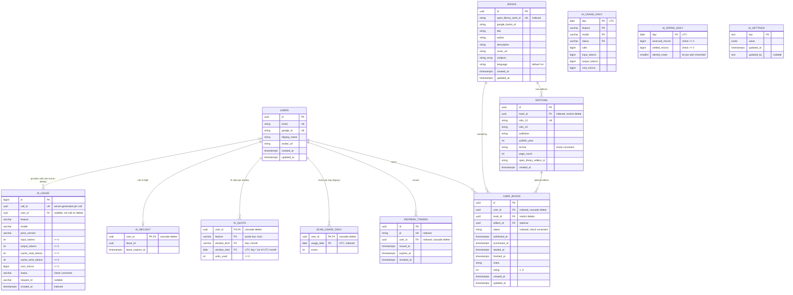

# Data model

PostgreSQL schema, entity reference, and the dedup strategy that makes the collection work at the work-level instead of per-edition. For the architectural rationale behind dedup see [`architecture.md`](architecture.md#adr-work-level-book-deduplication-open-library-work_id); for migration mechanics see the [Migration workflow](#migration-workflow) section below.

## ER diagram



All primary keys are `UUID` (Postgres native `uuid` type, generated server-side via `uuid.uuid4`), except `ai_usage.id` (`BIGSERIAL`) and the composite keys of the counter tables. All timestamps are `TIMESTAMPTZ` (UTC).

**Deletion semantics.** Shared catalog rows (`books`, `editions`) must never take user data with them:

| FK | `ON DELETE` | Effect |
|---|---|---|
| `user_books.user_id` → `users.id` | `CASCADE` | Deleting an account removes that user's library (intentional). |
| `refresh_tokens.user_id` → `users.id` | `CASCADE` | Deleting an account removes its refresh tokens. |
| `scan_usage_daily.user_id`, `ai_quota.user_id`, `ai_inflight.user_id` → `users.id` | `CASCADE` | Deleting an account removes its usage counters and any lease. |
| `ai_usage.user_id` → `users.id` | `SET NULL` | Deleting an account keeps the cost history but removes the personal link (`user_id` becomes NULL). |
| `user_books.book_id` → `books.id` | `RESTRICT` | A book referenced by any user's library cannot be deleted (`IntegrityError`). |
| `editions.book_id` → `books.id` | `RESTRICT` | A book that still has editions cannot be deleted. |
| `user_books.edition_id` → `editions.id` | none (`NO ACTION`) | An edition referenced by a `UserBook` cannot be deleted. |

An unreferenced book can be deleted. The ORM relationships `Book.editions` and `Book.user_books` have no delete cascade and use `passive_deletes="all"`, so the ORM never deletes or nulls out children (even when they are loaded in the session) and the `ON DELETE RESTRICT` FKs reject the delete (migration `0004`).

## Entity reference

### `users` (`backend/app/models/user.py`)

| Column | Type | Notes |
|---|---|---|
| `id` | UUID PK | generated |
| `email` | string, **unique**, not null | authenticated email |
| `google_id` | string, **unique**, not null | Google OAuth `sub` claim |
| `display_name` | string, nullable | from Google profile |
| `avatar_url` | string, nullable | from Google profile |
| `created_at` / `updated_at` | timestamptz, server defaults | `updated_at` auto-bumps on row change |

**Lockdown:** the backend enforces `ALLOWED_EMAILS` at the `/auth/google` endpoint — any Google account whose email isn't in that comma-separated env var is rejected *before* a User row is created. See [`architecture.md`](architecture.md#auth-architecture).

### `books` (`backend/app/models/book.py`)

Represents the **conceptual work** — the thing a user would say "I own Dune" about. Editions are separate.

| Column | Type | Notes |
|---|---|---|
| `id` | UUID PK | generated |
| `open_library_work_id` | string, **unique**, indexed, nullable | primary dedup key ([ADR](architecture.md#adr-work-level-book-deduplication-open-library-work_id)) |
| `google_books_id` | string, nullable | fallback dedup key when Open Library has no work_id |
| `title` | string, not null | |
| `author` | string, not null | first author; additional authors rolled into the string |
| `description` | string, nullable | from Open Library or Google Books |
| `cover_url` | string, nullable | Google Books cover URL (typically) |
| `subjects` | text[], nullable | Open Library subject tags |
| `language` | string, default `'en'`, not null | ISO 639-1 code |
| `created_at` / `updated_at` | timestamptz, server defaults | |

**Relationships:**
- `editions` → `Edition[]` (no cascade — a Book with Editions cannot be deleted)
- `user_books` → `UserBook[]` (no cascade — a Book in any user's library cannot be deleted)

### `editions` (`backend/app/models/edition.py`)

Specific publication of a Book. Captures ISBN, publisher, year, format.

| Column | Type | Notes |
|---|---|---|
| `id` | UUID PK | generated |
| `book_id` | UUID FK → `books.id`, indexed, restrict delete, not null | |
| `isbn_13` | string, **unique**, nullable | canonical identifier |
| `isbn_10` | string, nullable | legacy form |
| `publisher` | string, nullable | |
| `publish_year` | int, nullable | |
| `format` | string, nullable | check constraint: `hardcover`, `paperback`, `ebook`, `audiobook`, `unknown` |
| `page_count` | int, nullable | |
| `open_library_edition_id` | string, nullable | Open Library's per-edition ID |
| `created_at` | timestamptz, server default | no `updated_at` — editions are immutable once captured |

### `user_books` (`backend/app/models/user_book.py`)

The user's relationship to a Book — this is the "bookshelf" row.

| Column | Type | Notes |
|---|---|---|
| `id` | UUID PK | generated |
| `user_id` | UUID FK → `users.id`, indexed, cascade delete, not null | |
| `book_id` | UUID FK → `books.id`, restrict delete, not null | |
| `edition_id` | UUID FK → `editions.id`, nullable (no cascade) | nullable because wishlisted items often don't have an edition picked yet |
| `status` | string, indexed, not null | check constraint: `wishlisted`, `purchased`, `reading`, `read` |
| `wishlisted_at` | timestamptz, nullable | set when status first enters `wishlisted` |
| `purchased_at` | timestamptz, nullable | set on wishlisted→purchased transition |
| `started_at` | timestamptz, nullable | set on purchased→reading transition (or on re-read) |
| `finished_at` | timestamptz, nullable | set on reading→read transition |
| `notes` | string, nullable | user notes |
| `rating` | int, nullable | check constraint: 1..5 |
| `created_at` / `updated_at` | timestamptz, server defaults | |

**Uniqueness:** `(user_id, book_id)` is a unique constraint (`uq_user_books_user_book`). A user can have at most one tracking row per work — this is what dedup is enforcing. Different editions of the same work still share one `UserBook`; changing edition updates `edition_id` in place.

### `refresh_tokens` (`backend/app/models/refresh_token.py`)

Backs the refresh-rotation + revocation mechanism ([architecture.md](architecture.md#auth-architecture)).

| Column | Type | Notes |
|---|---|---|
| `id` | UUID PK | generated |
| `jti` | string, **unique**, indexed, not null | the `jti` claim inside the refresh JWT |
| `user_id` | UUID FK → `users.id`, indexed, cascade delete, not null | |
| `issued_at` | timestamptz, server default | |
| `expires_at` | timestamptz, not null | issued + `REFRESH_TOKEN_EXPIRY_DAYS` (default 7) |
| `revoked_at` | timestamptz, nullable | set on `/auth/refresh` (old jti) or `/auth/logout` |

**Lifecycle:** `/auth/refresh` validates the presented refresh JWT → checks `jti` exists and `revoked_at IS NULL` → issues a new access+refresh pair, inserts a new row, and sets `revoked_at = now()` on the old row. The effect is that **refresh tokens are single-use** — a stolen copy is invalidated by the legitimate client's next refresh.

### `scan_usage_daily` (`backend/app/models/scan_usage.py`)

**Legacy since #528:** `/scan` no longer reads or writes it (the caps moved to `ai_quota` below). The table, `app/services/scan_quota.py` and its purge stay until #540 removes them; existing rows age out through the purge.

Counts scans that reached the vision provider, per user per UTC day. Backed the per-user and global daily scan caps of #509.

| Column | Type | Notes |
|---|---|---|
| `user_id` | UUID FK → `users.id`, cascade delete, PK part | |
| `usage_date` | date, PK part, indexed (`ix_scan_usage_daily_usage_date`) | UTC day |
| `scans` | int, not null, server default 0 | incremented by the reservation upsert, decremented (never below 0) on a refund |

**Keys:** the composite primary key `(user_id, usage_date)` is the unique key the reservation upsert targets. The `usage_date` index serves the global daily sum and the retention purge.

**Volume and retention:** one row per active user per day (~40 bytes of data, roughly 100 bytes on disk with the indexes). The daily cleanup task (`app/services/token_cleanup.py`, calling `scan_quota.purge_old_scan_usage`) deletes rows with `usage_date` older than 90 days, in batches of 5,000 and at most 20 batches per run. Deleting a user removes their rows by cascade.

### `ai_quota` (`backend/app/models/ai_quota.py`)

Per-user count of AI calls reserved, per quota key and window (#528). Backs the daily and monthly scan allowances and the global daily ceiling ([architecture.md](architecture.md#book-identification--dedup-pipeline)).

| Column | Type | Notes |
|---|---|---|
| `user_id` | UUID FK → `users.id`, cascade delete, PK part | |
| `feature` | varchar(64), PK part | the quota key: `scan` for every scan, standard or enhanced (one shared allowance, OD-1; `quota.SCAN_QUOTA_FEATURE`). Kept as a column so later AI features can have their own allowance |
| `window_kind` | varchar(8), PK part, CHECK `IN ('day', 'month')` | |
| `window_start` | date, PK part | the UTC day, or the 1st of the UTC calendar month |
| `units_used` | int, not null, server default 0, CHECK `>= 0` | incremented by the reservation upsert, decremented (never below 0) on a refund |

**Keys and indexes:** the composite primary key `(user_id, feature, window_kind, window_start)` is the unique key the reservation upsert targets (`INSERT … ON CONFLICT … DO UPDATE SET units_used = units_used + 1 WHERE units_used < limit`). `ix_ai_quota_window (window_kind, window_start)` serves the global daily sum and the retention purge.

**Writes:** only `app/ai/quota.py` (reserve, refund, purge), from the request's server-side user and the server's quota key. No client-supplied value is stored.

**Volume and retention:** about 70 bytes per row. Per active user, one day row for each day they scan plus one month row per month: roughly 70 bytes per active user per day, plus 70 bytes per active user per month. The daily cleanup task (`app/services/token_cleanup.py`, calling `quota.purge_old_quota`) deletes day rows older than 90 days and month rows whose month began more than 13 months before the current month, in batches of 5,000 and at most 20 batches per window kind per run.

### `ai_inflight` (`backend/app/models/ai_quota.py`)

The per-user lease that allows one paid AI call in flight at a time (#528).

| Column | Type | Notes |
|---|---|---|
| `user_id` | UUID FK → `users.id`, cascade delete, PK | at most one row per user |
| `lease_id` | UUID, not null | random per acquisition; the release deletes the row only while it still holds this id, so a slow request whose lease expired and was taken over cannot release the new holder's lease |
| `lease_expires_at` | timestamptz, not null | `clock_timestamp()` + the feature's `timeout_s` + 30 s; an expired lease can be taken over |

**Writes:** acquired with `INSERT … ON CONFLICT (user_id) DO UPDATE … WHERE ai_inflight.lease_expires_at < clock_timestamp()`, deleted when the call settles or is refunded (always, in a `finally`).

**Volume and retention:** at most one row per user with a call in flight (~60 bytes). Rows are deleted on release; a row left by a crashed request stays until that user's next scan takes it over (it is harmless once expired), or the user is deleted.

### `ai_usage` (`backend/app/models/ai_usage.py`)

The AI usage ledger: one row per paid provider call (#530). Counts and cost only; it never stores the prompt, the image or the model's output (`tests/security/test_ai_usage_ledger_content.py` asserts the exact column set).

| Column | Type | Notes |
|---|---|---|
| `id` | BIGSERIAL, PK | |
| `call_id` | UUID, not null, unique (`uq_ai_usage_call_id`) | generated by the server (`uuid4`) once per provider call; the insert is `ON CONFLICT (call_id) DO NOTHING`, so a settle retried after a commit whose acknowledgement was lost adds no second row |
| `user_id` | UUID FK → `users.id`, nullable, `ON DELETE SET NULL` | NULL after the account is deleted |
| `feature` | varchar(64), not null | gateway feature, e.g. `scan.standard`, `scan.enhanced` |
| `model` | varchar(64), not null | the model the call used (registry default or `ai_settings` override) |
| `price_version` | varchar(16), not null | the price-table version the cost was computed at (`app/ai/prices.py`) |
| `input_tokens` | int, not null, ≥ 0 | prompt tokens billed at the full input price (excludes cached tokens) |
| `output_tokens` | int, not null, ≥ 0 | completion tokens |
| `cache_read_tokens` | int, not null, ≥ 0 | prompt tokens served from the provider's cache |
| `cache_write_tokens` | int, not null, ≥ 0 | prompt tokens written to the provider's cache (0 for OpenAI) |
| `cost_micros` | bigint, not null, ≥ 0 | cost in micro-dollars (1,000,000 = $1), each count × its list price, rounded up |
| `status` | varchar(16), not null, check | `ok`, `refused` (a `refusal` or content filter), `truncated` (the provider answered), `timeout`, `refunded` (unavailable or never reached; the quota was refunded), `error` (anything else, including a cancelled request; the quota was kept), `cache_hit` (cost always 0; no cache yet, #534) |
| `request_id` | varchar(64), nullable | the server-generated `X-Request-ID`; never client-supplied |
| `created_at` | timestamptz, not null, server default `now()` | indexed (`ix_ai_usage_created_at`) |

**Writes:** `/scan` builds the row (`app/ai/ledger.py`, `usage_insert`) and hands it to `quota.release`, which executes it just before the lease delete, so the row and the settle commit in one transaction. A cancelled request still writes an `error` row (0 tokens) through the shielded settle, since its reservation is kept. A kill switch hit inside the gateway (`FeatureDisabledError`, no provider reached) writes none. If the row is rejected (CHECK or FK), it is dropped (logged, no content) and the lease is released on its own; if the settle times out, nothing more is tried and the lease expiry is the backstop. A ledger failure never fails the scan. `ledger.record` commits on its own and is only for paths with no settle (cache hits, #534). Costs come from the list-price table in `app/ai/prices.py`, keyed by `(model, price_version)`; an unknown pair raises instead of pricing at zero, and every allow-listed model must have a price at the current version (checked at import and in CI).

**Keys and indexes:** `ix_ai_usage_created_at (created_at)` for the rollup; `ix_ai_usage_user_created (user_id, created_at)` for per-user lookups and the `SET NULL` on account deletion.

**Volume and retention:** about 80 bytes per row, one row per provider call. Raw rows are kept 30 days: the daily cleanup task (`app/services/token_cleanup.py`, calling `ledger.rollup_and_purge`) moves older rows into `ai_usage_daily` and deletes them, in batches of 5,000 and at most 20 batches per run. Each batch deletes its rows (`DELETE … RETURNING`) and adds their totals to the daily rows in one transaction, so a row is never counted twice or lost, and a second run changes nothing.

### `ai_usage_daily` (`backend/app/models/ai_usage.py`)

Daily totals of `ai_usage` per UTC day, feature, model and status (#530). No user column.

| Column | Type | Notes |
|---|---|---|
| `day` | date, PK | UTC day of `ai_usage.created_at` |
| `feature` | varchar(64), PK | |
| `model` | varchar(64), PK | |
| `status` | varchar(16), PK, check | same values as `ai_usage.status` |
| `calls` | bigint, not null, ≥ 0 | number of raw rows |
| `input_tokens` | bigint, not null, ≥ 0 | sum of `ai_usage.input_tokens` (cache tokens are not carried over) |
| `output_tokens` | bigint, not null, ≥ 0 | sum of `ai_usage.output_tokens` |
| `cost_micros` | bigint, not null, ≥ 0 | sum of `ai_usage.cost_micros` (includes cache costs) |

**Writes:** only the rollup, as an upsert that adds to an existing row (`INSERT … ON CONFLICT (day, feature, model, status) DO UPDATE SET calls = calls + excluded.calls, …`).

**Volume and retention:** tens of rows per day (features × models × statuses), each under 100 bytes. Rows are kept 400 days; the same cleanup run deletes older ones in bounded batches.

### `ai_spend_daily` (`backend/app/models/ai_spend.py`)

The service-wide daily AI cost circuit breaker (#531, `app/ai/breaker.py`). One row per UTC day, all tiers and features together. Standalone: no foreign keys, no user column, no content.

| Column | Type | Notes |
|---|---|---|
| `day` | date, PK | UTC day the calls were reserved on |
| `reserved_micros` | bigint, not null, default 0, ≥ 0 | sum of the cost estimates (`FeatureSpec.est_cost_ceiling_micros`) of calls reserved but not yet settled |
| `settled_micros` | bigint, not null, default 0, ≥ 0 | cost of finished calls: the priced cost of an answered call, the estimate of an `error`/cancelled call, nothing for a refunded call |
| `alerted_mask` | smallint, not null, default 0, ≥ 0 | bit 0/1/2 set once the 50/75/90 % spend alert was sent for the day |

The non-negative rule is one CHECK, `ck_ai_spend_daily_non_negative`.

**Writes:** only `app/ai/breaker.py`, on the request's session: the reservation upsert in `quota.reserve` (`INSERT … ON CONFLICT (day) DO UPDATE SET reserved_micros = reserved_micros + est`, with `WHERE reserved_micros + settled_micros + est <= ceiling` for Free; Premium has no condition); the give-back (`reserved_micros = greatest(reserved_micros - est, 0)`); the settle, executed with the `ai_usage` row and committed with the lease delete; and the alert claim (`UPDATE … SET alerted_mask = alerted_mask | bit WHERE alerted_mask & bit = 0`). The ceiling is the `ai_settings` key `breaker.free_daily_ceiling_micros`. No endpoint reads or writes the table directly.

**Volume and retention:** one row per day, under 60 bytes. Rows older than 90 days are deleted by the daily cleanup task (`app/services/token_cleanup.py`, calling `breaker.purge_old_spend`) in bounded batches.

### `ai_settings` (`backend/app/models/ai_settings.py`)

Server-side AI dials and kill switches ([architecture.md](architecture.md#book-identification--dedup-pipeline)). Standalone: no foreign keys, no user data.

| Column | Type | Notes |
|---|---|---|
| `key` | text, PK | one of the keys defined in `app/ai/settings.py`; other keys are ignored |
| `value` | JSONB, not null | bool, string or int depending on the key; validated on write and again on read |
| `updated_at` | timestamptz, not null, server default `now()` | set on every write |
| `updated_by` | text, nullable | `seed` for startup seeding, else the CLI's `--by` / `$USER` / `cli` |

**Writes:** only the startup seed (insert-if-missing) and the CLI `python -m app.ai.settings set`. No endpoint reads or writes it from a request.

**Volume and retention:** 13 rows today (7 from #526, plus `scan.global_daily_limit` and the four `quota.*` allowances from #528, plus `breaker.free_daily_ceiling_micros` from #531), each under 300 bytes. It does not grow with usage, so no retention job.

## Dedup strategy — why work_id, not ISBN

The dedup check lives in `backend/app/services/deduplication.py` and runs inside the `POST /scan` response pipeline. For each candidate returned by the vision identifier + enrichment:

```python
# Pseudocode of DeduplicationService._is_in_library
if candidate.open_library_work_id:
    exists = db.exec(
        select(UserBook)
        .join(Book, Book.id == UserBook.book_id)
        .where(Book.open_library_work_id == candidate.open_library_work_id,
               UserBook.user_id == user_id)
    )
    if exists: return True  # already in library

if candidate.google_books_id:
    # same join on Book.google_books_id
    ...
```

**Why not ISBN:**
- A single work (*Dune*) has dozens of editions — hardcovers, paperbacks, international translations, special anniversary reprints, audiobooks, each with its own ISBN.
- ISBN-based dedup would let a user wishlist 14 copies of *Dune* and flag none of them as duplicates.
- Users think in terms of the **work** (*Dune*), not the **edition** (*Dune, 40th Anniversary Hardcover, Ace 2005*).

**Why the Google Books fallback:**
- Open Library doesn't always have a `work_id` (incomplete coverage on newer / self-published books).
- Google Books `volume_id` is still work-level (one per title+author), so it's a reasonable second choice.
- If neither is available, the candidate is returned with `already_in_library=False` and the user sees a duplicate — rare enough to accept.

**When dedup is actually applied:**
- On `POST /scan` the candidates are flagged (`already_in_library=true|false`) but still returned. The frontend's `BookCandidatePicker` shows the flag so the user can skip duplicates intentionally.
- On `POST /wishlist` the unique constraint `uq_user_books_user_book` on `(user_id, book_id)` is the database-level enforcement — the `Book` row is reused if dedup found a match, so the insert either succeeds (new tracking row) or fails the unique constraint (already tracking that Book).

## Migration workflow

Migrations are managed with Alembic and live in `backend/alembic/versions/`:

- `0001_initial_schema.py` — creates `users`, `books`, `editions`, `user_books`
- `0002_refresh_tokens.py` — adds `refresh_tokens` table
- `0003_enhanced_scan_credits.py` — adds `users.enhanced_scan_credits`
- `0004_restrict_catalog_deletes.py` — `user_books.book_id` and `editions.book_id` FKs become `ON DELETE RESTRICT`
- `0005_scan_usage_daily.py` — adds `scan_usage_daily` table (daily scan caps)
- `0006_ai_settings.py` — adds `ai_settings` table (DB-backed AI dials and kill switches; rows are seeded at app startup, not by the migration)
- `0007_ai_quota.py` — adds `ai_quota` (per-user daily/monthly AI allowance counters) and `ai_inflight` (one call in flight per user) tables; additive, the downgrade drops both
- `0008_ai_usage.py` — adds `ai_usage` (one row per paid AI provider call) and `ai_usage_daily` (daily rollup) tables; additive, the downgrade drops both
- `0009_ai_spend_daily.py` — adds `ai_spend_daily` (service-wide daily AI spend for the cost circuit breaker); additive, the downgrade drops it

### Writing a new migration

```bash
cd backend
source .venv/bin/activate

# Make your model change first (edit app/models/*.py)

# Autogenerate a migration skeleton
alembic revision --autogenerate -m "short description"

# Review the generated file — Alembic's autogen is imperfect
# (misses check constraints, reorders things, can generate no-ops)
$EDITOR alembic/versions/<new-file>.py

# Apply it
alembic upgrade head
```

### Check-constraint gotcha

Alembic autogen **does not detect `CheckConstraint` changes** well. When you modify or add a check constraint (e.g. a new status value, a different rating range), you typically need to:

1. Add an explicit `op.drop_constraint(...)` for the old one
2. Add an explicit `op.create_check_constraint(...)` for the new one

The existing `VALID_STATUSES` / `VALID_FORMATS` tuples in the model files are the source of truth — autogen will read them on future generations, but won't produce the drop+create dance for in-place edits.

### Rolling back

```bash
alembic downgrade -1           # one step back
alembic downgrade <revision>   # to a specific revision
alembic downgrade base         # nuke everything (dev only)
```

**Production caveat:** Render runs `alembic upgrade head` as `preDeployCommand` on every deploy (see `render.yaml`). A migration that fails there blocks the deploy. Test locally against a copy of the prod schema before merging migration PRs.

## Rules referenced

- Rule #7: SQLAlchemy ORM only — no raw SQL. The `_is_in_library` dedup check, the `/auth/refresh` jti lookup, and all CRUD paths use `select(...)` constructs, not text SQL.
